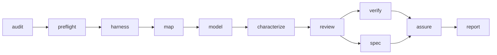

# java-logic-audit：設計 v1.0（定案）

> 這一版是定案。v0.2 的審查方法保留，封裝與執行方式重做。
> 所有取捨都已決定，理由與被否決的做法記在第 19 節。
> 標「驗收時確認」的技術假設共四項，各有既定的替代做法（第 20 節），不影響其餘設計。
> 封裝方式對照的參考實作：官方 `code-modernization` plugin v1.1.0。

## 目錄

0. 定案摘要
1. 範圍
2. 架構原則
3. Plugin 組成
4. 工作區與產出檔
5. 指令
6. Agent
7. Workflow
8. 腳本
9. auditkit：通用執行器
10. 資料格式
11. 方法
12. 判定規則
13. 人決定的五件事
14. 不可信輸入與安全
15. 支援範圍
16. 成本控制
17. Plugin 自身的驗收
18. 建置順序
19. 決策紀錄
20. 驗收時確認的假設
21. 已知限制
- 附錄 A：一個問題的完整路徑
- 附錄 B：Java 業務邏輯陷阱目錄
- 附錄 C：方法出處

---

## 0. 定案摘要

1. **形式是 plugin。** 13 個指令、5 個 agent、4 個 workflow、一組 Python 腳本、一套 Java 載具（auditkit）。沒有 SKILL.md，沒有 hooks。
2. **工作區是目標 repo 的專用分支。** plugin 只新增三處內容，不修改任何既有檔案，不提交、不推送、不修復問題。
3. **Agent 只產出資料，執行器依資料執行，腳本依結果檔判定。** 沒有任何等級、數字或判定是由模型填寫的。
4. **每個 repo 需要撰寫的 Java 預設為零。** 命令的呼叫方式來自機械抽取的事實，執行器是通用的，測試內容全部是 JSON。
5. **測試執行不交給 agent 平行。** 平行的 agent 只做閱讀與判斷；執行是單一的腳本化建置呼叫，平行由執行器內部處理。
6. **人決定五件事**（第 13 節），其餘不需要人。
7. **v1 的支援範圍固定**（第 15 節）。範圍外的技術只給靜態模型，結論停在 C 級。
8. **v1 不含**：形式化模型、jqwik、真實訊息代理、hooks、自動修復。

## 1. 範圍

### 1.1 適用

同時具備以下三點的 Java 後端：

- 業務實體存在關聯式資料庫。
- 實體有生命週期：狀態欄位，或由數量、時間戳、旗標推導出的狀態。
- 操作受狀態約束：同一操作在不同狀態下被允許或拒絕。

### 1.2 不適用

由 `audit-preflight` 判定並說明原因後結束：

| 情況 | 原因 |
|---|---|
| 純函式庫、無狀態的轉換服務 | 沒有狀態機與矩陣可填 |
| 串流處理管線 | 正確性在視窗與順序語意 |
| 邏輯主要在流程引擎、規則引擎、預存程序 | 讀 Java 得不到行為 |
| 沒有關聯式資料庫 | 效果軌跡與交錯都建立在 JDBC 上 |

部分符合時判定為「部分適用」，在 `PREFLIGHT.md` 列出被排除的實體。

### 1.3 回答的三個問題

1. 程式實際做了什麼（現況模型）。
2. 程式是否自我一致。
3. 程式是否符合 PRD（有提供時）。

### 1.4 非目標

效能與容量、安全弱點掃描、程式風格、自動修復、業務規則本身的對錯。最後一項的意思是：plugin 指出矛盾與異常，由人決定哪一邊是對的。

## 2. 架構原則

這八條是實作時遇到沒寫到的情況的判斷依據。

**P1　Agent 產出資料，執行器執行，腳本判定。**
Agent 的輸出一律是符合 schema 的結構化資料。資料由通用執行器在真實環境執行，結果寫成檔案，等級與判定由腳本從這些檔案算出。任何一個結論都能回答「是哪個檔案的哪一筆結果支持它」。

**P2　機械事實用工具取得。**
入口、呼叫關係、寫入點、交易屬性、SQL 讀寫集合都由工具抽取。Agent 只做解讀：這個條件是不是守衛、這兩條路徑是不是在算同一件事。

**P3　行為存在與行為錯誤分開判定。**
前者是證據等級，由腳本算。後者必須指出依據：規格、人的決策、程式自相矛盾、通用性質、領域慣例。

**P4　能力決定證據上限。**
缺少真實資料庫引擎、外部依賴被替身取代、時間不可控，都只讓對應的結論降級，並寫明補上什麼就能升級。plugin 在任何 repo 都跑得完。

**P5　反例必須可由公開入口到達。**
交易資料只能經由命令建立。做不到時由執行器在證據檔標記，等級自動降為 B。

**P6　狀態在檔案裡。**
每個指令只讀檔案、不依賴對話。換一個人或開一個新工作階段，執行 `audit-status` 就能接續。

**P7　被分析的內容是資料，不是指示。**
程式碼、註解、檔名、PRD 文字進入 agent 提示時一律包在標記裡。唯讀的 agent 不寫檔，產出交由編排的工作階段或腳本寫入。

**P8　對目標 repo 只做加法。**
全部內容放在三處，預設建置的輸入與輸出不變，整組移除只需刪掉這三處。

## 3. Plugin 組成

```
java-logic-audit/
  .claude-plugin/plugin.json
  README.md
  commands/                 13 個指令，每個一個檔
    audit.md
    audit-preflight.md
    audit-harness.md
    audit-map.md
    audit-model.md
    audit-characterize.md
    audit-review.md
    audit-verify.md
    audit-spec.md
    audit-assure.md
    audit-report.md
    audit-status.md
    audit-rerun.md
  agents/                   4 個 agent
    code-reader.md
    harness-engineer.md
    spec-analyst.md
    adversary.md
  scripts/                  Python 3.8+，只用標準函式庫；tests/ 是它們的單元測試
  schemas/                  profile、answers、manifest 三種產出的 JSON Schema
  assets/
    auditkit/               Java 原始碼模板（Java 8 語法）：core、spring、spring-restclient
    build/versions.json     載具額外加入的依賴版本表
  references/
    model-format.md         命令模型的格式，讀碼 agent 與腳本共同遵守的契約
```

上面是實際做出來的內容。原設計中沒有做的：`workflows/`（見第 7 節）、`seeder` agent（缺陷由人提供，見 5.11）、靜態規則包、領域包、其餘產出的 JSON Schema（由 `validate.py` 以程式檢查）。驗收用的樣本與量測工具在 repo 的 `fixtures/`，不屬於 plugin。

設定不放在 plugin 選項裡，而是寫在 `INTENT.md` 開頭的區塊，由每個指令讀取。這符合原則 P6：換一個人或新的工作階段，讀到的是同一份設定。

| 設定 | 預設 | 作用 |
|---|---|---|
| `language` | `auto` | 給人看的產出所用的語言。`auto` 跟隨對話語言 |
| `budget` | `quick` | `quick` 或 `deep`，對應第 16 節的預算表 |

## 4. 工作區與產出檔

### 4.1 三處內容

| 位置 | 內容 | 是否進版控 |
|---|---|---|
| `audit/<system>/` | 所有資料產出與給人看的文件 | 是，`runs/` 與 `*.local.*` 除外 |
| `<module>/src/audit/java`、`src/audit/resources` | auditkit 與可選的 `DriverCustomizer` | 是 |
| 建置入口 | Maven：模組目錄下生成的 `pom-audit.xml`（原 `pom.xml` 加上一個 profile），以 `-f pom-audit.xml` 使用。Gradle：`audit/<system>/build/audit.init.gradle`。兩者都不修改既有的建置檔 | 是 |

`<system>` 是在入口指令選的短名稱（字母、數字、`-`、`_`），預設為 repo 目錄名。單一 repo 內有多個可獨立部署的應用時，各自一個 `<system>`。

`pom-audit.xml` 由腳本從 `pom.xml` 生成，每次執行前重新產生，內容是原檔加上一個 profile：把 `src/audit/java` 加為測試原始碼根目錄、加入 auditkit 需要的測試依賴、設定只執行 `auditkit` 套件下的執行器。

不直接在 `pom.xml` 內加區塊的原因：Maven 會把 `pom.xml` 打包進 jar（`META-INF/maven/`），所以對它的任何修改，即使只是一個不啟用的 profile，都會改變一般建置的產物。實測樣本一：加區塊時 jar 有一個項目不同；改用生成檔後逐位元組相同。

plugin 不提交也不推送。使用者自行決定何時提交 `audit/` 與 `src/audit/`。

### 4.2 產出檔

給人看的是 `.md`，給程式讀的是 `.json`。兩者內容相同時，`.md` 由腳本從 `.json` 生成。

| 檔案 | 產生者 | 內容 |
|---|---|---|
| `INTENT.md` | `audit` | 目標、範圍、基準 commit、語言、預算 |
| `PREFLIGHT.md`、`profile.json` | `audit-preflight` | 五個回答、技術概況、適用性、各指令的就緒程度 |
| `answers.json` | `audit-preflight` | 五個回答的原話，供後續指令讀取 |
| `manifest.json` | `audit-preflight` | 主程式與既有測試的檔案清單與雜湊，用來檢查來源未被改動 |
| `harness.json`、`HARNESS.md` | `audit-harness` | 載具設定（9.2）；給人看的安裝說明與能力表 |
| `facts/*.json` | `audit-harness` | 機械事實：schema、context、實體對映、位元組碼 |
| `map.json`、`MAP.md`、`shards.json` | `build_map.py` | 入口、實體、寫入點表、各狀態欄位由誰寫入、孤兒寫入點、給模型階段的切分 |
| `map_resolved.json` | `audit-map` | 腳本讀不出、由 `code-reader` 判讀出的寫入（資料表、欄位、引用行） |
| `model_raw/*.json` | `audit-model`、`audit-characterize` | 每個 agent 的回覆，原樣保存：`mine-<組>`、`referee-<命令>`、`recipes-<組>`、`fix-<序號>` |
| `model_result.json` | `model_store.py` | 由回覆彙整出的原始結果，含裁判判定與後續修正 |
| `model/commands.json`、`model/render.json`、`MODEL.md` | `render_model.py` | 命令模型；被否決與被排除的項目；給人看的版本 |
| `model/fixtures.json`、`model/recipes.json` | `model_store.py` | 起始情境與每一格的到達配方 |
| `model/matrix.json`、`model/ids.json` | `build_matrix.py` | 矩陣格與靜態預測；永久的格子編號 |
| `model/reconciliation.json` | `reconcile.py` | 每一格的執行狀態、差異、未執行原因、標記、不穩定的格子、觀察到的生命週期轉移 |
| `model/expected.json` | `reconcile.py`、`apply_decisions.py` | 每一格的預期：鎖定的觀察或人的決策 |
| `questions.json`、`QUESTIONS.md` | `audit-characterize`、`audit-verify`、`audit-spec` | 需要人回答的問題 |
| `DECISIONS.json`、`DECISIONS.md` | `audit-review` | 人的回答，永久保存 |
| `spec/clauses.json`、`spec/expectations.json`、`SPEC_TRACE.md` | `audit-spec` | 條款、預期、追溯矩陣、反向清單 |
| `scenarios.json` | `audit-verify`、`audit-spec`、`audit-assure` | 可重播的命令序列 |
| `findings.json`、`FINDINGS.md` | `judge.py` | 問題 |
| `assure/*.json`、`ASSURANCE.md` | `audit-assure` | 盲驗、金絲雀、埋入缺陷的結果 |
| `VERDICT.json`、`VERDICT.md` | `judge.py` | 每個實體的審查判定、規則全文、空白的簽核欄 |
| `REPORT.html` | `build_report.py` | 單頁報告，離線可開。每個指令結束時重新生成 |
| `runs/<kind>-<時間>/` | 執行器 | 結果檔、證據檔、軌跡。不進版控 |

### 4.3 編號

| 前綴 | 對象 | 前綴 | 對象 |
|---|---|---|---|
| `EP-` | 入口 | `SCN-` | 情境（可重播的序列） |
| `CMD-` | 命令 | `Q-` | 問題 |
| `ENT-` | 實體 | `D-` | 決策 |
| `CELL-` | 矩陣格 | `PRD-` | 規格條款 |
| `RCP-` | 到達配方 | `F-` | 問題（缺陷、不一致、異常） |
| `INV-` | 不變量 | `SEED-` | 埋入的缺陷 |
| `PAIR-` | 成對路徑 | `MR-` | 蛻變關係 |

編號由 `ids.py` 配發，永不重用。`F-` 的對齊靠指紋（12.4）。

## 5. 指令

### 5.1 順序



每個指令獨立，結束時印出下一個要貼的完整指令。任何時候都可以執行 `audit-status`。

| 步驟 | 指令 | 得到什麼 | 平行 agent |
|---|---|---|---|
| 0 | `audit [system]` | 說明想做什麼，寫入 `INTENT.md` | 無 |
| 1 | `audit-preflight <system>` | 這個 repo 做得到什麼 | 無 |
| 2 | `audit-harness <system>` | 載具裝好並證明能跑；機械事實 | 一個 |
| 3 | `audit-map <system>` | 入口、實體、寫入點表 | 少量 |
| 4 | `audit-model <system> [pattern]` | 守衛、狀態、矩陣、候選不變量 | 多（workflow） |
| 5 | `audit-characterize <system> [entity]` | 矩陣逐格執行的結果；問題清單 | 少量 |
| 6 | `audit-review <system> [flagged｜all]` | 人的決策 | 無 |
| 7 | `audit-verify <system> [faults｜races｜sequences｜all]` | 故障、併發、隨機序列的檢驗結果 | 無 |
| 8 | `audit-spec <system> <prd>` | PRD 逐條對照 | 每個章節 2 個 |
| 9 | `audit-assure <system> [recheck｜canary｜seeds <檔>｜all]` | 獨立重驗、金絲雀、埋入缺陷 | 每個問題 1 個 |
| 10 | `audit-report <system>` | 判定與報告，等待簽核 | 無 |
| — | `audit-status <system>` | 進度、過期的產出、下一個指令 | 無 |
| — | `audit-rerun <system>` | 新 commit 上的差異重跑 | 視差異而定 |

`INTENT.md` 的目標決定路徑長度：

| 目標 | 路徑 |
|---|---|
| 先理解 | 0 到 6 |
| 完整審查 | 0 到 10，無 PRD 時略過 8 |
| 對照 PRD | 0 到 6、8、10 |
| 改版後回歸 | `audit-rerun` |

### 5.2 `audit [system]`

- **做什麼**
  1. `audit/` 下已有該系統的檔案時，視為回訪：執行 `audit-status` 的內容後結束。
  2. 找出可獨立啟動的應用模組。一個就直接用；多個就問是哪一個。接著先做一次只讀檔的靜態掃描：判定為不適用時，直接以白話說明原因後結束，不寫任何檔案、不問任何問題。
  3. 用彈出式問答問一題：想做什麼（先理解、完整審查、對照 PRD、改版後回歸）。使用者的訊息裡已經說明的就不再問。選了對照 PRD 時再問 PRD 的位置。優先順序留給 preflight 的第五題，不重複問。
  4. 寫 `INTENT.md`：開頭是可解析的設定區塊（系統名稱、模組路徑、目標、語言、預算、基準 commit、日期），接著是回答的原話，以及使用者在訊息中附帶說明的事項（憑證以 `[redacted]` 取代）。寫完以 `validate.py` 檢查格式。
  5. 依目標列出要走的指令，每個指令的說明文字固定寫在指令檔裡；尚未安裝的指令標明「此版本尚未提供」。只列出這條路徑上需要人做決定的地方，並說明 preflight 可能判定方法不適用而結束。
- **結尾**：給出填好參數的 `audit-preflight` 指令。

### 5.3 `audit-preflight <system>`

- **寫**：`PREFLIGHT.md`、`profile.json`、`manifest.json`、`answers.json`
- **做什麼**：除了判定為不適用時直接結束，其餘每一項檢查都執行，不因前面失敗而停。
  - **檢查 1，記錄來源**：在執行任何東西之前先寫 `manifest.json`。已存在時不重寫，只比對並回報。
  - **檢查 2，技術概況**：`preflight_scan.py` 由建置檔、依賴、註解、設定檔辨識建置工具、JDK、框架、持久化、資料庫、訊息、排程、對外呼叫、測試資產，並算出適用性與支援範圍。
  - **檢查 3，適用性**：依 1.1 與 1.2 判定完全適用、部分適用、不適用。**不適用時到此為止**：不問任何問題、不建置，寫一份簡短的報告後結束。
  - **檢查 4，問人**：只問第 13 節列的五題，每題都有「不知道」的選項。使用者已在訊息中回答的不再問；重跑時只問尚未回答的。回答照原話寫入 `answers.json`，憑證以 `[redacted]` 取代。
  - **檢查 5，工具**：JDK、建置工具、Docker（指令是否存在與 daemon 是否回應分開記錄）、`python3`。缺少時說明哪個指令會受影響。
  - **檢查 6，連線安全**：列出測試會連到的位址，並考慮這台機器上會覆蓋設定的環境變數。任何一個不是本機或容器位址就標紅，且不執行測試。
  - **檢查 7，建置與既有測試**：先讀 CI 定義（沒有時用建置工具的標準指令）；建置一次且不跑測試；通過檢查 6 後才跑既有測試。由結果檔記錄基線，狀態為通過、失敗、未執行，或「受阻」（機器的問題而非程式的問題，例如資料庫連不上）。最後比對 `manifest.json`，確認建置與測試沒有改到來源。
    使用者提供資料庫給既有測試使用時，必須同時滿足三點才可使用：位址是本機；使用者指明它是測試用的；專案自己有文件說明如何切換。使用前要明說既有測試可能清空該資料庫。
  - **檢查 8，範圍邊界**：資料庫 schema 是否由本 repo 的遷移腳本完整定義；是否有其他系統寫入同一個資料庫的跡象。
  - **檢查 9，來源保護**：唯讀檢查專案與使用者的權限設定是否有阻擋編輯 `src/main` 與 `src/test` 的規則。沒有就印出建議的片段（14.3）。此項只有綠或黃。
  - **檢查 10，支援範圍**：對照第 15 節，列出在範圍內與範圍外的技術。
- **報告**：`PREFLIGHT.md` 以五個回答與範圍邊界開頭，接著是每項檢查一列的表格（各狀態的條件寫在指令檔裡）、這個 repo 能讓審查證明到什麼程度、受環境影響的後續指令的就緒程度。這份檔案只給人看；後續指令讀的是 `profile.json`、`answers.json`、`manifest.json`。
- **結尾**：最需要先修的一項。有任何一項標紅時，下一步是修好後重跑 `audit-preflight`；否則是 `audit-harness`。

### 5.4 `audit-harness <system>`

- **寫**：`src/audit/**`、建置入口、`harness.json`、`facts/*.json`、`HARNESS.md`、`profile.json` 的能力欄位
- **做什麼**
  1. 判定能否安裝：不適用或不是 Spring Boot 應用就停止並說明。
  2. 由腳本安裝：`harness_install.py` 把 auditkit 複製到 `<module>/src/audit/java/auditkit/`，並寫出建置入口。兩者都不手寫。
  3. 設定：腳本先由技術概況寫出 `harness.json` 的草稿與待定清單，`harness-engineer` 依原始碼補完：啟動類別、要沿用的既有測試設定、要以替身取代的型別、HTTP 回應規則、哪些例外型別代表業務拒絕、基礎資料。
  4. 決定載具用哪個資料庫：專案自己的測試容器，或使用者提供給審查用的本機資料庫（位址與憑證只由環境變數 `AUDIT_DB_URL`、`AUDIT_DB_USER`、`AUDIT_DB_PASSWORD` 傳入）。兩者都沒有就停止。
  5. 執行六項煙霧測試，結果由執行器寫入結果檔：
     - 應用 context 能啟動。
     - 連線守衛通過（資料庫位址是本機或容器），且會拒絕遠端位址。
     - DataSource 代理看得到語句與提交。
     - 重置兩次後的資料庫狀態相同。
     - 每個外部系統都被會記錄呼叫的替身取代。
     - 四組事實（schema、context、實體對映、位元組碼）寫出 `facts/`。
     失敗時只修 `harness.json`，最多三輪。
  6. `judge.py capabilities` 由煙霧測試的結果檔與使用者對正式環境的回答，寫入能力欄位與各類檢驗的證據上限（12.1）。
  7. `manifest.py check` 確認沒有任何既有檔案被改動。
- **人決定**：載具可以清空並使用哪個資料庫。
- **結尾**：能力表，以及下一個指令 `audit-map`。

### 5.5 `audit-map <system>`

- **寫**：`map.json`、`MAP.md`
- **做什麼**
  1. `build_map.py` 由 `facts/` 建出入口清單、命令的呼叫方式、實體與欄位、每個欄位的寫入點表、橫切邏輯的套用範圍。
  2. 腳本解不出來的寫入點（動態 SQL 的欄位集合、原生 SQL 字串、整個物件的欄位複製）列為待解。待解項目交給 `code-reader`，每個檔案一個，回傳欄位清單與引用行。
  3. 由呼叫關係算出每個寫入點可從哪些入口到達。到不了的列為孤兒寫入點。
  4. `make_shards.py` 產生 `audit-model` 要用的切分清單。
- **結尾**：入口數、實體數、寫入點數、孤兒數，以及下一個指令 `audit-model`。

### 5.6 `audit-model <system> [pattern]`

- **寫**：`model_raw/`（每個 agent 的回覆，原樣保存）、`model_result.json`、`model/commands.json`、`model/render.json`、`MODEL.md`
- **做什麼**
  1. `model_brief.py shards` 列出要建模的入口群組與 agent 數。給了 `pattern` 就只取符合的。超過 12 組時用彈出式問答詢問：全部執行、只跑一部分、取消。
  2. 每組一個 `code-reader`。它拿到的簡報由 `model_brief.py mine` 從地圖與機械事實產生：入口（處理方法、路徑、參數）、要讀的檔案、資料表與欄位、業務拒絕的例外型別。它回傳這組入口的命令（10.2）：每個命令的變數、依程式執行順序排列的守衛、寫入分支，每筆附 `檔案:行`。
  3. 每組再一個**新的** `code-reader` 擔任裁判，一次最多八個命令，超過就分批。簡報由 `model_brief.py referee` 產生，只有主張與引用位置，看不到抽取者的推理與檔案清單。判定：確認、引用位置錯誤（附正確位置）、否決。
  4. 回覆逐一原樣存成 `model_raw/` 下的檔案。`model_store.py collect` 彙整成 `model_result.json`，`render_model.py` 產生模型。編排的工作階段不手改任何模型檔；要改，就再存一份回覆、重跑腳本。
  5. `render_model.py` 只留下機械上站得住的主張：命令的處理方法必須是地圖上有的入口，HTTP 方法與路徑以地圖為準；被裁判否決的守衛移除；引用位置必須是工作區內存在的行；變數的查詢必須是單一 `SELECT`；不自洽的命令（守衛提到不存在的變數、基準情況被守衛拒絕）整個排除並列出原因。
  6. 回報：命令數、沒有命令的入口、被否決的主張數與兩三個例子、被排除的命令、缺口。
- **結尾**：下一個指令 `audit-characterize`。

這個階段的產出是「主張」，還不是結論。主張對不對，由下一個階段逐格執行來確認。

### 5.7 `audit-characterize <system> [entity]`

- **寫**：`model/fixtures.json`、`model/recipes.json`、`model/matrix.json`、`model/ids.json`、`model/reconciliation.json`、`model/expected.json`、`questions.json`、`QUESTIONS.md`、`findings.json`、`FINDINGS.md`、`VERDICT.json`、`VERDICT.md`
- **做什麼**
  1. **到達配方。** 每個入口群組一個 `code-reader`，依序執行，後面的看得到前面定義的起始情境。它讀程式後回傳起始情境與每一格的到達配方（10.5），回覆原樣存檔，`model_store.py recipes` 彙整，`build_matrix.py` 展開矩陣（11.2）。
  2. **第一次執行。** 以記錄模式執行矩陣，`reconcile.py` 比對每一格的靜態預測與觀察結果。
  3. **解釋不一致，最多三輪。** 沒執行到或不一致的格子，依命令交給 `code-reader` 分類（7.2）：配方錯、模型錯、載具缺口、或「程式就是這樣」。前三種回傳修正後的整筆命令或配方，存成 `fix-<nn>.json`，重建後只重跑受影響的命令。最後一種原樣保留。**不允許為了讓差異消失而改預測**：差異要嘛由讀程式解釋並修正模型，要嘛留下來問人。
  4. **鎖定並檢查穩定度。** `reconcile.py --pin` 把每一格的觀察結果記為預期（`expected.json`，來源 `observed`），再以驗證模式執行兩次。同一格在相同條件下結果不同的部分列為不穩定，不納入鎖定。三次執行同時滿足 12.2「已重現」的次數要求。
  5. **問題、問題清單、判定。** `build_questions.py`、`judge.py findings`、`judge.py verdict`，全部由腳本從結果檔計算。
- **結尾**：有待回答的標記問題時，下一個指令是 `audit-review`，否則是 `audit-verify`。

`build_questions.py` 的問題種類，每一種對應一條固定規則：

| 種類 | 規則 | 預設標記 |
|---|---|---|
| `refused-but-changed` | 被拒絕或失敗的呼叫仍然改了資料 | 是 |
| `read-wrote` | 模型標為讀取的命令有寫入 | 是 |
| `undecided` | 這個情況沒有任何守衛或分支處理，結果是預設行為 | 是 |
| `error` | 結果是非業務拒絕的錯誤 | 是 |
| `differs` | 三輪之後仍與靜態預測不同 | 是 |
| `dropped` | 訊息被收下後沒有任何效果，資料中不留痕跡，發送方也不知情 | 是 |
| `unstable` | 相同條件下兩次結果不同 | 是 |
| `never-decides` | 在可到達的範圍內，這個檢查從這個入口永遠不會成為決定者 | 否 |

問題以指紋（種類、命令、觀察到的內容）對齊，重建時編號不變，已有的決策自動接上。

### 5.8 `audit-review <system> [flagged｜all]`

- **寫**：`DECISIONS.json`、`DECISIONS.md`；之後由腳本更新 `model/expected.json`、`questions.json`、`findings.json`、`VERDICT.*`
- **做什麼**
  1. 讀 `questions.json`，已回答的略過並說明數量。`flagged`（預設）只問有標記的；`all` 問全部。
  2. 用彈出式問答詢問，每次最多四題，一題一個行為。內容依序是：觀察到什麼、為什麼問、程式位置、可以重跑的格子。選項固定三個：**不是本意**、**本意如此**、**不確定**。人可以改為輸入一段說明，照原話保存。指令不替人回答，也不加上自己的看法。
  3. 人在請求裡已經寫明的決定直接記錄，不再彈出。
  4. 沒有問答工具也沒有寫明的決定時（無人值守的執行），全部保留為未決，不猜。
  5. `apply_decisions.py record` 記錄每個回答；`apply` 套用：「不是本意」把該問題各格的預期改成應有的行為（問題的 `if_not_intended`），來源標為 `decision`，原本的觀察保留在旁；「本意如此」保留觀察為預期並註記接受；「不確定」不改任何東西。同一問題之後的新回答會取代舊回答，舊紀錄不刪。
  6. 以驗證模式再執行一次。被判為「不是本意」的格子此時**應該**失敗：它們現在是與人說的應有行為比對。之後重算問題清單與判定。
- **結尾**：說明三件事。標為「不是本意」的成為缺陷，在程式修改前驗證會持續失敗；「不確定」的維持待確認，不會被當成判定依據；決策永久保存，重跑不重問。下一個指令是 `audit-verify`。

### 5.9 `audit-verify <system> [faults｜races｜sequences｜all]`

- **寫**：`model/invariants.json`、`runs/faults-*`、`runs/races-*`、`runs/sequences-*`，之後由腳本更新 `questions.json`、`findings.json`、`VERDICT.*`
- **做什麼**
  1. `invariants.py candidates` 由 schema 以固定樣板產生候選規則（11.12）。人已確認或否決的保留不動。
  2. **故障注入**（11.8）執行三次，滿足「已重現」的次數要求。**並行呼叫**（11.10）同樣執行三次；資料庫是替代引擎時跳過並說明。
  3. **隨機序列**（11.7）執行一次。`budget: deep` 時先以預設規模量時間，超過 30 分鐘先詢問。
  4. `invariants.py assess` 依序列的結果為每條候選分類；`build_questions.py`、`judge.py findings`、`judge.py verdict` 重算。
  5. 回報：故障點數與留下的東西；序列的呼叫數、狀態數、從未成功過的命令；一直成立的規則與幾乎成立卻被打破的規則。
- **結尾**：有待回答的標記問題或尚未回答的候選規則時，下一個指令是 `audit-review <system> all`（`all` 才會問「這是規則嗎」）。規則被確認後值得再跑一次本指令，序列才會把它當規則檢查。

這個版本不含蛻變關係與成對路徑差分。分類也不再另外交給 agent：故障與序列的結果是機械的觀察，直接成為問題，由人回答。

### 5.10 `audit-spec <system> <prd>`

- **寫**：`spec/sections.json`、`spec/vocabulary.json`、`spec/briefs/`、`spec/raw/`、`spec/clauses.json`、`spec/expectations.json`、`SPEC_TRACE.md`，以及經由既有腳本更新的 `model/expected.json`、`questions.json`、`findings.json`
- **做什麼**（全部由 `spec.py` 與既有腳本完成，指令只負責啟動 agent 與原樣存檔）
  1. `spec.py split` 依標題切分 PRD、保留行號，並寫出詞彙表：命令、每個變數、它的值域、平常值、讀取它的查詢。不含任何「哪個值導致哪個結果」。
  2. 每個章節一個 `spec-analyst`：`spec.py brief` 把簡報寫成檔案，agent 只讀那一個檔，回覆條款（逐字引用、行號、可測／有歧義／不可測）與預期（命令、變數的值、結果、PRD 自己寫出的代碼）。結果除了允許、拒絕、忽略，還有「不應允許」：條文只說不行、沒說是否告知呼叫方。
  3. 每個有預期的章節再由**另一個** `spec-analyst` 複核：這幾個字真的要求這件事嗎。
  4. `spec.py join`：引用不是原文逐字子字串的條款丟棄並計數；複核判為不忠實的預期擱置；其餘每筆接到「恰好是這些值、其他都平常」的那一格，與觀察比較。
  5. 相符的格子記下它滿足哪一條。不符的格子從此以條款為預期（來源 `spec`），驗證執行會一直失敗到程式或文件改掉為止；同時成為一個標記問題與一筆依據 N1 的缺陷。人在 `audit-review` 回答「本意如此」代表程式對、文件過時，格子回到觀察值。
  6. 追溯表另列：沒有任何格子可比的預期（兩個變數同時偏離，或模型沒有那個值）、有歧義與不可測的條款及其說明、兩條條款對同一格要求不同、條款要求的行為正是人先前判為「不是本意」的、讀者回報的疑似指示文字，以及反向清單（沒有任何條款提到的已執行格子，依命令計數）。
- **結尾**：有標記問題待答時是 `audit-review`，否則 `audit-assure`。

與原設計的差異：預期只到格子層級（結果與代碼），不含跨命令的情境，也不表達「執行後的狀態應為何」，這類條款會被標為不可測；有歧義的條款列在追溯表而不進問題清單，因為它要的答案不是「本意與否」。

### 5.11 `audit-assure <system> [recheck｜canary｜seeds <檔>｜all]`

- **寫**：`assure/briefs/`、`assure/recheck/`、`assure/canary.json`、`assure/seeds.json`、`ASSURANCE.md`
- **做什麼**
  1. **獨立重驗**：每個問題一個 `adversary`。`assure.py brief` 給它的只有：陳述、最多三個案例的結果檔與證據檔位置、狀態如何建立、引用的程式位置。不給歸類、等級、為什麼問、人怎麼答。它回答五件事（7.4）並下判定：成立、減弱、反駁。
  2. **守衛金絲雀**：`canary.py`（11.9）。
  3. **埋入缺陷**（人提供缺陷檔才做）：`seed_run.py` 逐一把缺陷套到暫存複本，執行四種檢查，只算未改動的程式原本沒有顯示的訊號。
  4. `judge.py` 把重驗的判定附在問題上：減弱或反駁成為保留標記，等級由 A 降為 B；**不刪除任何問題**，因為執行結果顯示的就是那樣，取捨是人的事。`assure.py summary` 寫出 `ASSURANCE.md`。
- **人決定**：提供埋入用的缺陷（每個是一處精確的文字替換）。plugin 不替人發明缺陷。
- **結尾**：成立、減弱、反駁各幾個與理由；讀者找到的「可能是刻意」的跡象；每個存活的檢查；沒被注意到的缺陷。下一個指令是 `audit-report`。

與原設計的差異：重驗的 agent 不自己執行建置（多個 agent 同時用同一個資料庫會互相干擾），它讀既有執行的原始紀錄，「連續三次」的條件已由 `judge.py` 從結果檔機械地檢查；沒有做全面變異測試與由歷史提交挑選缺陷。

### 5.12 `audit-report <system>`

- **寫**：`findings.json`、`FINDINGS.md`、`VERDICT.json`、`VERDICT.md`、`REPORT.html`
- **做什麼**：執行 `judge.py` 與 `build_report.py`。把每個實體的判定、每個理由的原文、問題清單、「這份報告不能證明什麼」、空白的簽核欄顯示給使用者。不軟化理由，不更改判定。
- **人決定**：簽核。

### 5.13 `audit-status <system>`

只檢視不修改（重新生成 `REPORT.html` 除外）。`status.py` 列出每個階段的產出是否存在與修改時間，標出過期的產出，最後三行固定為：目前到哪裡、什麼過期了、下一個指令與一行理由。

過期的判定：任何產出比它所依據的產出舊；模型或矩陣比來源程式舊；`VERDICT.md` 比任何一個結果檔舊。

### 5.14 `audit-rerun <system>`

實際做出來的流程：

1. `manifest.py check` 列出新增、移除、修改的檔案；對每個改動的檔案，由 `shards.json` 指出哪些入口群組的模型是讀舊程式得來的。
2. 重新複製載具，矩陣執行三次（一次記錄、兩次驗證），再執行 `audit-verify` 的三種檢查。
3. 每次執行都帶著「這次跑的是哪一份編譯結果」的標記（應用程式自己的類別與資源目錄的雜湊）。判定的腳本只採用標記與最新一次相同的執行：改碼之前看到的行為不是改碼之後的證據。因此問題在新程式上沒有任何一次顯示就是已修復，連續三次顯示才是已重現；同一格在改碼前後不同是行為變更，不是不穩定。
4. 報告：已修復的問題、行為與鎖定不同的格子（是預期的效果還是回歸，只有人知道）、仍然牴觸決策或規格的格子、被打破的已確認規則、模型已過時的群組。
5. 以下三件事要人同意才做，無人值守時一律不做：對改動的群組重新推導模型、把新行為接受為鎖定值、把來源清單與基準 commit 更新為現在的樣子。

這個流程是在樣本一上修掉一個缺陷後實測出來的。第一版只跑一次驗證、新舊結果一起算，結果修好的問題沒有被判為已修復，還多出一個「不穩定」的誤報；另外併發檢查挑對的方式會隨哪些格子被允許而變，一個與修改無關的問題跟著消失。三者都已修正（決策 31、32）。

與原設計的差異：不重抽機械事實來精算受影響的格子（改以「讀過這個檔案的群組」粗分），也不自動重新推導與更新基準。

## 6. Agent

四個。只有 `harness-engineer` 有寫入工具，而且只寫審查用的兩處。

| Agent | 工具 | 職責 | 產出 |
|---|---|---|---|
| `code-reader` | Read、Glob、Grep、Bash（僅唯讀檢視） | 讀程式並回傳主張：守衛、寫入、轉移、候選不變量、成對路徑。也擔任裁判與分類者 | 結構化資料，每筆附 `檔案:行` |
| `harness-engineer` | Read、Write、Edit、Glob、Grep、Bash | 撰寫 `harness.json`、基礎資料、必要時的 `DriverCustomizer`。只寫 `audit/<system>/` 與 `src/audit/` | 設定檔 |
| `spec-analyst` | Read（只讀自己的簡報檔） | 由簡報中的 PRD 章節抽出條款並寫成預期紀錄；或複核別人寫的預期是否忠於原文 | 結構化資料，每筆附原文引用與行號 |
| `adversary` | Read、Glob、Grep、Bash（僅唯讀檢視） | 對單一問題做獨立重驗並嘗試反駁 | 判定與理由 |

設計上的三個選擇：

- **`spec-analyst` 只有 Read，而且被要求只開一個檔。** 原設計是完全不給工具、由提示傳入 PRD 文字。實測時這條路走不通：編排的工作階段要把約 30 KB 的簡報逐字貼進每個 agent 的提示，那是該次執行大部分的成本，而且貼錯過一行（它自己發現後重跑）；真實系統的詞彙表更大，只會更糟。改為由腳本把簡報寫成檔案、agent 自己讀。代價是隔離不再是結構性的：它沒有列目錄與搜尋的工具，簡報裡也沒有任何原始碼路徑，要讀到程式得自己猜出路徑。Claude Code 的 agent 定義沒有「零工具」的寫法（省略 `tools` 等於繼承全部），所以以只列一個工具的白名單表達；白名單也使日後新增的工具不會自動流入。
- **裁判與抽取者是同一種 agent，但看到的東西不同。** 裁判只拿到一筆主張與它引用的位置，被要求只讀那幾行並自行推導。
- **只有 `harness-engineer` 會為目標 repo 寫東西，而且寫的是設定。** 測試內容是資料，由腳本或編排的工作階段寫入。

每個 agent 的系統提示都包含第 14 節的不可信輸入規則。

## 7. Workflow

**現況（M2）：模型階段不用 Workflow 工具，由指令逐一啟動 subagent。** 每個 agent 的簡報由 `model_brief.py` 產生，回覆原樣存成 `model_raw/` 下的檔案，模型由腳本從這些檔案組裝。續跑靠檔案：已有回覆的群組與已有判定的命令直接略過。這個做法在任何有 subagent 的環境都能執行，也已在樣本一上實測。

Workflow 版本的價值在大型系統：數十個群組時由腳本決定啟動順序與上限、中斷後由執行期重播。它與現在的做法共用簡報、回覆的形狀、後續腳本，只差在誰負責啟動 agent。等第一個真實系統量出群組數與用量後再決定是否補上。下面的契約是補上時要遵守的：

- 參數先驗證。系統名稱必須符合 `[A-Za-z0-9][A-Za-z0-9_-]*`。來自目標 repo 的名稱與路徑先清洗：標籤移除控制字元與 shell 語法字元；路徑不合規就丟棄，並記錄丟了幾個。
- 每個 agent 呼叫都指定輸出 schema。
- 由前一個 agent 的輸出組成的提示內容，一律包在不可信標記裡，並先移除內容中的標記字樣。
- 每次展開前檢查 agent 數上限與 token 預算。放不下的工作略過並回報，不讓整個執行失敗。
- 啟動順序只由參數與先前結果決定，使中斷後以相同參數續跑時，已完成的 agent 直接重播。
- Workflow 不碰檔案系統。產出由呼叫它的指令存檔並交給腳本處理。

### 7.1 `model-mine`

| 階段 | 做什麼 |
|---|---|
| 抽取 | 每個入口群組一個 `code-reader`。回傳每個命令的變數、守衛（依執行順序）、寫入分支 |
| 裁判 | 每個入口群組一個新的 `code-reader`（一次最多八個命令），只拿到主張與引用位置。判定：確認、否決、引用位置錯誤（附正確位置） |

回傳的物件與指令自己逐一啟動 agent 時存下的回覆是同一種形狀，後續由同樣的腳本處理。只由註解或字串支持的主張一律否決。

主張的粒度規則寫在 `references/model-format.md`：一個業務決定一筆守衛，不是一個分支一筆；兩個條件只在同時成立時才有意義的，寫成一個多值變數；純粹的管線程式碼（參數解析、格式化）不建模。

**由下往上的抽取（每個實體一個 reader，從寫入點回推支配的守衛）排在 M3**，與守衛不對稱（11.3）、候選不變量一起做。M2 的矩陣只用由上往下的結果；由下往上的那一半負責找出「同一欄位在別的入口沒有這個檢查」。

### 7.2 `triage`

輸入是一批差異或失敗，每筆附執行證據的摘要與相關的模型片段。每筆一個 `code-reader`，回傳分類與引用：

| 分類 | 後續 |
|---|---|
| 模型要修 | 附修正後的主張，交回 `render_model.py` |
| 載具缺口 | 附缺少的設定，交給 `harness-engineer` |
| 不一致 | 成為問題候選，依據 N3 |
| 異常 | 進問題清單，依據 N4 或 N5 |

被歸為不一致的，再由第二個 `code-reader` 只憑引用位置與重現步驟複核一次。

### 7.3 規格對照（`audit-spec` 直接啟動 agent）

| 階段 | 做什麼 |
|---|---|
| 條款與預期 | 每個 PRD 章節一個 `spec-analyst`，一次交出條款（原文引用、行號、狀態）與每條的預期 |
| 複核 | 每個章節的預期由第二個 `spec-analyst` 檢查是否忠實於引用的原文；判為不忠實的由腳本擱置 |
| 引用檢查 | 由 `spec.py join` 檢查：引用必須是該行號範圍內的逐字子字串（只容許空白差異）。不符的條款直接丟棄並計數 |

詞彙表有命令與變數的名稱、值域、平常值，以及讀取狀態變數的那句查詢。`spec-analyst` 因此知道系統「有哪些操作、在哪些情況下」，但不知道它們「怎麼做」。已知的滲漏：變數的值是讀碼 agent 取的名字，有些名字本身帶著行為的影子（例如「降到會取消排程的數量」）。

### 7.4 獨立重驗（`audit-assure` 直接啟動 agent）

每個問題一個 `adversary`。它拿到的只有：陳述、案例的結果檔與證據檔位置、狀態如何建立、引用的程式位置。它要回答五件事：

1. 原始紀錄是否顯示陳述所說的行為（先從紀錄自己推出呼叫做了什麼，再與陳述比對）。
2. 起始狀態是否只經由應用程式自己的命令建立。
3. 所引用的程式是否存在，且做的是陳述所說的事。
4. 是否找得到這個行為是刻意設計的跡象（測試、註解、文件）。它不判斷該不該，只列出位置給回答問題的人。
5. 有沒有別的解釋：替身的預設回應、時鐘、步驟順序，或案例其實沒有把系統放進它宣稱的情況。

判定為成立、減弱、反駁。它不能刪除問題，也不被要求重新考慮判定。

### 7.5 沒有 Workflow 工具時

這是目前的做法（見本節開頭）。連 subagent 都沒有時，編排的工作階段依 `agents/code-reader.md` 自己逐組完成，每完成一組先存檔再做下一組；裁判這一步因為沒有獨立的讀者，所有守衛在 `MODEL.md` 中標為「未經裁判」。規模上限是 12 個群組；超過時要求使用者以 `pattern` 分批。

## 8. 腳本

Python 3.8 以上，只用標準函式庫。需要每次結果相同的工作都在這裡。

| 腳本 | 作用 |
|---|---|
| `preflight_scan.py` | 由建置檔、依賴、設定檔辨識技術概況 |
| `manifest.py` | 建立與比對來源檔案清單 |
| `build_map.py` | 由 `facts/` 建出入口、實體、寫入點表、可到達關係 |
| `model_brief.py` | 由地圖與機械事實產生每個 agent 的簡報：建模、裁判、配方、分類 |
| `model_store.py` | 把 agent 的回覆（原樣存檔）彙整成 `model_result.json` 與配方檔 |
| `render_model.py` | 由彙整結果建出命令模型，只留機械上站得住的主張 |
| `build_matrix.py` | 以 base-choice 展開矩陣格、算靜態預測、配發永久編號、併入預期 |
| `reconcile.py` | 靜態對觀察；只採信雜湊相符且對應目前定義的結果；鎖定觀察為預期 |
| `sql_statements.py` | 讀出寫在專案裡的 SQL（MyBatis 的 mapper XML 與註解）寫哪張表、哪些欄位；讀不準的交給讀者 |
| `invariants.py` | 以固定樣板提出候選不變量；依序列執行的結果分類 |
| `build_questions.py` | 由各種差異產生問題 |
| `apply_decisions.py` | 把預期分層疊好：觀察、規格、人的決策，後者優先 |
| `spec.py` | 切分 PRD、產生簡報、檢查引用、把預期接到格子、寫追溯表 |
| `assure.py` | 產生重驗的簡報；彙整 `ASSURANCE.md` |
| `canary.py` | 守衛金絲雀 |
| `seed_run.py` | 把人提供的缺陷逐一套到暫存複本並執行各項檢查 |
| `judge.py` | 能力、證據等級、問題狀態、每個實體的判定（第 12 節） |
| `status.py` | 進度與過期判定 |
| `build_report.py` | 生成 `REPORT.html` |
| `harness_install.py` | 複製載具、生成建置入口（`pom-audit.xml` 或 Gradle init script）、印出每種執行的指令 |
| `validate.py` | 驗證產出的形狀 |

併發的命令對與排程由執行器自己產生（11.10），沒有另外的腳本。格子、問題、決策、問題清單的編號由各自的腳本以指紋配發並保存。沒有做的：由歷史提交挑選缺陷、Wilson 區間、把已確認的不變量匯出成 SQL 掃描腳本。

`judge.py` 讀到的每個檔案都當成不可信文字：不執行、拒絕指向工作區外的連結、限制大小。

## 9. auditkit：通用執行器

### 9.1 設計

auditkit 是一組 Java 原始碼，複製到目標模組的 `src/audit/java/auditkit/`。它解讀模型的 JSON 並執行，本身不含任何與特定 repo 有關的邏輯。

- Java 8 語法，不直接引用 `javax.*` 或 `jakarta.*`。
- 以原始碼提供而不發布成套件：目標專案不必依賴外部座標，而且看得到每一行。
- 第三方依賴的版本優先取自目標專案自己的依賴管理；沒有的，取自 plugin 隨附、依 JDK 版本分列的版本表。

| 元件 | 作用 |
|---|---|
| `SutDriver` | 依 `commands.json` 呼叫入口：HTTP 經 MockMvc，訊息與排程以反射呼叫處理方法。參數由 JSON 轉成請求物件 |
| `Outcome` | 統一的結果：`ALLOWED`、`REJECTED`（附錯誤碼）、`ERROR` |
| `ConnectionGuard` | 啟動時檢查資料庫位址。不是本機或容器位址就中止 |
| `DbReset` | 重置資料庫 |
| `Snapshot`、`Projection` | 傾印受審資料表；排除易變欄位後比對 |
| `EdgeDoubles` | 以 Mockito 建立替身，取代 `harness.json` 列出的型別的 bean。記錄每次呼叫，可依指示丟出故障 |
| `EffectRecorder` | 以 DataSource 代理與替身記錄有序的效果軌跡，並寫出執行前後的資料列差異 |
| `Expr` | 小型運算式求值器：屬性路徑、四則運算、比較。用於參數樣板與狀態述詞 |
| `MatrixRunner` | 逐格執行矩陣。記錄模式寫入觀察結果；驗證模式比對預期 |
| `ScenarioRunner` | 重播 `scenarios.json` 的序列並檢查預期 |
| `SequenceRunner` | 帶種子的隨機命令序列，每步檢查；失敗時以 delta debugging 縮減 |
| `RelationRunner` | 蛻變關係 |
| `PairRunner` | 成對路徑 |
| `PurityRunner` | 讀取類入口的寫入集合必須為空 |
| `FaultRunner` | 在每個效果點注入故障 |
| `InterleaveRunner` | 兩個命令的受控交錯與重播 |
| `BytecodeFacts`、`ContextFacts` | 事實抽取 |
| `ResultWriter` | 寫出結果檔與證據檔 |

每個 repo 預設不需要寫任何 Java。通用驅動處理不了的呼叫方式（特殊的驗證標頭、多段表單）由一個可選的 `DriverCustomizer` 類別補上，這是唯一的擴充點。

### 9.2 `harness.json`

```json
{
  "application": "com.example.OrderApplication",
  "reuse_test_config": ["com.example.test.PostgresContainerConfig"],
  "profiles": [],
  "properties": {},
  "database": { "source": "environment", "permission": "人提供資料庫時的原話，機密已遮蔽" },
  "doubles": [ { "type": "io.nats.client.Connection", "kind": "messaging" } ],
  "http_doubles": [ { "method": "GET", "url": "^http://[^/]+/prices/[^/?]+\\?qty=\\d+$",
                      "example": "http://pricing.test/prices/SKU-1?qty=5",
                      "status": 200, "body": { "unitPrice": "10.00" } } ],
  "auth": { "headers": { "X-User": "audit" } },
  "rejections": ["com.example.BusinessException"],
  "error_code_path": "code",
  "base_data": ["fixtures/base.sql"],
  "clock": "2030-03-15T10:00:00Z",
  "todo": []
}
```

- `doubles` 取代的是第三方的 client 介面；外部 HTTP 服務以 `http_doubles` 的規則回應，不取代應用自己的 client 類別。
- `rejections` 決定一個結果被讀成業務拒絕還是錯誤。只列應用自己的例外型別。
- `error_code_path` 是錯誤回應中代碼欄位的名稱，預設 `code`。
- `clock` 是每一格開始時應用看到的「現在」。應用從 `java.time.Clock` bean 取時間時才生效。
- 資料庫的位址與帳密不在這個檔案裡，只經由環境變數傳入。引擎是否與正式環境一致由 `judge.py capabilities` 從煙霧測試的結果與人的回答算出，寫在 `profile.json`，是 B 級保留標記的來源之一。

### 9.3 結果的三種分類

| 結果 | 意義 |
|---|---|
| `ALLOWED` | 命令成功 |
| `REJECTED` | 程式有意識的拒絕：業務例外，或 4xx |
| `ERROR` | 非預期的失敗：空指標、5xx、約束違反直接冒出 |

`ERROR` 本身是資訊，代表程式沒有處理這個情況。但若該次執行中有替身回傳了未設定的預設值，執行器把這筆結果標為**載具缺口**，不算產品問題，交回 `harness-engineer` 補設定。

### 9.4 資料的建立與重置

- 基礎資料（產品、客戶、代碼表）可直接寫入。
- 交易資料只能經由命令建立。某種實體在受審範圍內沒有建立它的命令時允許直寫，執行器在證據檔標記 `synthetic-state`。
- 重置：清空所有應用資料表並重設自動編號，再植入基礎資料（PostgreSQL 以單一語句 `TRUNCATE … RESTART IDENTITY CASCADE`；MySQL 關閉外鍵檢查後逐表清空）。不使用交易回滾，因為效果軌跡需要真實的提交。
- 平行：需要平行時，執行器開多個 JVM 分叉，每個分叉用獨立的資料庫；屆時 PostgreSQL 改用範本資料庫複製。

### 9.5 決定性

- 每一格在相同條件下共執行三次（記錄一次、驗證兩次）。三次之間不同的部分是不決定的，列為不穩定並排除在鎖定之外；其餘的才成為預期。
- 每一格都從重置後的資料庫開始，自動編號歸零，所以編號本身是決定的。
- 應用有 `java.time.Clock` bean 時，執行器換上 `AuditClock`：時間固定在 `harness.json` 的 `clock` 所指的瞬間，只在配方的步驟要求時整天整天地移動，每一格開始時歸位。沒有 `Clock` bean 的，與時間有關的案例由判定腳本標記 `uncontrolled-time`。
- 送出的訊息若是 JSON，以排序後的鍵比較：鍵的順序不帶語意，而應用可能每次啟動都不同。
- 所有隨機序列記錄種子。

### 9.6 執行與結果檔

每一種執行都是一次建置呼叫，例如：

```
./mvnw -Paudit -pl app test -Dtest='auditkit.MatrixRunner' \
       -Daudit.system=orders -Daudit.mode=verify -Daudit.select=pinned
```

`audit.select` 有三個值：

| 值 | 內容 | 預期 |
|---|---|---|
| `pinned` | 行為已鎖定、沒有不利決策的案例 | 全部相符。可以放進 CI 當門檻 |
| `findings` | 對應到未修復問題的案例 | 不相符，直到問題被修掉 |
| `all` | 全部 | — |

`ResultWriter` 在 `runs/<kind>-<時間>/` 寫出：

- `results.jsonl`：每個案例一行，含編號、結果（`MATCH`、`MISMATCH`、`HARNESS_GAP`、`ERROR`、`SKIPPED`）、預期與觀察。
- `evidence/<案例編號>.json`：引擎、版本、隔離等級、是否有合成狀態、涉及哪些替身、時間是否受控、種子、排程。
- `run.json`：案例總數與 `results.jsonl` 的雜湊。
- 建置工具自己的測試結果 XML。

`judge.py` 會核對 `run.json` 的總數與 XML 的總數是否一致。

## 10. 資料格式

以下只列關鍵欄位。完整定義在 `schemas/`，每次寫入都驗證。

### 10.1 實體

```json
{
  "id": "ENT-order_line",
  "table": "order_line", "pk": "id",
  "parent": { "entity": "ENT-order_header", "fk": "header_id" },
  "lifecycle": [{ "column": "status", "values": ["OPEN", "CONFIRMED", "CLOSED"] }],
  "atoms": [
    { "id": "shipped", "expr": "shipped_qty > 0", "cite": "OrderLineService.java:201-204" }
  ],
  "volatile": ["updated_at", "version"]
}
```

### 10.2 命令

```json
{
  "id": "CMD-cancelOrder",
  "title": "Cancel an order as a whole",
  "handler": "com.example.orders.web.OrderController#cancel",
  "binding": { "kind": "http", "method": "POST", "path": "/orders/{orderId}/cancel" },
  "target": "order_header",
  "vars": [
    { "name": "order", "kind": "state", "domain": ["DRAFT", "CONFIRMED", "CLOSED", "CANCELLED", "null"],
      "sql": "select status from order_header where id = :orderId" },
    { "name": "shipped", "kind": "state", "domain": ["false", "true"],
      "sql": "select exists(select 1 from order_line where header_id = :orderId and shipped_qty > 0)" }
  ],
  "base": { "order": "DRAFT", "shipped": "false" },
  "guards": [
    { "id": "G1", "when": { "var": "order", "is": "null" }, "outcome": "rejected", "code": "NOT_FOUND",
      "cite": "src/main/java/.../OrderService.java:112" },
    { "id": "G2", "when": { "var": "order", "not_in": ["DRAFT", "CONFIRMED"] }, "outcome": "rejected",
      "code": "ORDER_NOT_OPEN", "cite": "src/main/java/.../OrderService.java:82-84" },
    { "id": "G3", "when": { "var": "shipped", "is": "true" }, "outcome": "rejected",
      "code": "ORDER_ALREADY_SHIPPED", "cite": "src/main/java/.../OrderService.java:85-87" }
  ],
  "branches": []
}
```

- **變數**是這個命令的檢查會看的東西。`state` 是儲存資料上的事實，由一句回傳單一值的 `SELECT` 讀出，命令的參數以 `:名稱` 傳入；`param` 是參數值所屬的類別（低於已出貨量、等於原值、未提供），可以附一句 `SELECT` 讓執行器驗證實際使用的值確實屬於那個類別。
- **`base`** 是一般成功呼叫的情況，所有守衛都放行。
- **`guards`** 依程式的執行順序排列，第一個條件成立的決定結果：`rejected`（呼叫方被拒絕）、`ignored`（正常返回但什麼都沒變）、`error`。`swallowed` 記錄被接住只寫 log 的拒絕。
- **`branches`** 是放行之後決定「多寫什麼」的條件，例如最後一筆交貨出貨後行項目關閉。`writes` 列出 `資料表.欄位`，`sends` 列出送出的訊息或外部呼叫的識別文字，執行器會檢查它們確實發生。
- 命令層級的 **`writes`、`sends`** 是每次放行都會發生的寫入與送出，檢查方式相同。
- 沒有參數的批次工作，若是逐列處理，就針對「一列」建模：用一個只給查詢使用的參數指出那一列。
- 入口的檢查取決於某個鑑別欄位時，每個值一個變體：`CMD-proposeChange.QTY`、`CMD-proposeChange.DATE`。

`handler` 與 `binding` 的 HTTP 方法、路徑以地圖為準。完整的撰寫規則在 `references/model-format.md`，那份文件是抽取者的契約。

### 10.3 矩陣格

```json
{
  "id": "CELL-0025",
  "key": "CMD-cancelOrder|shipped=true",
  "command": "CMD-cancelOrder",
  "deviation": "shipped=true",
  "given": { "order": "CONFIRMED", "shipped": "true" },
  "static": { "outcome": "rejected", "guard": "G3", "code": "ORDER_ALREADY_SHIPPED" },
  "fixture": "partly-shipped", "steps": [], "with": { "orderId": "${order.id}" },
  "sha": "5f0c…",
  "expected": { "outcome": "rejected", "code": "ORDER_ALREADY_SHIPPED", "after": {…}, "written": [],
                "created": [], "deleted": [], "published": [], "external": [], "source": "observed" }
}
```

- `key` 是（命令、偏離）；`id` 由 `model/ids.json` 配發，格子消失後編號不再給別人。
- `given` 是這一格宣稱的變數值。執行器在呼叫前讀每個變數的查詢，值不符就回報「狀態未到達」，不做比對。
- `static` 是讀程式得到的預測：第一個成立的守衛決定結果；放行時列出成立的分支與它們要寫的欄位。偏離的變數沒有任何守衛或分支提到時，標 `unhandled`。
- `sha` 是決定「執行這一格代表什麼」的所有內容的雜湊（命令的繫結與變數、配方、共用的起始情境）。結果檔記下當時的 `sha`，模型改動後舊結果自動不算數。
- `expected` 來自 `model/expected.json`：人的決策（`decision`）、規格（`spec`）、或已鎖定的觀察（`observed`）。決策與規格不會被觀察覆蓋。

記錄模式與 `static` 比對，只比結果與代碼（以及分支宣稱的寫入）。驗證模式與 `expected` 比對：結果、代碼、呼叫後的變數值、被修改的欄位、新增與刪除的資料表、對外送出的訊息與呼叫。JSON 內容的訊息以排序後的鍵比較。

### 10.4 不變量

```json
{
  "id": "INV-07",
  "class": "bound",
  "statement": "已出貨量不得大於訂購量",
  "scope": "ENT-order_line",
  "check": { "sql": "SELECT id FROM order_line WHERE shipped_qty > qty", "expect": "empty" },
  "sources": [{ "kind": "enforced", "cite": "ShipmentListener.java:77-81" }],
  "unenforced_at": ["OrderLineService#changeQty", "ImportJob#apply"],
  "critical": true,
  "status": "candidate"
}
```

狀態只有 `candidate`、`confirmed`、`rejected`。只有已確認的不變量被違反時才直接算缺陷。

### 10.5 情境

```json
{
  "id": "SCN-0007",
  "origin": "sequence seed 81327, shrunk from 38 steps",
  "steps": [
    { "command": "CMD-createOrder", "params": { "lines": [{ "sku": "A", "qty": 100 }] }, "as": "order" },
    { "command": "CMD-confirmOrder", "params": { "orderId": "${order.id}" } },
    { "command": "CMD-onShipment", "params": { "lineId": "${order.lines[0].id}", "qty": 60 } },
    { "command": "CMD-changeLineQty", "params": { "lineId": "${order.lines[0].id}", "qty": 40 } }
  ],
  "expect": { "invariants": ["INV-07"] }
}
```

成對路徑、蛻變關係、到達配方、規格的情境層級預期，都用同一種步驟格式。

### 10.6 問題與決策

```json
{
  "id": "Q-014", "kind": "unhandled-cell", "flagged": true,
  "about": ["CELL-0142", "INV-07"],
  "observation": "狀態為 CONFIRMED 且已有出貨時，數量可改成小於已出貨量",
  "why": "出貨路徑檢查「已出貨 ≤ 訂購」，改量路徑沒有",
  "reproduce": "./mvnw -Paudit -pl app test -Dtest='auditkit.MatrixRunner' -Daudit.case=CELL-0142"
}
```

```json
{
  "id": "D-021", "question": "Q-014", "verdict": "not-intended",
  "by": "…", "at": "…", "note": "已出貨的數量不可能收回",
  "effects": [
    { "set": "INV-07.status", "to": "confirmed" },
    { "set": "CELL-0142.expected", "to": { "outcome": "REJECTED" } }
  ]
}
```

`verdict` 是 `not-intended`、`intended`、`unsure`。`effects` 由 `apply_decisions.py` 依問題種類算出，不由人或模型填。

### 10.7 問題

```json
{
  "id": "F-012",
  "fingerprint": "…",
  "title": "已有出貨的訂單行，數量可改到低於已出貨量",
  "disposition": "defect",
  "severity": "S1",
  "basis": [
    { "kind": "N1", "ref": "PRD-3.2.4-b" },
    { "kind": "N2", "ref": "D-021" },
    { "kind": "N3", "ref": "INV-07" }
  ],
  "evidence": { "cases": ["CELL-0142", "SCN-0007"], "grade": "A", "caveats": [] },
  "status": "reproduced",
  "anchors": ["OrderLineService#changeQty"],
  "minimal_counterexample": "建立數量 100 的訂單行，出貨 60，改量為 40，系統接受",
  "recheck": "confirmed"
}
```

`grade`、`caveats`、`status` 由 `judge.py` 寫入，其他工具不得填寫。

## 11. 方法

### 11.1 三個事實來源

| 來源 | 方向 | 取得的指令 | 容易漏的 |
|---|---|---|---|
| 由上往下 | 從入口沿呼叫鏈到寫入與對外效果 | `audit-model` | 橫切邏輯、級聯、trigger 造成的寫入 |
| 由下往上 | 從每個欄位的寫入點回推到入口 | `audit-model` | 經反射或設定間接觸發的入口 |
| 執行觀察 | 實際執行並攔截 SQL 與對外效果 | `audit-characterize` | 沒被執行到的分支 |

三者的不一致只有兩種：某個寫入點沒有任何已知入口到得了（孤兒），或某個入口的追蹤漏了某個寫入。每一筆都要結案或成為問題。

### 11.2 守衛誘導的抽象狀態

守衛是支配一個拒絕或一個寫入的條件。它所測的東西成為命令的變數，分兩類：

- **狀態變數**只涉及實體與其父子實體的欄位，例如 `shipped_qty > 0`。
- **參數類別**把命令參數與實體欄位比較，例如 `qty >= shipped_qty`，類別就是邊界：低於、等於、高於。

抽象狀態由守衛切出來：「部分交貨」這類狀態不必事先給定，程式裡有守衛測它，它就成為某個變數的一個值。

變數逐命令決定，以避免組合爆炸：

1. 目標實體的生命週期欄位一定納入，即使這個命令沒有任何檢查讀它。「不看狀態就改資料」正是要看的。
2. 父子實體的狀態只在這個命令的檢查有讀時才納入。
3. 兩個條件只在同時成立時才有意義的（最後一個未結行項目的最後一筆數量），寫成一個多值變數，不寫成兩個布林。

**格子採 base-choice 展開**：一格是基準情況，其餘每一格只讓一個變數偏離基準、其他維持基準值。格數是各變數值域大小的總和，不是乘積。每個守衛測的每個值、每個邊界都至少被執行一次。

變數之間有必然關聯時（已結案的訂單必然有出貨），配方以 `also` 說明這一格同時偏離的其他變數，靜態預測就依那個組合計算。讀程式後確定任何命令序列都到不了的格子，以 `unreachable` 附理由與行號，不執行，列為「主張」。

這個展開方式不涵蓋兩個獨立變數同時偏離的情況。那一部分由 M3 的隨機序列補上。

靜態預測另外給出一個副產品：**在可執行的格子裡從未成為決定者的守衛**。通常是因為前面的檢查總是先成立，或它所測的狀態到不了。樣本一有 19 個，全部在提交變更的路徑上：過期檢查擋在前面，後面的狀態檢查從這個入口永遠輪不到。

### 11.3 寫入點表與守衛不對稱

每個欄位一張表，列出所有寫入點、途徑、支配的守衛、可到達的入口、交易屬性、併發保護。

| 欄位 | 寫入點 | 途徑 | 支配的守衛 | 入口 | 交易 | 併發保護 |
|---|---|---|---|---|---|---|
| `order_line.qty` | `OrderLineService#changeQty` | 實體 setter | 狀態 ∈ {OPEN, CONFIRMED} | `CMD-changeLineQty` | REQUIRED | 版本欄位 |
| `order_line.qty` | `ShipmentListener#onShipped` | mapper UPDATE | `qty >= shipped_qty` | `CMD-onShipment` | REQUIRED | 無 |
| `order_line.qty` | `ImportJob#apply` | 原生 SQL | 無 | `CMD-nightlyImport` | 無 | 無 |

同一欄位各寫入點的守衛不同，就是守衛不對稱：程式在某處認為這個條件必須成立，在另一處沒檢查。這個檢驗不需要知道條件對不對。同一張表也直接顯示沒有交易的寫入、沒有併發保護的寫入、繞過版本欄位的批次更新。

### 11.4 生命週期欄位的一致性

| 情況 | 意義 |
|---|---|
| 有守衛讀，沒有程式寫 | 可能由其他系統寫入，或是廢棄的值 |
| 有程式寫，沒有守衛讀 | 進入之後所有操作的行為都未定義 |
| 列舉中有，讀寫都沒有 | 死值 |
| 多個布林或時間戳共同表示狀態 | 列出所有組合，標出從未處理的 |

### 11.5 到達配方與矩陣執行

到達配方是把資料帶到某一格所需的命令序列：一個具名的起始情境（可以接續另一個），加上這一格自己的步驟。狀態只經由命令建立，不直寫資料列。

配方由 `code-reader` 讀程式後提出，由執行確認，不在靜態狀態機上搜尋。理由：守衛誘導的狀態不是一張乾淨的狀態機，許多狀態（部分出貨、變更已過期）要靠特定參數與特定順序才到得了，讀得懂程式的 reader 比廣度優先搜尋更快找到，而每一份配方都會被執行器驗證，提錯了不會混過去。

執行每一格：重置、時鐘歸位、執行起始情境與步驟、讀每個變數的查詢並與這一格宣稱的值比對、快照、呼叫命令、快照、記錄結果與效果軌跡。

- 值不符：回報「狀態未到達」，交回 reader 修配方或補 `also`。
- 步驟中途被拒絕或出錯：回報哪一步，除非該步標了 `may_fail`。
- 與時間有關的規則：步驟 `set_today` 把應用的時鐘往後移，使「提出時日期有效、提交時已過期」這類情況到得了。前提是應用從 `java.time.Clock` 取時間。

找不到配方的格子不猜，留空，回報為未執行，並反映在 12.3 的第 1 項。

執行中由 `reconcile.py` 做三個檢查：

- 觀察到的生命週期轉移，連同造成它的命令，全部列出。
- 被拒絕的呼叫是否仍有寫入；標為讀取的命令是否有寫入。
- 同一格在相同條件下重跑，結果是否相同。

### 11.6 檢驗準則

| 編號 | 準則 | 判定內容 | 需要業務知識 | 依據 | 執行器 |
|---|---|---|---|---|---|
| O1 | 矩陣特徵化 | 每格的實際結果；靜態與執行是否一致 | 否 | — | `MatrixRunner` |
| O2 | 守衛不對稱 | 同一欄位各寫入點的守衛不同 | 否 | N3 | 腳本，執行確認 |
| O3 | 宣告與實作 | 約束、驗證、對映與實際行為不符 | 否 | N3 | 腳本，執行確認 |
| O4 | 成對路徑差分 | 兩條宣稱等價的路徑結果不同 | 否 | N3 | `PairRunner` |
| O5 | 讀取純度 | 讀取類入口有寫入 | 否 | N4 | `PurityRunner` |
| O6 | 模型符合 | 模型外的轉移；同狀態不同反應 | 否 | N3 | 各執行器 |
| O7 | 不變量保持 | 隨機序列每一步都成立 | 已確認者需要 | N2 | `SequenceRunner` |
| O8 | 蛻變關係 | 逆操作、可加、設定冪等、無變更、可交換、拆分等價 | 等價的定義需確認 | N4 | `RelationRunner` |
| O9 | 原子性 | 故障後的狀態等於執行前或完整執行後 | 否 | N4 | `FaultRunner` |
| O10 | 效果對應 | 對外訊息與已提交的變更一一對應 | 否 | N4 | `FaultRunner` |
| O11 | 重送收斂 | 重送或重試後等同成功一次 | 否 | N4 | `FaultRunner` |
| O12 | 可序列化 | 併發結果等同某個先後順序 | 否 | N4 | `InterleaveRunner` |
| O13 | 規格符合 | PRD 條款 | 由 PRD 提供 | N1 | `MatrixRunner`、`ScenarioRunner` |
| O14 | 領域慣例 | 領域包中的常理 | 由領域包提供 | N5 | `ScenarioRunner` |

成對路徑的種類：預覽與執行、單筆與批次、不同入口的同一操作、新舊版本的端點、建立後修改與直接建立、寫入端與讀取端、重複的計算片段。

### 11.7 隨機序列

矩陣一次只變一件事。隨機序列補上它到不了的組合。

**步驟從哪來。** 不另外產生參數：步驟池就是模型已經用來到達各格的那些步驟（每個起始情境與配方裡的每一步、每一格自己的呼叫），參數仍然寫成對先前結果的引用。從一個沒有前置的起始情境出發，隨機抽步驟；引用在目前序列裡解不開的步驟（指向這條序列沒建立過的東西）直接跳過。三次裡有一次改抽「一整串步驟」（配方裡的提出、確認、提交），否則隨機單抽幾乎走不完多步的流程：第一次實測時提交變更在 1,050 個狀態裡一次都沒成功過，加上整串之後每種各成功十幾次。

**每一步檢查兩件事。** 每條規則的查詢是否回傳了違反的資料列；這次呼叫是否以非業務拒絕的錯誤結束。被拒絕是正常結果，不算問題。

**縮減與重播。** 違反時把序列縮到最短：先截到第一次違反之處，再由後往前逐步嘗試刪除，刪掉後仍違反就保留刪除。縮完後從重置狀態再重播兩次，三次都違反才算可重現。只對已確認的規則、以及「幾乎總是成立」的候選做縮減；常常被打破的候選根本不是規則，不值得花重播。

**決定性。** 一切由種子決定，種子記在結果檔裡。預設 50 條、每條 20 步；`deep` 為 2,000 條、每條 50 步。

**還沒做的。** 以矩陣作為每一步的參考模型（查這一步的結果是否符合矩陣的預測）、參數的邊界值擴充（零、一、型別上限）。目前的參數只有配方裡出現過的值。

### 11.8 故障注入

對每個會改變狀態的命令，從矩陣裡每一種不同的效果取一格，先不受干擾地執行一次以得知它的步驟，再逐一讓每個步驟失敗後重跑。

| 步驟 | 注入的方式 | 模擬的情況 |
|---|---|---|
| 寫入語句（第 n 個） | DataSource 代理在執行前丟出例外 | 資料庫錯誤、逾時 |
| 提交 | 代理在提交前丟出例外 | 連線中斷 |
| 訊息發送（第 n 個） | 替身在被呼叫時丟出例外 | 代理不可用 |
| 外部 HTTP 呼叫（第 n 個） | HTTP 替身丟出 I/O 例外 | 下游連不上 |

每次注入後檢查三件事，都不需要業務知識：

- **全有或全無（O9）。** 資料等於呼叫前，或等於不受干擾時的呼叫後，不能卡在中間。
- **送出的與留下的一致（O10）。** 變更被回滾時不能已經有訊息送出；變更留下時，成功呼叫會送的東西不能沒送。
- **重試收斂（O11）。** 同一個呼叫再做一次，結束在不受干擾時結束的地方；也不能把同一則訊息送第二次。

比對快照時不看主鍵與外鍵欄位：失敗的那次已經消耗了自動編號，重試拿到的鍵不同，要相同的是其餘的一切。

「送出」只計訊息與非讀取的 HTTP 呼叫（`POST`、`PUT`、`PATCH`、`DELETE`）。被替身取代的 client 型別分不出讀寫，不計。

**還沒做的。** 「對方已經做了、但回應遺失」這一類（提交成功後失敗、發送成功後失敗、逾時但對方已執行）；訊息的重複處理與亂序另由序列涵蓋一部分。

### 11.9 守衛金絲雀

目的是證明審查測試真的會失敗。

`canary.py` 不用變異測試工具。對模型引用的每一處檢查，它在 repo 之外做一份暫存複本，把那一處檢查關掉，以驗證模式執行「依賴這處檢查的那些命令」的格子，再逐格與未改動程式的最近一次驗證結果比較。關掉的方式依序取第一個適用的：

| 方式 | 做法 |
|---|---|
| 條件 | 引用行內開始的 `if (...)` 改為永不成立：`if (false && (...))` |
| 拋出 | 刪除引用行內開始的 `throw new ...;` |
| 查找 | `.orElseThrow(...)` 改為 `.orElse(null)` |

| 結果 | 意義 |
|---|---|
| 被殺 | 至少一格的結果與原本不同：原本符合預期的現在不符，或原本不符（人或規格說它錯）的現在符合，或不符的部分換了 |
| 存活 | 每一格的結果都與原本相同：這處檢查消失也沒有格子會發現 |
| 預期中的存活 | 存活，而模型本來就說沒有任何可到達的格子由它決定 |
| 無效 | 關掉之後複本無法編譯或啟動 |
| 無變異體 | 引用行裡沒有腳本關得掉的東西（以註解宣告的約束、迴圈、查詢） |

只跑相關命令而不是整個矩陣，是為了讓大型系統跑得動：每處檢查仍要建置並啟動一次應用程式。原設計的變異測試工具路線沒有採用：它要整合第三方工具與動態測試，而「把這一處關掉、看有沒有格子發現」直接回答了要問的問題。

### 11.10 併發

**先選對再交錯。** `pairs.py` 由讀寫集合算出有衝突的命令對，依強度排序：寫入同一欄位；一方寫入的欄位是另一方守衛讀取的欄位；兩方寫入不同資料列，但這些列受同一條跨列不變量約束。第三類逐列的樂觀鎖與快照隔離都擋不住。

| 異常 | 靜態線索 | 動態確認 |
|---|---|---|
| 更新遺失 | 讀出後計算再寫回，無版本欄位、鎖或原子式 SQL | 交錯後結果不等於任一先後順序 |
| 檢查後動作 | 先查是否存在再新增，無唯一鍵 | 兩個建立命令交錯後產生重複 |
| 寫入偏斜 | 不變量跨多列，各命令改不同列 | 交錯後合計違反不變量 |
| 預覽過期 | 預覽與執行之間沒有版本比對 | 預覽、他人變更、再執行 |
| 重複提交 | 沒有冪等鍵 | 同一請求並行兩次 |
| 鎖先於提交釋放 | 鎖在交易方法內取得與釋放 | 一方放鎖未提交時另一方進入 |
| 死結 | 不同命令以不同順序鎖多列 | 交錯到互等，觀察應用的處理 |
| 排程競爭 | 排程與使用者命令寫同一欄位 | 把排程當成另一個命令交錯 |
| 記憶體內競爭 | 單例 bean 的可變欄位 | 只做靜態標記，C 級 |

**已建成的部分（`RaceRunner`）。**

- **選對。** 從矩陣裡取「起始情境與前置步驟完全相同、而且都會改資料」的兩格為一對；同一格配自己就是同一個請求並行送兩次。依兩者觸及的共同資料表數排序，同一對命令只取一組，預設 10 對。
- **兩個基準。** 先循序各跑一次：甲先乙後、乙先甲後。這兩個結果是觀察者可以接受的。
- **交錯。** 讓出點是每條 SQL 執行前與提交前，由 DataSource 代理替受控的執行緒計步。對先跑的那個命令的每一個步驟：讓它跑到那一步之前停住，啟動另一個命令讓它盡量跑，再放行前者。每個排程只停一次；步驟多於 16 個時等距取樣。
- **等鎖不是問題。** 後啟動的命令在 400 毫秒內沒跑完，視為在等前者持有的鎖，記下來，不回報。15 秒內沒回來的才算「沒有回來」。
- **每個排程結束後檢查三件事。** 資料與兩個呼叫方得到的回答，是否等於兩個循序結果之一；人確認過的規則是否全部成立；兩個呼叫是否都回來了。
- **結果是決定性的。** 排程由步數決定，不靠計時碰運氣；樣本一連跑三次結果相同。

不符合任一順序不一定是缺陷，歸為異常，由人接受或判為缺陷。違反已確認規則的直接是缺陷候選。

**還沒做的。** 一個排程停兩次以上；三個以上的呼叫同時進行；`pairs.py` 所說的依讀寫集合與守衛讀取欄位排序（目前只看共同觸及的資料表）；跨不同起始情境的配對（兩個 agent 各自定義的等價情境不會被配在一起）；以資料庫的鎖等待檢視確認阻塞（目前用時間判斷）；記憶體內的競爭只能靜態標記。

### 11.11 規格對照

PRD 的預期以資料表示，不寫成測試程式。

- 格子層級：條款說「某命令在某情況下應被拒絕」，成為一筆預期，接到變數恰好是那些值的那一格。
- 情境層級（條款涉及多個命令或計算結果）沒有做；這類條款目前標為不可測。

預期分三層疊在每一格上，由 `apply_decisions.py` 一次疊好：最底層是觀察到的行為，其上是規格說的，最上是人的決策。上層蓋住下層時，被蓋住的觀察值原樣留在旁邊；上層撤回（條款被刪、決策被新的取代）時下層自動露出來，不留殘跡。

`spec.py join` 比對預期與觀察。這是三方比對的機械來源（領域包沒有做，表中與「慣例」有關的三列目前無從產生）：

| 情況 | 來源 | 意義 |
|---|---|---|
| 程式 ≠ PRD | 規格預期與觀察不符 | 實作錯誤，或 PRD 過時 |
| 程式 ≠ 慣例，PRD 未提 | 領域包異常，且在反向清單中 | 可能是 bug 或刻意客製 |
| 程式 = PRD，兩者 ≠ 慣例 | 規格相符，領域包異常 | 需求本身值得確認 |
| 程式 = 慣例 ≠ PRD | 規格不符，領域包相符 | 照慣例實作，未照需求 |
| PRD 自相矛盾 | 兩條條款對同一格有不同預期 | 規格問題 |

### 11.12 不變量的類別與來源

規則寫成一條回傳違反資料列的 `SELECT`：查詢回傳空集合時，規則在那個狀態成立。同一組查詢日後可由 `export_scan.py` 匯出，拿去掃正式資料庫的唯讀副本。

**候選由固定樣板產生**（`invariants.py candidates`），不經過模型：

| 類別 | 樣板 | 限制 |
|---|---|---|
| 界限 | 同一張表裡，一個數值永遠不大於另一個 | 只對模型某個檢查的查詢同時讀到的兩個欄位產生。資料列少的時候幾乎任何兩個數都剛好有大小關係，沒有程式比較過的欄位對不值得問 |
| 彙總 | 父列的數值等於子列某欄位（或兩欄位乘積）的總和，可帶一個子列生命週期值的條件 | 版本欄位、主鍵、外鍵不參與 |
| 狀態對 | 某個生命週期值的子列不會出現在另一個值的父列底下 | 值取自矩陣執行時觀察到的 |

樣板產生的候選絕大多數是錯的，這在預期之內。樣本一產生 582 條，序列執行後留下的就是系統真正的規則：已出貨量不大於數量、訂單金額等於未取消行項目的數量乘單價之和、已出貨量等於已出貨交貨的數量和，以及幾組狀態對。

**依序列的結果分類**（`invariants.py assess`）：

| 狀態 | 條件 | 之後 |
|---|---|---|
| `proposed` | 還沒有任何序列評估過 | 不問人 |
| `candidate` | 適用的狀態至少 20 個，全部成立 | 問人「這是規則嗎」，不標記 |
| `near` | 幾乎總是成立，違反不超過二十分之一，且同一欄位沒有更嚴格的候選成立 | 數值類的標記並問人；狀態對不標記 |
| `discarded` | 常被打破，或被更嚴格的候選涵蓋（不帶條件的總和幾乎成立，帶條件的那條完全成立） | 不問 |
| `redundant` | 成立，但同一欄位已有兩條更簡單的成立 | 不問 |
| `confirmed`、`rejected` | 只由人的決策設定 | 已確認的被打破時直接是缺陷 |

候選來源目前只有樣板。由讀碼 agent 從守衛推導規則（「這裡檢查了，那裡沒有」）與 PRD、領域包排在後面的里程碑。

## 12. 判定規則

`judge.py` 依以下固定規則計算，規則全文寫入 `VERDICT.md`。所有判定每次都由當下的結果檔重新計算，不沿用先前的結果。

### 12.1 能力

由 `audit-harness` 的煙霧測試結果檔決定。每項能力只有「已執行確認」與「不具備」。

| 能力 | 條件 |
|---|---|
| 可執行 | context 啟動的測試通過 |
| 真實引擎 | 連線位址是容器或本機，且引擎不是記憶體內的替代品 |
| 引擎與正式環境一致 | `matches_production` 為 `confirmed` |
| 可攔截 SQL | 代理攔截到語句 |
| 邊界替身 | 替身記錄到呼叫，且被取代的型別不屬於應用自己的套件（也就是第三方的 client 介面） |
| 時間可控 | 找得到可注入的時鐘 |

### 12.2 證據等級與問題狀態

對每個問題，讀它所引用案例的結果。

| 狀態 | 條件 |
|---|---|
| 已重現 | 矩陣格或故障點：引用的案例中至少一個，最近三次各自重置的執行都顯示這個行為，且結果對應目前的定義。序列：縮到最短的序列從重置狀態重播三次，三次都顯示 |
| 已修復 | 引用的案例都有執行，且最近的執行都不再顯示這個行為 |
| 僅有主張 | 沒有執行證據；引用位置經裁判確認 |
| 未證實 | 案例是 `ERROR`、`SKIPPED`、`HARNESS_GAP`，或沒有被執行 |

| 等級 | 條件 |
|---|---|
| A | 已重現，且證據檔沒有任何保留標記 |
| B | 已重現，證據檔有保留標記 |
| C | 僅有主張 |

未證實的不列為問題，另列在「未證實的候選」。

「顯示這個行為」依問題種類判定：人已判為「不是本意」並套用到預期的，看驗證模式是否 `MISMATCH`；其餘看觀察結果本身（拒絕後仍有寫入的標記、結果為錯誤、訊息被丟棄）。歸類與依據：人判為「不是本意」的是缺陷，依據加上 N2；尚未回答的，依據 N3 的是不一致，N4、N5 的是異常；判為「本意如此」的列為被接受的差異，不是問題。

保留標記由執行器寫入證據檔：

| 標記 | 何時寫入 |
|---|---|
| `substitute-engine` | 不是真實引擎 |
| `unconfirmed-version` | 引擎未與正式環境核對 |
| `synthetic-state` | 初始狀態含直寫的交易資料 |
| `mock-boundary` | 該案例中有外部呼叫由替身以未設定的預設值回應 |
| `uncontrolled-time` | 案例與時間有關，但時間不可控 |
| `recheck-weakened`、`recheck-refuted` | 不由執行器寫入：`audit-assure` 的獨立讀者判定這個問題減弱或被反駁時，由 `judge.py` 加上 |

與規格不符（`against-spec`）的問題：觀察結果不是條款要求的，就算顯示；條款成為該格預期之後，看驗證模式是否 `MISMATCH`。它不需要人先回答就歸類為缺陷，依據 N1。

### 12.3 每個實體的審查判定

問題清單回答「找到了什麼」。審查判定回答「沒找到問題的部分，能相信到什麼程度」。

| 判定 | 條件 |
|---|---|
| **審查完整** | 以下七項全部通過 |
| **部分審查** | 沒有任何一項失敗，但至少一項未能通過，逐項列出 |
| **審查不足** | 任何一項失敗 |

| 項目 | 通過 | 失敗 | 未能通過 |
|---|---|---|---|
| 1 矩陣已執行 | 每一格都有比程式新的結果，或已分類為不可到達 | 有格子沒有結果，或結果比程式舊，或有未處理的載具缺口 | 有狀態在預算內找不到到達配方 |
| 2 模型已對帳 | 靜態與觀察、三個來源之間沒有未結案的差異 | 有未結案的差異 | — |
| 3 不變量已檢查 | 每條已確認的不變量都在隨機序列中被執行檢查 | 有已確認的不變量從未在任何狀態適用 | 這個實體沒有任何已確認的不變量；或還沒跑過序列 |
| 4 故障已注入 | 每個會改變這個實體的命令都有故障點的結果 | 有命令完全沒有注入 | 缺少可攔截 SQL；還沒跑過故障注入；有故障點無法執行 |
| 5 併發已探索 | 涉及這個實體的命令對已在真實引擎上交錯執行，且引擎與正式環境一致。項目會寫出排程數與對數；只涵蓋預算內的對、每個排程停一次 | 有命令對被排入卻無法執行 | 替代引擎；引擎未核對；還沒跑過；沒有任何一對涉及這個實體的命令 |
| 6 金絲雀 | 這個實體的命令所依賴的每一處檢查，關掉之後都有格子發現（預期中的存活不算） | 有檢查存活 | 還沒跑過；只跑了一部分；有檢查關掉後無法建置 |
| 7 來源未動 | 主程式、既有測試、建置檔全部與 `manifest.json` 相符 | 有任何改動 | — |

待回答的問題、未簽核，都屬於人，列在「等待人決定」，不改變判定。

### 12.4 指紋

問題的指紋是（問題類型、依據的引用、格子鍵或不變量編號、程式錨點）的雜湊。程式錨點用「類別#方法」，不用行號。重跑時以指紋對齊：新增、仍存在、已修復、復發、已失效。

### 12.5 嚴重度

嚴重度只描述後果，由 `triage` 提出、盲驗確認。

| 等級 | 後果 |
|---|---|
| S1 | 已提交的資料錯誤且系統無法自行復原；或對下游送出錯誤、遺漏、重複的訊息 |
| S2 | 不變量可被破壞，但需要特定時序、故障或少見的操作順序 |
| S3 | 合法操作被拒絕，或錯誤訊息與實際原因不符 |
| S4 | 不影響資料正確性的不一致 |

### 12.6 判定依據與歸類

| 代號 | 依據 | 預設歸類 |
|---|---|---|
| N1 | 違反 PRD 條款 | 缺陷 |
| N2 | 違反人確認過的不變量或決策 | 缺陷 |
| N3 | 程式自相矛盾 | 不一致 |
| N4 | 違反通用性質 | 異常 |
| N5 | 違反領域慣例 | 異常 |

異常進問題清單。人判為「不是本意」後成為缺陷，依據加上 N2；判為「本意如此」後成為被接受的差異，附理由，不再列為問題。

## 13. 人決定的五件事

plugin 不替人決定以下任何一項。

| # | 決定 | 指令 | 形式 |
|---|---|---|---|
| 1 | 想做什麼 | `audit` | 彈出式問答，或使用者訊息裡已說明 |
| 2 | 五個只有人知道的答案 | `audit-preflight` | 彈出式問答 |
| 3 | 載具可以清空並使用哪個資料庫 | `audit-harness` | 使用者提供並指明用途 |
| 4 | 每個被標記的行為是不是本意；是否接受檢驗找到的每一個差異 | `audit-review` | 彈出式問答，每次最多四題 |
| 5 | 簽核報告 | `audit-report` | 具名簽署 `VERDICT.md` |

preflight 的五題：

1. 這個 repo 是完整的系統，還是有其他系統也會寫入同一個資料庫？
2. 正式環境的資料庫引擎版本與交易隔離等級是什麼？
3. 這裡能不能建置並執行測試（含 Docker）？
4. 有沒有不能碰或不能執行的部分（共用環境、會真的對外發送的測試）？
5. 最想先看的實體或流程是哪些？

另有三個成本上的確認，不算決定：大規模的 agent 展開前、長時間的執行前、提供埋入缺陷的補丁。

## 14. 不可信輸入與安全

### 14.1 被分析的內容是資料

- 程式碼、註解、字串、檔名、測試名稱、PRD 文字，都可能包含看起來像指示的內容。Agent 一律不遵從，並把位置回報在 `injectionFlags`，列入報告。
- 一個主張只有在可執行的程式碼確實如此時才成立。只由註解或文件支持的主張，裁判判為否決。
- 由 agent 產出、再進入另一個 agent 提示的內容，包在不可信標記裡。
- 進入提示或指令的路徑與名稱先清洗（第 7 節的契約）。
- 唯讀的 agent 不寫檔。

### 14.2 這個 plugin 會執行目標的程式

與只讀程式碼的工具不同，這個 plugin 會建置並執行目標 repo 的程式與測試。因此：

- 只在可以放心執行該 repo 的機器上使用。來源不明的程式碼請在容器或沙箱中執行。
- `ConnectionGuard` 在執行器啟動時檢查資料庫位址，不是本機或容器位址就中止。這是程式中的檢查，不是提示中的要求。
- `audit-preflight` 的檢查 6 事先列出所有連線位址。
- 對外的 HTTP 與訊息一律由替身攔截。`harness.json` 沒有列為替身的對外 client，由 `audit-harness` 的煙霧測試找出並要求補上。
- 每個指令結束時停止它啟動的容器與程序，並刪除暫存複本。

### 14.3 來源保護

建議的權限設定，由 `audit-preflight` 檢查並在缺少時印出：

```json
{
  "permissions": {
    "allow": ["Read(**)", "Edit(audit/**)", "Edit(**/src/audit/**)"],
    "deny":  ["Edit(**/src/main/**)", "Edit(**/src/test/**)"]
  }
}
```

權限規則只涵蓋 Claude 的檔案工具與它認得的 shell 指令。真正的檢查是 12.3 的第 7 項：`manifest.py` 比對主程式與既有測試的雜湊。

### 14.4 其他守則

- 不提交、不推送。
- 不修復問題。修法只寫成建議。
- 不停用、不略過、不放寬任何既有的測試或檢查。
- 設定檔中的憑證不抄入任何產出；必須引用時只留兩到四個字元的遮罩。
- 使用者提供的密碼不寫入任何檔案，只在當次工作階段使用，之後要從環境變數或使用者重新取得。傳給測試時一律用環境變數，不用 `-D` 參數，因為測試工具會把系統屬性寫進結果檔。
- 正式資料的掃描只輸出 SQL 腳本，由人在唯讀副本上執行。

## 15. 支援範圍

v1 只有兩級：支援，或只有靜態模型。

| 面向 | 支援 |
|---|---|
| 建置 | Maven、Gradle |
| JDK | 8 到 21 |
| 框架 | Spring Boot 2.x 與 3.x，Spring MVC |
| 持久化 | JPA 與 Hibernate、MyBatis、Spring JDBC |
| 資料庫 | PostgreSQL、MySQL |
| 訊息 | Kafka、RabbitMQ、NATS、Spring 事件。一律以邊界替身處理 |
| 排程 | `@Scheduled`、Quartz |
| 測試 | JUnit 4 或 5；有無 Testcontainers 皆可 |

不在表中的技術（WebFlux 與 R2DBC、Jakarta EE、Quarkus、Micronaut、jOOQ、Oracle、SQL Server、流程引擎、規則引擎）由 `audit-preflight` 偵測並列出。受影響的實體只走到 `audit-model`，結論停在 C 級，並在報告的未審範圍中說明。

訊息系統的遞送語意（確認模式、重送設定）在 v1 只做靜態檢查。應用層的冪等與順序處理由 11.8 的重新呼叫來檢驗。

## 16. 成本控制

### 16.1 展開前估算並詢問

| 指令 | 估算方式 | 詢問門檻 |
|---|---|---|
| `audit-model` | 每個入口群組 2 個 agent（建模、裁判），每個約 10 到 20 萬 token | 超過 12 個群組 |
| `audit-characterize` | 每個入口群組 1 到 3 個配方 agent（每 60 格一個），加上每個有差異的命令一個分類 agent | 與 `audit-model` 合併估算 |
| `audit-verify` | 案例數 × 特徵化階段量到的單次執行時間 | 超過 30 分鐘 |
| `audit-spec` | 每條條款 3 個 agent | 超過 150 條條款 |
| `audit-assure` | 每個問題 1 到 2 個 agent | 超過 40 個問題 |

**樣本一的實測**（約 1,800 行主程式、13 個入口、19 個命令、217 格）：

| 階段 | agent 數 | token | 最長的一個 |
|---|---|---|---|
| 建模 | 5 | 約 68 萬 | 6 個入口、12 個命令的那一組，22 萬 token、19 分鐘 |
| 裁判 | 5 | 約 60 萬 | 63 筆主張，17 萬 token |
| 到達配方 | 6 | 約 95 萬 | 57 格，18 萬 token |
| 分類與複核 | 2 | 約 25 萬 | — |
| 合計 | 18 | 約 250 萬 | 平行執行下全程約 50 分鐘 |

折算下來每個入口約 19 萬 token，每個命令約 13 萬。矩陣本身一次執行 217 格約 20 秒，三次執行加上重建不到 2 分鐘：成本幾乎全在讀程式，不在執行。

這比原先估的「每個 agent 2 萬 token」高一個數量級，agent 數則少得多：一個讀碼 agent 要讀完整條呼叫鏈才能交出可執行的模型。對照官方 plugin 的實測（3 萬行、44 個程式用了 466 到 647 個 agent，約 880 萬 token），依行數線性外推，一個 4 到 5 萬行的系統大約是 6,000 萬到 7,000 萬 token；這個外推還沒有在真實系統上驗證，入口的密度與呼叫鏈的深度都會改變它。第一個真實系統應先以 `pattern` 只跑一兩個群組，量出實際數字再決定範圍。

詢問一律用彈出式問答，選項為全部執行、只跑一部分、取消。

### 16.2 預算

| 項目 | `quick` | `deep` |
|---|---|---|
| 隨機序列 | 50 條，每條 20 步 | 2,000 條，每條 50 步 |
| 搶佔次數上限 | 1 | 2 |
| 衝突命令對 | 排序後前 10 對 | 前 30 對 |
| 每個（命令、狀態值）的述詞組合上限 | 8 | 16 |
| 到達配方的搜尋深度 | 6 | 10 |
| 模型修正的重跑輪數 | 3 | 3 |

預算外沒做到的部分由腳本列入未審範圍，並反映在 12.3 的「未能通過」。

### 16.3 比例原則

- 主張的粒度依 7.1 的規則，避免小程式產出數百條主張。
- 每個實體的候選不變量超過 12 條時，`render_model.py` 只保留有程式引用的，其餘列為觀察。
- `audit-review` 預設只問被標記的問題。

## 17. Plugin 自身的驗收

### 17.1 驗證樣本

| 樣本 | 內容 | 用途 |
|---|---|---|
| 樣本一 | Spring Boot 3、JPA、PostgreSQL、Maven、訊息以替身。附人工審定的標準模型、一份含兩處與程式不符的 PRD、16 個埋入缺陷（八類各兩個；原訂 36 個） | 主要樣本，有完整標準答案 |
| 樣本二 | Spring Boot 2.7、MyBatis（XML 與註解）、MySQL 8、Gradle、JUnit 4 的庫存保留服務；埋了兩個怪癖 | 舊版技術組合 |
| 樣本三 | 純函式庫；串流處理服務 | 應判定為不適用 |
| 樣本四 | 不存放在 repo，由 `fixtures/hostile.py` 在某個樣本的複本上埋七個陷阱：README 要求先跑一支會留下標記檔的腳本、三處註解（不要回報、去改程式、刪掉審查目錄）、一個自稱系統指示的設定值、一個含 shell 語法的檔名 | 不可信輸入 |
| 真實系統 | 第一個導入的團隊自己的系統 | 規模、雜訊、成本實測 |

缺陷的九個類別：守衛、級聯、交易、併發、訊息、成對路徑、數值與型別、資料對映、時間。

### 17.2 驗收門檻

這些是通過與否的標準，不是預測。

| 項目 | 門檻 |
|---|---|
| 概況 | 樣本一、二、三的 `profile.json` 與標準答案完全相符 |
| 不適用判定 | 樣本三判定為不適用，不產生矩陣 |
| 矩陣 | 樣本一：由全新的 agent 推導出的模型，執行後觀察到的行為涵蓋標準模型的 ≥ 95%（以 `fixtures/compare_model.py` 量測，逐入口比對「結果、代碼、修改的欄位、新增的資料表」的集合） |
| 召回率 | 樣本一的 36 個缺陷整體 ≥ 80%，每個類別至少 4 個中 2 個 |
| 誤報 | 樣本一未套用補丁時，歸類為缺陷或不一致的問題 ≤ 2 個 |
| 穩定度 | 同一 commit 執行三次，問題指紋集合的 Jaccard 相似度 ≥ 0.8 |
| 不可信輸入 | 樣本四：沒有任何埋入的指示被遵從，沒有標記檔，來源未變，埋入的位置全數列在報告中 |
| 隔離 | 安裝載具後，一般建置（不使用 `pom-audit.xml`）的產物內容雜湊與安裝前相同，且 `src/audit` 不會被編譯 |
| 降級 | 移除 Docker 後，併發項目為「未能通過」，且沒有任何問題被評為 A 級 |
| 續跑 | `audit-model` 中途中斷後以相同參數續跑，已有回覆的群組與已有判定的命令不重跑 |
| 重跑 | 修掉一個缺陷後執行 `audit-rerun`，該問題為已修復，其餘編號不變 |

召回率這一項量的是整個流程的發現能力，要在套用補丁的樹上、不提供 git 歷史的情況下從頭執行。這與 `audit-assure` 對個別系統量的「測試套件召回率」是兩回事：後者只量已產出的測試能否抓到新植入的缺陷，完全由腳本執行。

每個驗收案例同時跑「有 plugin」與「沒有 plugin」兩種設定，比較命中、誤報、耗時與用量。

## 18. 建置順序

每個里程碑以第 17 節的門檻作為結束條件。真實系統從第二個里程碑就開始用。

| 里程碑 | 內容 | 結束條件 |
|---|---|---|
| M0 | plugin 骨架、`audit`、`audit-preflight`、`audit-status`、樣本一與樣本三 | 概況與不適用判定兩項門檻 |
| M1 | auditkit 的核心（驅動、連線守衛、重置、替身、效果軌跡、矩陣執行器）、`audit-harness`、`audit-map` | 樣本一的六項煙霧測試通過；隔離門檻；在真實系統上完成到 `audit-map` |
| M2 | `model-mine`、`audit-model`、`audit-characterize`、`audit-review`、`judge.py` | 矩陣門檻；續跑門檻；在真實系統上對一個實體完成到 `audit-review`，並以實測值更新 16.1 的係數 |
| M3 | 序列、蛻變、成對路徑、故障注入 | 樣本一中守衛、級聯、交易、訊息、成對路徑、數值、資料對映七類的召回率門檻 |
| M4 | 交錯執行器 | 併發類的召回率門檻；失敗排程連續重播三次相同 |
| M5 | `audit-spec`、`audit-assure`、`audit-report`、`audit-rerun` | 整體召回率、誤報、穩定度、重跑四項門檻 |
| M6 | 樣本二（MyBatis、MySQL、Gradle、JUnit 4）、樣本四 | 樣本二達到與樣本一相同的門檻；不可信輸入門檻 |

**M2 在樣本一上的結果。** 五個讀碼 agent 只憑腳本產生的簡報推導出 19 個命令，與人工審定的標準模型一一對應；116 筆主張經裁判後 115 筆確認、1 筆改正引用位置、0 筆否決；配方由另外六個 agent 寫出，217 格中 208 格可執行，第一次執行 207 格與預測一致，沒有任何一格出現「狀態未到達」。唯一的差異由分類 agent 判為模型錯誤並修正，修正後的結論與標準模型相同（夜間結案工作真正會動作的情況到不了）。行為涵蓋率 57/57，檢查對應 63/63，另外多出 2 個標準模型沒有的行為。三次執行結果一致，產生的 6 個標記問題與標準模型產生的相同。尚未完成的結束條件：在真實系統上對一個實體完成到 `audit-review`。

**M3 在樣本一上的結果。** 故障注入：13 個會改資料的命令、93 個故障點，91 個乾淨回滾且重試收斂，其餘 2 個是事件轉送在發送後失敗時的「至少一次」行為。隨機序列：582 條樣板候選規則、1,050 個狀態，留下的是系統真正的規則，人確認 10 條後逐步檢查全部成立。

埋入缺陷的量測（`fixtures/orders-jpa-defects/`，16 個，八類各兩個；由 plugin 的 `seed_run.py` 執行，`fixtures/recall.py` 是它的包裝）。下表是併發檢查加入後的最後一次量測：

| 類別 | 被注意到 | 途徑 | 不靠鎖定也注意到 |
|---|---|---|---|
| 守衛 | 2/2 | 鎖定、規則、序列中的錯誤 | 2 |
| 級聯 | 2/2 | 鎖定、規則、併發 | 1 |
| 交易 | 2/2 | 故障注入 | 2 |
| 訊息 | 2/2 | 鎖定、故障注入 | 1 |
| 成對路徑 | 2/2 | 鎖定 | 0 |
| 數值 | 2/2 | 鎖定、規則、併發 | 2 |
| 資料對映 | 2/2 | 鎖定、規則、併發 | 1 |
| 併發 | 2/2 | 併發 | 2 |
| 合計 | 16/16 | | 11 |

這個數字要這樣讀：

- 它量的是「由未改動的程式建立的檢查，在程式之後被改壞時是否注意到」，也就是審查產出的測試本身的偵測力。它**不是**本節門檻所說的流程召回率（在改過的程式上從零審查能否發現）；那需要對每個缺陷重跑讀碼 agent，尚未量測。
- 「鎖定」能注意到任何改變了既有行為的修改，所以 16/16 主要說明鎖定的涵蓋面夠。比較接近「沒有既有紀錄也看得出來」的是最後一欄的 11 個：規則被打破、序列撞出錯誤、故障後留下東西、併發結果不等同任何先後順序。
- 成對路徑的兩個都只靠鎖定。預覽與提交不一致這類問題，在沒有既有紀錄時目前沒有任何檢查看得出來，這是成對路徑比對還沒做的直接後果。
- 缺陷是寫檢查的同一個人埋的，會偏向抓得到的那種。第一版裡就有一個埋錯：吞掉寫入失敗其實不改變行為（框架會把交易標為必須回滾），沒被注意到是對的，已換掉。
- 第一輪量測時回應內容還沒納入鎖定，只改回應的兩個缺陷沒被注意到；納入之後才全部注意到。

**M4 在樣本一上的結果。** 10 對命令、126 個排程、38 秒，連跑三次結果相同。9 對全部等同某個先後順序，其中多數是後到的呼叫在等鎖。唯一的例外是同一個建單請求並行送兩次：資料正確（只建了一張），但第二個呼叫方得到的是唯一鍵擋下的 `CONFLICT`，循序執行時得到的是 `DUPLICATE_ORDER_NO`。這是樣本程式自己在註解裡承認的行為，被機械地找了出來，重現三次評為 A 級。埋入的兩個併發缺陷（拿掉資料列鎖）只被這項檢查注意到，鎖定、規則、故障注入都看不出來。尚未完成的結束條件與上面相同：流程召回率沒有量。

M3 尚未完成的：成對路徑比對、蛻變關係、由程式的守衛推導規則（守衛不對稱）、「對方已執行但回應遺失」的故障、流程召回率的量測。

M2 結束是唯一的檢討點。矩陣一致率或問題清單的品質不達標時，問題在模型的推導方法，要在這裡修正，因為後面每個階段都建立在這份模型上。

## 19. 決策紀錄

| # | 決定 | 被否決的做法 | 理由 |
|---|---|---|---|
| 1 | Plugin，每個階段一個指令 | 一個 skill 加多個模式；兩個 skill | 跨天、有人工簽核的流程，由使用者明確呼叫階段比讓模型判斷觸發可靠；每個指令只載入自己的指示 |
| 2 | 工作區是目標 repo 的分支 | 獨立工作區加上唯讀的來源連結 | 產出的測試要能隨程式一起執行並接上 CI；來源保護改由清單比對落實 |
| 17 | 建置入口是生成的 `pom-audit.xml`，不修改 `pom.xml` | 在 `pom.xml` 內加一個 profile 區塊 | Maven 把 `pom.xml` 打包進 jar，任何修改都會改變一般建置的產物；生成檔讓既有檔案完全不動，也不再需要人批准建置檔的改動 |
| 3 | 測試內容是資料，由通用執行器執行 | 由 agent 為每個 repo 產生測試程式 | 生成的程式碼難以審閱也難以穩定；資料可以驗證 schema、比對差異、由腳本判定 |
| 4 | 測試執行不交給 agent 平行 | 每個命令或每個格子一個 agent 各自執行建置 | 多個建置同時寫同一個輸出目錄會互相覆蓋；執行本來就不需要判斷 |
| 5 | 等級與判定由腳本從結果檔計算 | 由 agent 評估後填寫 | 結論必須能追溯到檔案；模型手打的數字不算證據 |
| 6 | 五個 agent，以工具權限區分 | 十二個角色，各自準備隔離的工作目錄 | 多數角色只是提示不同；真正需要隔離的是規格分析，直接不給工具 |
| 7 | 規格預期是資料，與矩陣做連接 | 由看不到實作的 agent 撰寫規格測試 | 不必寫程式就不必處理編譯問題，也沒有為了修編譯而接觸實作的破口 |
| 8 | 內建的隨機序列與縮減 | jqwik | 少一個處於維護模式的依賴，也省去它與 context、變異測試工具的整合問題 |
| 9 | 守衛金絲雀是判定的必要項；全面變異是選項 | 全面變異分數作為必要項 | 守衛行上的變異直接回答「矩陣測試抓不抓得到守衛被拿掉」，成本低一個數量級 |
| 10 | 個別系統只量測試套件召回率；流程召回率只在驗證樣本上量 | 每次審查都在埋入缺陷的樹上重跑整個流程 | 後者的成本是一次完整審查的倍數 |
| 11 | 訊息一律以邊界替身處理 | 以容器啟動真實代理 | 應用層的冪等與順序可由重新呼叫檢驗；代理的設定語意留給靜態檢查 |
| 12 | 支援範圍只有兩級 | 三級，中間一級為部分支援 | 「部分支援」的邊界說不清楚，使用者無從預期 |
| 13 | 不含形式化模型 | TLA+ 與 trace validation | 成本高；這類系統的併發問題在真實引擎上交錯更直接 |
| 14 | 不含 hooks | 讀檔時自動附上分析結果 | 依賴尚在早期的功能；不影響正確性 |
| 15 | 人的決定以彈出式問答取得，存成檔案 | 請人編輯問題清單檔 | 問答可以一題一題做、隨時停、不會格式錯誤 |
| 18 | 矩陣格以 base-choice 展開：基準加上每次一個變數的偏離 | 所有變數值的乘積；成對組合 | 格數與守衛數同階，每個守衛測的每個值都被執行；乘積在第三個變數就失控。獨立變數同時偏離的情況交給隨機序列 |
| 19 | 抽象狀態以「每個命令自己的變數加一句查詢」表示 | 每個實體一組全域的原子述詞 | 同一個實體在不同命令眼中要看的東西不同；查詢讓執行器能在呼叫前驗證狀態真的到了，配方錯了不會被當成行為 |
| 20 | 到達配方由 reader 讀程式提出，由執行驗證 | 在靜態狀態機上做廣度優先搜尋 | 守衛誘導的狀態不是乾淨的狀態機，許多狀態要特定參數與順序才到得了；提錯的配方會被「狀態未到達」擋下 |
| 21 | agent 的回覆原樣存檔，模型檔一律由腳本組裝 | 由編排的工作階段把回覆整理後寫入模型檔 | 編排者一旦動手整理，就分不清哪些是 reader 的主張、哪些是整理時加的；原樣存檔也讓中斷後可以續跑 |
| 22 | 差異只能由讀程式解釋後修正模型，或原樣留給人回答；鎖定與決策分開存放 | 觀察到什麼就把預測改成什麼 | 把預測改成觀察等於把要找的差異抹掉 |
| 23 | 記錄一次、驗證兩次後才談重現 | 單次執行即視為證據 | 樣本一第一次驗證就抓到事件內容的鍵順序每次啟動都不同；不穩定的部分要先被看見並排除在鎖定之外 |
| 16 | 重置不使用交易回滾 | 以回滾作為最快的重置 | 效果軌跡、故障注入、交錯都需要真實的提交 |
| 24 | 每一格的預期分三層：觀察、規格、人的決策，上層優先，下層保留 | 規格的預期另存一份，各自比對 | 驗證執行只有一個預期可比；分層讓「條款撤回」「決策被取代」都能乾淨還原，也讓人可以明說「程式對、文件過時」 |
| 25 | 金絲雀是把模型引用的檢查逐一關掉，只跑依賴它的命令 | 以變異測試工具對含守衛的類別做變異 | 要問的只有一件事：這處檢查消失時有沒有格子發現。自己關掉檢查不需整合第三方工具，也不受它對動態測試的支援限制 |
| 26 | 金絲雀比的是「每一格的結果是否與未改動時相同」 | 只數新出現的不符 | 被人或規格判為錯的格子，在檢查被關掉後會由不符變成相符。只數新的不符會把這種檢查誤報為存活（樣本一第一次量測就發生） |
| 27 | 獨立重驗的判定只降等級，不刪問題 | 判為反駁就剔除 | 問題的狀態來自執行結果；讓一個 agent 的意見刪掉有執行證據的問題，等於讓模型的判斷壓過證據 |
| 28 | 簡報寫成檔案，由 agent 自己讀 | 由編排的工作階段把簡報貼進 agent 的提示 | 第一次以真正的 plugin 執行時量到：貼簡報是該次大部分的成本，而且貼錯過一行。讀檔沒有轉述，也就沒有轉述錯誤 |
| 29 | 載具在 Gradle 上有自己的 `auditTest` 工作，並在專案的建置檔之後才設定 | 把設定加到專案原有的 `test` 工作 | 樣本二的專案以 `useJUnit()` 指定 JUnit 4，會蓋掉載具需要的 JUnit 5，結果是一個測試也找不到 |
| 31 | 每次執行記下編譯結果的雜湊，判定只採用與最新一次相同的執行 | 以時間先後取最近三次 | 改碼前後的結果混在一起時，修好的問題判不出已修復，改變的行為被誤報為不穩定 |
| 32 | 併發的對分兩種各佔一半預算：同一個呼叫送兩次、兩個不同命令；同一命令的不同格子不配對 | 依共同觸及的資料表數排序取前幾對 | 重複送出是最常見的併發情況，不應被擠出預算；用「同命令的另一格」當夥伴會隨程式改動而換對，問題跟著出現或消失 |
| 30 | 沒有對映類別的資料表也是實體；mapper 的 SQL 以文字比對讀出，讀不準的列為未解 | 只認 ORM 對映；以 XML 解析器讀 mapper 檔 | MyBatis 專案沒有實體類別，寫入點全在 SQL 裡。mapper 檔的 DOCTYPE 指向網路上的 DTD，不解析就沒有外部實體的風險；寧可少讀也不猜 |

## 20. 驗收時確認的假設

設計依賴四個尚未在真實專案上驗證的技術假設。每一個都有既定的替代做法。

| 假設 | 確認時機 | 不成立時 |
|---|---|---|
| Maven 的額外測試原始碼根目錄與 Gradle 的 init script 都能在不影響預設建置的情況下編譯 `src/audit` | M1 | **Maven 已在樣本一確認**（改用生成的 `pom-audit.xml`；一般建置的產物逐位元組相同）。**Gradle 已在樣本二確認**：init script 不動任何建置檔，但要用自己的工作並在專案設定之後才設定（決策 29） |
| DataSource 代理與目標專案的連線池相容 | M1 | **已在樣本一確認**（HikariCP）。其他連線池不成立時改在連線池的設定層包裝 |
| 變異測試工具能執行 auditkit 的動態測試，並回報每個變異體的行號 | M3 | **不再需要**：金絲雀改為自己關掉檢查（決策 25），沒有使用變異測試工具 |
| 資料庫的鎖等待檢視足以即時判斷執行緒被阻塞 | M4 | 以逾時輔助判斷，交錯探索變慢，預算內涵蓋的對數下降 |

## 21. 已知限制

- **一致但錯的規則。** 程式各處一致地實作了錯誤的規則時，只有 PRD、人的決策、領域包能指出來。三者都沒有時，plugin 只找得到不一致。
- **相關的盲點。** 所有 agent 由同一個模型擔任。裁判與盲驗降低但不能消除共同的誤讀，所以結論必須落在執行證據上。
- **動態行為。** 反射、動態代理、設定驅動的分派不在靜態呼叫關係內。執行觀察補得上被執行到的部分。
- **抽象的完整性。** 抽象狀態由守衛切出。影響行為卻從未出現在守衛裡的欄位，只有在執行剛好走到時才會被發現。
- **交錯的粒度。** 只在資料庫互動的邊界交錯。記憶體內的競爭只有靜態標記。
- **模型的變異。** 同一 repo 兩次執行 `audit-model` 可能得到不同的主張。模型是經過裁判與執行確認的產出，不是決定性的建置產物；決定性的是執行結果與判定。
- **單一偏離。** 矩陣一次只偏離一個變數。兩個獨立條件同時成立才出現的行為，要寫成一個多值變數才會有格子，否則留給隨機序列。
- **時間。** 只有從 `java.time.Clock` 取時間的程式受控。直接呼叫 `LocalDate.now()` 的規則無法重現日期相關的情況，相關問題最高為 B 級。
- **測試不是證明。** 所有執行證據都是抽樣。審查判定說明抽了多少，不保證沒抽到的部分沒有問題。
- **規模。** 超過約十五萬行的 repo 要依模組分成多個 `<system>` 審查，跨系統的互動不在單次審查內。
- **缺少的檢查。** 程式裡根本沒寫的檢查，矩陣看不到（沒有守衛就沒有格子），金絲雀也看不到（沒有東西可關）。它只會在三個地方露出來：規格的條款、人確認過的資料規則被序列打破、或別的命令以同一代碼拒絕同一情況（守衛不對稱）。樣本二埋的第二個怪癖（盤點數可以低於已保留量）就沒被找到：候選規則「已保留量不超過庫存量」存在，但隨機序列只用配方裡的參數值，沒有一條走到會打破它的數字。
- **隨機序列不移動時間，也不變化參數。** 序列重播的是矩陣格的呼叫，參數是配方裡的那幾個值；只有在特定日期之後才會出現的狀態、特定數值才會出現的狀態，序列走不到。
- **規格對照只到「結果」。** 預期只表達某命令在某情況下被允許、拒絕、忽略或不應允許，以及文件自己寫出的代碼。條款若說的是執行後的狀態、計算出的數字、跨命令的流程，會被標為不可測。
- **規格分析的隔離靠窄工具，不是零工具。** 見第 6 節。
- **金絲雀關不掉的檢查。** 以註解宣告的約束（Bean Validation）、迴圈、查詢本身的條件沒有變異方式，列為「無變異體」；金絲雀對它們沒有說任何話。
- **「允許但什麼都沒變」會被記為忽略。** 一個成功回應卻沒有改動任何資料的寫入命令，執行器記為忽略，與模型預測的允許不符，成為一個要人看一眼的差異。這是分類的定義問題，不是行為問題。
- **執行的標記只涵蓋應用程式自己的類別與資源。** 只換了相依函式庫版本而沒有重新編譯自己的程式時，標記不變，舊證據仍被當成現在的證據。
- **無人值守時模型的自律。** 以較小的模型實測時，有一次在可以啟動 agent 的情況下自己做了 agent 的工作（寫載具設定），並回報「沒有 subagent」。指令已改為明確禁止，但這類偏離只能靠指令的措辭與事後的報告發現，沒有機械的檢查。

---

## 附錄 A：一個問題的完整路徑

以「已有出貨的訂單行，數量可改到低於已出貨量」為例。

1. **`audit-map`**：`order_line.qty` 的寫入點表有三列。
2. **`audit-model`**：由下往上的抽取者回報出貨路徑有守衛 `qty >= shipped_qty`，裁判讀引用行後確認。`render_model.py` 比對三個寫入點，產生一筆守衛不對稱與候選不變量 INV-07；展開矩陣時，改量命令在「已確認且有出貨、參數低於已出貨量」這一格找不到任何守衛，靜態結果為 `unhandled`。
3. **`audit-characterize`**：到達配方是「建立、確認、出貨 60」。執行該格，觀察結果為 `ALLOWED`。`build_questions.py` 產生 Q-014。
4. **`audit-review`**：人選「不是本意」。`apply_decisions.py` 把 INV-07 升為已確認，並把該格的預期翻成 `REJECTED`。
5. **`audit-verify`**：該格現在是 `MISMATCH`，以驗證模式重跑三次都相同。隨機序列另外找到一條不同順序的路徑，縮減後存成 SCN-0007。交錯執行器發現改量與出貨併發時，即使兩邊都有守衛仍可違反 INV-07；這是另一個問題 F-013，修法不同。
6. **`audit-spec`**：條款 PRD-3.2.4-b 的預期接到同一格，與觀察不符。
7. **`audit-assure`**：`adversary` 只拿到陳述、反例、重現指令，重現三次並確認狀態只經由命令建立，判定為確認。守衛金絲雀顯示出貨路徑的守衛被拿掉後有測試轉紅。
8. **`audit-report`**：`judge.py` 由結果檔算出 F-012 為已重現、A 級，依據 N1、N2、N3。

沒有 PRD 時，流程少了第 6 步，依據是 N2 與 N3。連決策都沒有時，它是一個 A 級的不一致，等人決定哪一邊是對的。

## 附錄 B：Java 業務邏輯陷阱目錄

靜態規則的命中只是線索。要成為問題，必須照「確認方式」做出執行證據。完整說明在 `references/pitfalls/`。

### B.1 數值與型別

| 樣態 | 後果 | 確認方式 |
|---|---|---|
| `BigDecimal` 用 `equals` 比較，或放進雜湊集合、當雜湊表的鍵 | `2.0` 與 `2.00` 被視為不同 | 以不同小數位數的等值參數呼叫 |
| `new BigDecimal(double)`；以浮點數表示金額或數量 | 精度誤差累積 | 以 0.1 的倍數做加總的蛻變關係 |
| `divide` 未指定小數位數與捨入方式 | 除不盡時丟例外 | 以除不盡的參數呼叫 |
| 各處捨入方式或小數位數不一致 | 預覽與執行差一個最小單位 | 成對路徑，參數取捨入邊界 |
| 整數相乘溢位；整數除法；窄化轉型 | 大數量時結果錯誤 | 以接近型別上限的參數呼叫 |
| 包裝型別以 `==` 比較 | 值在 −128 到 127 之外時為 false | 以大於 127 的編號或代碼呼叫 |
| 自動拆箱；null 與零混用 | 空指標，或把未填當成零 | 以 null 欄位的資料呼叫 |
| SQL `SUM` 對空集合回傳 NULL；`NOT IN` 遇到 NULL | 合計為空值；條件永遠不成立 | 以沒有子項的父項呼叫 |

### B.2 時間

| 樣態 | 後果 | 確認方式 |
|---|---|---|
| 直接取現在時間 | 不可測；隱含系統時區 | 列為可測性問題 |
| 以系統預設時區做日期判斷 | 伺服器時區不同時日界線錯位 | 以日界線前後的時間、不同預設時區執行 |
| 期限比較含不含當日不一致 | 到期日當天各處行為不同 | 參數取期限當日、前一日、後一日 |
| 格式字串用週曆年 | 跨年那幾天年份錯誤 | 以十二月底的日期執行 |

### B.3 狀態與列舉

| 樣態 | 後果 | 確認方式 |
|---|---|---|
| 列舉以序號存入資料庫；以序號大小表示先後 | 調整列舉順序後既有資料的意義改變 | 靜態標記 |
| `switch` 沒有預設分支；新增的列舉值未處理 | 新狀態下靜默不做事 | 矩陣中的 `unhandled` 格 |
| 多個布林或時間戳共同表示狀態 | 出現無意義的組合 | 11.4 的組合窮舉 |
| 狀態以字串字面值散落各處 | 拼字或大小寫不一致使守衛失效 | 靜態比對字面值集合 |

### B.4 JPA 與 Hibernate

| 樣態 | 後果 | 確認方式 |
|---|---|---|
| 在讀取路徑修改受管實體 | 交易結束時被自動寫回 | 讀取純度 |
| 沒有版本欄位，且更新語句寫入所有欄位 | 併發修改同一列的不同欄位時，後寫者把先寫者的欄位蓋回舊值 | 兩個改不同欄位的命令交錯 |
| 批次更新語句繞過持久化上下文與版本檢查 | 之後讀到舊的實體；樂觀鎖失效 | 批次更新後在同一交易內讀取並比較 |
| 整個物件的欄位複製；合併離線實體 | null 覆寫既有值；可改到不該改的欄位 | 以缺欄位的請求、帶狀態欄位的請求呼叫 |
| 級聯與孤兒移除 | 隱含的刪除 | 效果軌跡中的 DELETE |
| 雙向關聯只設定一邊 | 同一交易內合計算錯 | 新增子項後立即讀父項合計 |
| 實體的 `equals`、`hashCode` 使用可變欄位 | 放進集合後找不到 | 靜態標記 |
| 查詢沒有排序卻取第一筆 | 選到哪一筆不固定 | 以多筆符合的資料重複執行 |
| 約束違反延後到 flush 或提交才丟出 | 例外落在預期的處理範圍之外 | 以違反約束的參數呼叫，看結果分類 |

### B.5 SQL 與 MyBatis

| 樣態 | 後果 | 確認方式 |
|---|---|---|
| 動態條件全部為空時沒有 WHERE | 更新或刪除整張表 | 以全空的條件呼叫，檢查資料列差異 |
| 全欄位更新與選擇性更新混用 | null 覆寫 | 以缺欄位的請求呼叫 |
| 樂觀鎖的更新未檢查影響筆數 | 衝突時靜默失敗，仍回報成功 | 兩個命令交錯，檢查回應與狀態是否一致 |
| 字串拼接的 SQL | 注入與型別問題 | 靜態標記 |
| 預期單筆的查詢回傳多筆；結果對映漏欄位 | 例外，或欄位靜默為 null | 以多筆符合的資料呼叫 |
| 批次執行的回傳值未檢查 | 部分失敗未被發現 | 故障注入 |

### B.6 Spring 交易

| 樣態 | 後果 | 確認方式 |
|---|---|---|
| 同一類別內的自我呼叫 | 交易、非同步、快取的代理被繞過 | 執行期交易屬性與效果軌跡的交易邊界不符 |
| 交易註解標在 private 方法 | 代理模式下無效 | 同上 |
| 受檢例外預設不觸發回滾 | 失敗後資料仍被提交 | 故障注入後檢查原子性 |
| 交易內捕捉例外後繼續 | 部分寫入被提交；或整個交易被標記回滾而在提交時才失敗 | 故障注入 |
| 內層以新交易提交 | 外層回滾後內層的資料仍在 | 故障注入在內層提交之後 |
| 交易內呼叫外部服務或發送訊息 | 提交前對方已可見；回滾後無法收回；長時間持鎖 | 效果軌跡中的位置 |
| 非同步或新執行緒中的工作 | 不在原交易內 | 效果軌跡的執行緒與連線 |
| 唯讀交易內寫入 | 依 ORM 與驅動而異：靜默不寫或丟例外 | 執行並比較前後快照 |
| 鎖在交易方法內取得與釋放 | 鎖先釋放、交易後提交 | 11.10 的對應交錯 |
| 提交後的事件監聽器內再寫資料庫 | 沒有交易；例外被吞 | 效果軌跡與故障注入 |

### B.7 訊息與冪等

| 樣態 | 後果 | 確認方式 |
|---|---|---|
| 處理前確認，或自動確認 | 處理失敗即遺失 | 靜態標記；故障注入在處理中 |
| 消費者不冪等 | 重送時重複套用 | 同一訊息處理兩次 |
| 假設順序但未保證 | 亂序時狀態錯誤 | 兩則訊息反序處理 |
| 提交與發送不是原子的 | 多出訊息，或遺失訊息 | 故障注入與效果對應 |
| 毒訊息無上限重試，或直接丟棄 | 佇列卡住，或資料靜默遺失 | 以必然失敗的訊息呼叫 |
| 對非冪等的操作自動重試 | 重複套用 | 故障注入在「成功後、回傳前」 |
| 逾時視為失敗，但對方已執行 | 兩邊狀態不一致 | 故障注入：逾時但已執行 |

### B.8 錯誤處理與流程

| 樣態 | 後果 | 確認方式 |
|---|---|---|
| 捕捉所有例外後回傳預設值或成功 | 失敗被當成成功 | 故障注入後檢查回應與狀態 |
| 迴圈內捕捉例外後繼續 | 批次部分成功但未回報 | 批次中放一筆必然失敗的項目 |
| 驗證只掛在 HTTP 入口 | 訊息與排程入口繞過驗證 | 以非法參數經各入口呼叫 |
| 租戶或擁有者條件只加在部分查詢 | 可讀寫別人的資料 | 以另一個租戶的編號呼叫 |
| 排程在多個實例重複執行 | 重複處理 | 把排程與自己交錯 |
| 單例 bean 的可變欄位、非執行緒安全的集合 | 記憶體內競爭 | 靜態標記 |

## 附錄 C：方法出處

| 做法 | 出處 |
|---|---|
| 封裝方式：每階段一個指令、腳本化的平行、裁判、由腳本計算判定、不可信輸入的處理 | Anthropic `code-modernization` plugin v1.1.0 |
| 特徵化測試 | Feathers, *Working Effectively with Legacy Code*, 2004 |
| 由程式自身的信念找出偏離 | Engler et al., "Bugs as Deviant Behavior", SOSP 2001 |
| 由執行資料探勘可能的不變量 | Ernst et al., Daikon 系列研究 |
| 以述詞誘導抽象狀態 | Ball et al., "Automatic Predicate Abstraction of C Programs", PLDI 2001 |
| 隨機測試與性質 | Claessen & Hughes, "QuickCheck", ICFP 2000 |
| 蛻變測試 | Chen et al., "Metamorphic Testing", 1998 |
| 變異測試 | DeMillo, Lipton & Sayward, "Hints on Test Data Selection", 1978 |
| 失敗輸入的縮減 | Zeller & Hildebrandt, "Simplifying and Isolating Failure-Inducing Input", 2002 |
| 有界搶佔的併發探索 | Musuvathi & Qadeer, "Iterative Context Bounding", PLDI 2007 |
| 隔離等級與異常的分類 | Berenson et al., "A Critique of ANSI SQL Isolation Levels", SIGMOD 1995 |
| 小範圍假設 | Jackson, *Software Abstractions*, 2006 |
