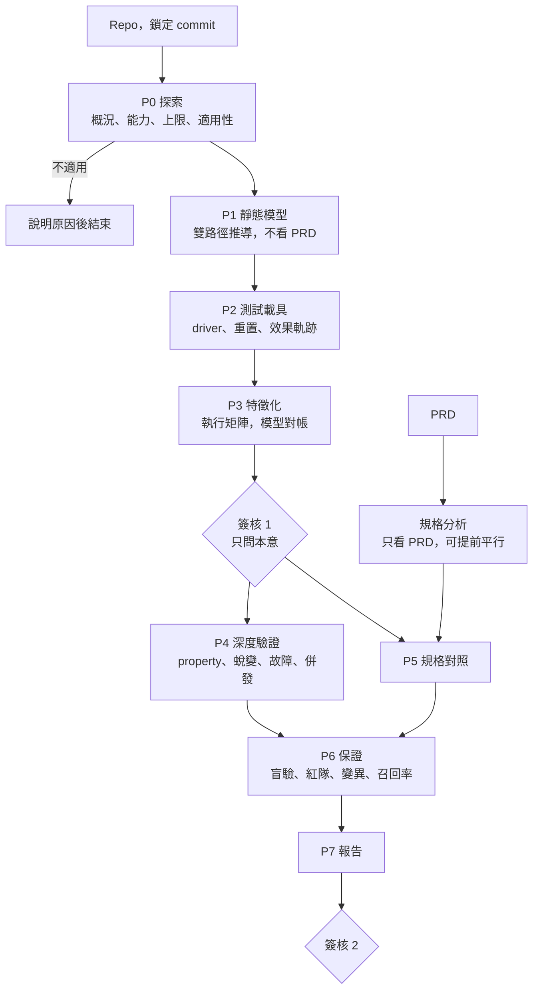

# Java 業務邏輯嚴密審查 Skill：設計 v0.2

> 狀態：設計稿，尚未實作。
> 文中的預設數值都是起始值，要以試行結果校正。標「需試跑」的工具相容性尚未查證。
> 前一版（v0.1）是針對單一訂單系統的審查計畫；本版把方法與個別系統的事實拆開，改寫成通用於 Java 的 skill。

## 目錄

0. 摘要
1. 定位與範圍
2. 核心設計決策
3. 兩條軸：證據等級與判定依據
4. 流程總覽
5. P0 探索
6. P1 靜態模型
7. P2 測試載具
8. P3 特徵化
9. 簽核 1 與決策紀錄
10. P4 深度驗證
11. P5 規格對照
12. P6 保證
13. P7 報告與重跑
14. 資料模型
15. Skill 封裝
16. Java 轉接層與支援分級
17. Java 業務邏輯陷阱目錄
18. 完成條件、量測指標、預算
19. 安全守則
20. Skill 本身的驗證
21. 里程碑
22. 限制與待決事項
- 附錄 A：一個問題的完整路徑
- 附錄 B：方法出處

---

## 0. 摘要

`java-logic-audit` 是一個 skill。給它一個 Java 後端的 repo（PRD 選配），它回答三個問題：程式實際做了什麼、程式是否自我一致、程式是否符合規格。每個結論都附可重跑的證據，並量測審查本身的漏網程度。

設計建立在四個想法上：

1. **探索決定能力，能力決定證據上限。** skill 不要求前置條件。它先掃 repo 並實際執行幾個煙霧測試，確認自己在這個 repo 做得到什麼，再決定每一類結論最高能到哪一級證據。任何 repo 都跑得完，差別只在報告的強度。
2. **模型就是測試資料。** 現況模型（入口、狀態、命令 × 狀態矩陣、不變量）以 JSON 保存，由通用的測試執行器直接執行。模型與程式是否相符由機器驗，人只回答「這是不是本意」。
3. **「行為存在」與「行為錯誤」分開判定。** 前者由證據等級表示；後者必須指出依據：規格、人工決策、程式自相矛盾、通用性質，或領域慣例。讀者永遠看得到一個問題是憑什麼被稱為問題。
4. **骨幹是不需要業務知識的檢驗準則。** 守衛不對稱、成對路徑差分、讀取無副作用、原子性、重送收斂、可序列化，在任何有狀態的交易系統都成立。skill 能通用，靠的是這一組準則。

## 1. 定位與範圍

### 1.1 適用對象

skill 適用於同時具備以下三點的 Java 系統：

- 有持久化的業務實體（關聯式資料庫）。
- 實體有生命週期：狀態欄位，或由數量、時間戳、旗標推導出的狀態。
- 操作受狀態約束：同一個操作在不同狀態下被允許或拒絕。

訂單、工單、付款、預約、庫存異動、審批流程都屬於這一類。

### 1.2 不適用對象

以下情況由 P0 自行判定並說明原因，不硬做：

| 情況 | 原因 |
|---|---|
| 純函式庫、無狀態的轉換服務 | 沒有狀態機與矩陣可填 |
| 串流處理管線 | 正確性在視窗與順序語意，不在實體生命週期 |
| 邏輯主要在 BPMN、規則引擎、預存程序 | 邏輯不在 Java，讀 Java 得不到行為 |
| 沒有關聯式資料庫（純文件庫、純事件溯源） | 效果軌跡與交錯載具建立在 JDBC 上 |

部分符合時（例如一半邏輯在預存程序）判定為「部分適用」，明列哪些實體不在審查範圍。

### 1.3 非目標

- 效能、容量、高負載行為。
- 安全弱點掃描（注入等只在陷阱目錄順帶標記）。
- 程式風格與可維護性。
- 自動修復。skill 只提修法建議。
- 業務規則本身的對錯。skill 指出矛盾與偏離慣例之處，由業務判斷。

### 1.4 輸入

| 輸入 | 必要性 | 取得方式 |
|---|---|---|
| Repo，鎖定 commit | 必要 | — |
| 可執行 Docker 的機器 | 影響證據上限 | P0 偵測 |
| PRD（markdown） | 選配 | 使用者提供；沒有就跳過 P5 |
| 術語表（程式命名對業務用語） | 選配 | skill 先由程式起草，簽核 1 時請人修正 |
| 正式環境的資料庫版本與隔離等級 | 影響併發結論 | 先找設定檔；找不到才問 |
| 典型資料形狀（一個父項幾個子項） | 選配 | 先由既有測試與 fixture 推估；找不到用小規模預設 |

只有 repo 裡真的找不到的東西才問人，而且集中在 P0 結束時一次問完。

## 2. 核心設計決策

每一條都附理由，因為實作時遇到沒寫到的情況，要靠理由判斷。

**D1　探索取代前置條件。**
v0.1 的「輸入與前置條件」「待決事項」大部分是掃 repo 就能回答的事。通用 skill 不能假設環境，所以把它們全部變成 P0 的產出。

**D2　能力決定證據上限。**
缺 Testcontainers、外部依賴用 mock、沒有 PRD，都不是失敗條件。它們只讓對應面向的結論停在較低的證據等級，報告同時寫明「補上什麼就能升級」。這讓 skill 在條件差的 repo 也有產出，而且不會誇大。

**D3　機械事實用工具取得，判斷才交給 agent。**
入口清單、呼叫關係、寫入點、SQL 讀寫集合、交易屬性都能機械列舉。agent 讀程式碼去「找」這些東西既慢又會漏。agent 的工作是解讀：這個條件是不是守衛、這兩條路徑是不是在算同一件事。

**D4　模型即測試資料。**
模型若只是文件，就只能請人相信它。把矩陣、不變量、成對路徑都存成 JSON，由通用執行器逐項執行，模型的每一句話就都有一個會紅會綠的測試。程式改版後，測試先告訴你哪一格變了。

**D5　行為存在與行為錯誤是兩件事。**
「改量可以低於已出貨量」可以是 A 級事實（有測試重現），但它是不是缺陷，取決於有沒有規格或決策說不可以。把兩者混成一個「嚴重度」會讓報告失去可信度。

**D6　以領域無關的準則為骨幹。**
由程式推導的不變量有循環問題：程式一致地做錯，推導出來就是規則。skill 不假裝能解決這件事，而是把力氣放在不需要知道「正確答案」的檢驗上（見 10.1），其餘交給規格與人工決策。

**D7　反例必須可由公開入口到達。**
測試直接往資料庫塞資料，很容易造出正式環境不可能出現的狀態，然後「發現」一堆問題。規則：交易資料只能用命令建立；做不到時，證據降為 B 並標明。

**D8　獨立性靠輸入隔離落實。**
同一個模型跑兩次，盲點是相關的，結果一致不算證據。有意義的獨立性來自看到不同的東西：一條路徑從入口往下、一條從資料表往上；規格分析者看不到程式；盲驗者看不到審查過程。隔離用檔案可見性落實，不只靠指示。

**D9　對目標 repo 的改動是加法且隔離的。**
全部產物放在 `audit/`、`src/audit/` 和一個建置 profile 裡。預設建置的輸出不受影響，整組移除只要刪這三處。

**D10　決策紀錄是長期的判定依據。**
人在簽核時回答過的問題存成決策紀錄，之後每次重跑都沿用，不重問。這是整套產物裡唯一無法由程式重新推導的部分，要當成資產維護。

**D11　形式化模型不在核心流程。**
TLA+ 與 trace validation 成本高，且這類系統的併發問題多半出在應用層與資料庫隔離語意的互動，在真實引擎上做受控交錯更直接。形式化模型保留為選配延伸（10.7）。

## 3. 兩條軸：證據等級與判定依據

每個問題都同時標這兩條軸。

### 3.1 證據等級：這個行為確實存在嗎

| 等級 | 定義 | 取得條件 |
|---|---|---|
| A | 可重現的執行證據 | 測試經公開入口、從合法初始狀態出發、在與正式環境同款的資料庫引擎上，連續 3 次重現 |
| B | 可執行，但帶保留 | 能重現，但有下列任一保留標記 |
| C | 靜態推論 | 附完整的程式路徑（類別#方法 的鏈），未執行 |

B 級的保留標記：

| 標記 | 意義 |
|---|---|
| `mock-boundary` | 行為涉及被替身取代的外部系統 |
| `substitute-engine` | 在 H2 等替代引擎上執行 |
| `synthetic-state` | 初始狀態由資料直寫建立，未經命令 |
| `unconfirmed-version` | 資料庫版本或隔離等級未與正式環境核對 |
| `uncontrolled-time` | 行為與時間有關，但時間不可控 |
| `model-only` | 來自模型檢查的反例，尚未在程式上重播 |

### 3.2 判定依據：憑什麼說它有問題

| 代號 | 依據 | 例子 | 預設歸類 |
|---|---|---|---|
| N1 | 規格 | 違反 PRD 條款 | 缺陷 |
| N2 | 決策 | 違反人工確認過的不變量或決策 | 缺陷 |
| N3 | 自相矛盾 | 程式在別處強制同一條件；預覽與執行結果不同；宣告與行為不符 | 不一致 |
| N4 | 通用性質 | 違反原子性、冪等、可序列化、讀取無副作用 | 異常 |
| N5 | 領域慣例 | 違反領域包中的常理 | 異常 |
| N0 | 無 | 只是值得一問的觀察 | 待確認 |

歸類的意義：

- **缺陷**：有明確依據，可直接排修。
- **不一致**：程式自己有兩種說法，至少有一邊是錯的，要人決定哪一邊。
- **異常**：偏離一般預期，可能是刻意設計。進簽核問題清單，回答後升為缺陷或鎖定為既定行為。
- **待確認**：不算問題，只是問題清單的一項。

一個問題可以有多個依據。依據越多，越不需要人工判斷。

### 3.3 嚴重度

嚴重度只描述後果，不描述把握程度。

| 等級 | 後果 |
|---|---|
| S1 | 已提交的資料錯誤且無法由系統自行復原；或對下游送出錯誤、遺漏、重複的訊息 |
| S2 | 不變量可被破壞，但需要特定時序、故障或少見的操作順序 |
| S3 | 合法操作被拒絕，或錯誤訊息與實際原因不符 |
| S4 | 不影響資料正確性的不一致 |

## 4. 流程總覽



與 v0.1 的主要差異：

| v0.1 | v0.2 | 原因 |
|---|---|---|
| 前置條件與待決事項 | P0 探索的產出 | D1 |
| 簽核 1 在靜態模型之後 | 簽核 1 在矩陣執行之後 | 人不該簽 C 級證據 |
| 階段 2 形式化模型 | 選配延伸 | D11 |
| 兩個 skill | 一個 skill，多個模式 | 共用同一份狀態與資料模型 |
| 三層實體、模擬提交流程寫在設計裡 | 由 P1 推導 | 那是某個系統的事實 |
| 信心估計表 | 量測指標（第 18 節） | 數字要有分母 |

### 4.1 模式

skill 以 `audit/state.json` 記錄進度，每個階段可單獨執行、可中斷續跑。

| 呼叫 | 作用 | 典型用途 |
|---|---|---|
| `/java-logic-audit` | 從下一個未完成的階段繼續 | 完整審查 |
| `… profile` | 只做 P0 | 評估某個 repo 做得到什麼 |
| `… model` | P0 到 P3，停在簽核 1 | 新人上手、需求影響評估 |
| `… decide` | 匯入人對問題清單的回答 | 簽核 1 之後 |
| `… verify [範圍]` | P4，可限定實體或命令 | 針對某個變更類型深入 |
| `… spec <prd>` | P5 | PRD 改版後重新對照 |
| `… assure` | P6 | 量測審查品質 |
| `… report` | P7 | 重新生成報告 |
| `… rerun` | 在新 commit 上做差異重跑 | 改版後回歸 |
| `… status` | 進度與量測指標 | — |

## 5. P0 探索

目的：產出 repo 概況、確認能力、定出證據上限、判定適用性。這個階段不做任何判斷性的審查。

### 5.1 探索面向

每個面向先看靜態線索，再盡量以執行確認。靜態線索只說「看起來有」，執行確認才算數。

| 面向 | 靜態線索 | 執行確認 |
|---|---|---|
| 建置 | `pom.xml`、`build.gradle(.kts)`、wrapper、JDK 版本、模組結構 | 乾淨建置連續成功兩次 |
| 框架 | 依賴座標、啟動類別、`javax.*` 或 `jakarta.*` 命名空間 | 測試中啟動應用 context |
| HTTP 入口 | `@RequestMapping` 系列、JAX-RS `@Path`、函式式路由 | 由 `RequestMappingHandlerMapping` 列舉 |
| 訊息入口 | `@KafkaListener`、`@RabbitListener`、`@JmsListener`、`io.nats.client` 的訂閱呼叫 | 由各 listener registry 列舉；無 registry 者由替身記錄訂閱 |
| 排程入口 | `@Scheduled`、Quartz `Job`、分散式排程的 handler | 由 `ScheduledTaskHolder` 列舉 |
| 內部事件 | `@EventListener`、`@TransactionalEventListener` | context 內的 listener 清單 |
| 其他入口 | 啟動時執行的 runner、`@PostConstruct` 中的寫入、管理端點、RPC 服務 | — |
| 持久化 | `@Entity`、mapper XML 與註解、`JdbcTemplate`、jOOQ | 攔截到實際 SQL |
| 資料庫 | 驅動、JDBC URL、遷移腳本、trigger、procedure、constraint | 容器內套用遷移後傾印實際 schema |
| 交易 | `@Transactional`、`TransactionTemplate`、隔離等級設定 | 由 `TransactionAttributeSource` 查每個方法實際生效的屬性 |
| 併發控制 | `@Version`、`FOR UPDATE`、`@Lock`、分散式鎖、唯一鍵 | — |
| 橫切邏輯 | `@Aspect`、filter、interceptor、JPA entity listener | 由 `Advised#getAdvisors` 查實際套用到哪些 bean |
| 對外呼叫 | Feign、`RestTemplate`、`WebClient`、gRPC stub、訊息發送 | — |
| 測試資產 | JUnit 4/5、TestNG、Mockito、Testcontainers、WireMock、H2 | 跑既有測試並記錄通過率與覆蓋率 |
| 外部依賴的替身 | mock 的對象與位置（見 5.3） | — |
| Java 以外的邏輯 | `.drl`、BPMN、預存程序、腳本、設定檔驅動的規則 | 標記，並影響適用性判定 |
| 修復歷史 | 提交訊息中的修復字樣、同時改到主程式與測試的提交 | 只統計數量，內容不給審查 agent 看 |

### 5.2 能力

每項能力的狀態是「已執行確認」「不具備」或「未知，需人回答」。不接受「看起來有」。

| 代號 | 能力 | 確認方式 |
|---|---|---|
| CAP-BUILD | 可重現建置 | 兩次乾淨建置成功 |
| CAP-TEST | 既有測試可執行 | 跑完並記錄結果 |
| CAP-CTX | 測試中可啟動應用 context | 生成並執行一個只啟動 context 的測試 |
| CAP-DB-REAL | 真實資料庫引擎，版本與正式環境一致 | 容器映像標籤對照設定檔或人工回答 |
| CAP-DB-SUB | 只有替代引擎 | — |
| CAP-DS-PROXY | 可在測試中包裝 DataSource | 煙霧測試攔截到至少一條 SQL |
| CAP-MQ-REAL | 訊息系統有真實代理（容器） | 煙霧測試收發一則訊息 |
| CAP-MQ-EDGE | 訊息在 client 邊界被替身攔截 | 替身位於最外層 client |
| CAP-EXT-EDGE | 外部服務在 client 邊界被替身攔截 | 同上 |
| CAP-CLOCK | 時間可控 | 找到 `Clock` 注入，或無直接取現在時間的呼叫 |
| CAP-HISTORY | 有可用的修復歷史 | 候選提交數 ≥ 門檻 |
| CAP-SPEC | 有 PRD | 使用者提供 |

### 5.3 替身的位置

外部依賴用 mock 不是問題，mock 放在哪裡才是。

- **邊界替身**：取代的是最外層的 client（訊息連線、HTTP client）。應用自己的序列化、主題命名、發送順序都還在受測範圍內。足以驗證「發了什麼、發了幾次、相對於提交的位置」。
- **內層替身**：取代的是應用自己的 gateway 或 service 類別。這段程式碼完全沒被執行，與它有關的結論只能停在 C。

P0 記錄每個外部依賴的替身位置。若是內層替身，skill 在自己的審查測試裡補一個邊界替身，不動既有測試。

邊界替身驗不到的是代理本身的語意：重送、亂序、ack 逾時。若該訊息系統的容器映像容易取得，P0 會建議補上並在同意後自行加入審查測試。

### 5.4 證據上限

| 檢驗 | 達到 A 需要 | 不具備時 |
|---|---|---|
| 矩陣特徵化 | CAP-CTX、CAP-DB-REAL | 只有 CAP-DB-SUB 為 B；連 CAP-CTX 都沒有為 C |
| 效果軌跡、讀取純度 | 加上 CAP-DS-PROXY | C |
| 訊息內容與次數 | CAP-MQ-EDGE | C |
| 訊息的重送與順序 | CAP-MQ-REAL | B（`mock-boundary`） |
| 故障注入 | CAP-DS-PROXY、邊界替身 | C |
| 併發 | CAP-DB-REAL、CAP-DS-PROXY | 替代引擎上不執行，一律 C |
| 時間相關規則 | CAP-CLOCK | B（`uncontrolled-time`） |
| 規格對照 | CAP-SPEC | 跳過 P5 |
| 召回率量測 | CAP-HISTORY 或人工埋入 | 只報變異分數 |

併發在替代引擎上不執行的理由：H2 的鎖與多版本行為與正式引擎不同，得到的結論可能兩個方向都是錯的，比沒有結論更糟。

### 5.5 產出

`audit/profile.json`（節錄）：

```json
{
  "commit": "…",
  "build": { "tool": "maven", "jdk": "17", "modules": ["app", "domain"], "reproducible": true },
  "framework": { "name": "spring-boot", "version": "3.2", "web": "mvc", "namespace": "jakarta" },
  "persistence": [{ "kind": "jpa-hibernate" }, { "kind": "mybatis", "xml_mappers": 42 }],
  "database": {
    "engine": "postgresql", "version_in_tests": "15",
    "migrations": "flyway", "isolation": { "value": null, "source": "unknown" },
    "db_side_logic": { "triggers": 0, "procedures": 0 }
  },
  "messaging": [{ "kind": "nats", "mode": "jetstream", "test_double": "edge" }],
  "outbound": [{ "name": "pricing", "client": "feign", "test_double": "edge" }],
  "capabilities": { "CAP-CTX": "verified", "CAP-DB-REAL": "verified", "CAP-MQ-REAL": "absent" },
  "ceilings": { "matrix": "A", "concurrency": "A", "message_redelivery": "B" },
  "support_tier": { "framework": 1, "persistence": 1, "database": 1, "messaging": 1 },
  "applicability": { "verdict": "full", "excluded": [] },
  "questions": ["正式環境的交易隔離等級是？設定檔中未指定。"]
}
```

## 6. P1 靜態模型

目的：只讀程式，推導出現況模型的草稿。這個階段所有產出都是 C 級，到 P3 才執行。全程不看 PRD、不看既有測試、不看 git 歷史。

### 6.1 三個事實來源

同一件事從三個方向取得，互相對帳：

| 來源 | 方向 | 階段 | 容易漏的 |
|---|---|---|---|
| 由上往下 | 從入口沿呼叫鏈追到寫入與對外效果 | P1 | AOP、entity listener、級聯、trigger 造成的寫入 |
| 由下往上 | 從每個資料表欄位的寫入點回推到入口 | P1 | 透過反射或設定間接觸發的入口 |
| 執行觀察 | 實際執行每個入口，攔截 SQL 與對外效果 | P3 | 測試沒走到的分支 |

前兩者由不同的 agent 各自做，彼此看不到對方的草稿。對帳的結果是一張「入口 ↔ 寫入點」的雙向關係表，不一致之處只有兩種：

- **孤兒寫入點**：由下往上找到，但沒有任何已知入口到得了。可能是隱藏入口、死碼，或由其他系統觸發。
- **漏失的寫入**：某個入口的由上往下追蹤沒有涵蓋到某個寫入點。通常是橫切邏輯。

每一筆不一致都要結案（補進模型）或列入問題清單，不能留著。

### 6.2 機械事實

以下事實由工具抽取，存入 `audit/facts/`，agent 只引用不重找：

| 事實 | 抽取方式 |
|---|---|
| 入口清單 | 靜態註解掃描；可啟動 context 時以執行期列舉為準 |
| 呼叫關係 | 以 ArchUnit 讀位元組碼，取方法呼叫與欄位存取；介面呼叫展開到所有實作 |
| 實體與欄位 | `@Entity` 對映、mapper 的 resultMap、遷移後的實際 schema |
| 寫入點 | 對實體 setter 與欄位的寫入、mapper 中的 INSERT/UPDATE/DELETE、原生 SQL |
| 交易屬性 | 執行期查詢每個 bean 方法實際生效的傳播、隔離、回滾規則 |
| 橫切套用 | 執行期查詢每個 bean 被哪些 advisor 包裹 |
| 重複邏輯 | 以複製貼上偵測工具找出相近的計算片段 |

呼叫關係是保守的過度近似（依類別階層展開），反射與動態代理不在其中。這是「孤兒寫入點」會出現的主因，也是需要執行觀察的理由。

### 6.3 入口與命令

- **入口**：外界能觸發程式執行的點，編號 `EP-`。
- **命令**：會改變持久狀態的入口，編號 `CMD-`。一個入口若依參數做不同的事（例如一個「變更」端點接受多種變更類型），拆成多個命令。
- **讀取**：宣稱不改變狀態的入口。是否真的不改，由 P3 的讀取純度檢驗確認。

P1 的靜態分類只是初判，以 P3 的效果軌跡為準。

### 6.4 實體與生命週期欄位

對每個實體找出**生命週期欄位**，也就是程式用來決定「現在能不能做某件事」的欄位：

- 列舉或代碼型的狀態欄位。
- 布林旗標（已取消、已鎖定、已刪除）。
- 被當成旗標用的可空時間戳（`cancelledAt != null`）。
- 出現在守衛條件裡的數量關係（已出貨量是否大於零、是否等於訂購量）。

判定標準是「有守衛讀它」，不是欄位名稱。

### 6.5 守衛述詞與抽象狀態

**守衛**是支配一個拒絕（丟例外、回傳錯誤）或一個寫入的條件。把所有守衛拆成原子述詞，分兩類：

- **狀態述詞**：只涉及實體自己或其父子實體的欄位，例如 `status ∈ {CONFIRMED}`、`shippedQty > 0`、`header.status = CLOSED`。
- **參數述詞**：把命令參數與實體欄位做比較，例如 `newQty >= shippedQty`。

抽象狀態不是先驗給定的，而是由守衛誘導出來的：兩個實體實例若讓所有相關述詞取相同的真值，就屬於同一個抽象狀態。v0.1 提到的「推導出來的有效狀態，例如部分交貨」就是這樣得到的：程式裡有守衛測 `shippedQty > 0`，於是「已確認且有出貨」自然成為一個獨立的狀態。

為了避免組合爆炸，細分是**逐命令延遲進行**的：

1. 主軸是顯式的狀態欄位值。
2. 每個命令只依「它自己的守衛測了哪些述詞」來細分格子。沒被這個命令測到的述詞不拆。
3. 父項與子項的狀態只在該命令的守衛有測時才納入格子的上下文。
4. 參數述詞不拆狀態，而是產生參數的等價類與邊界值（`shippedQty - 1`、`shippedQty`、`shippedQty + 1`）。

格子數量因此是「各命令 × 各狀態值 × 該命令實際測試的述詞組合」的總和，實務上每個命令多半只多出零到三個述詞。

### 6.6 變更矩陣

每一格的鍵是（命令、實體、狀態值、狀態述詞取值、祖先上下文、參數類別）。

```json
{
  "id": "CELL-0142",
  "command": "CMD-changeLineQty",
  "entity": "ENT-order_line",
  "state": { "status": "CONFIRMED", "atoms": { "shippedQty>0": true } },
  "context": { "ENT-order_header.status": "OPEN" },
  "param_class": "newQty<shippedQty",
  "static": {
    "outcome": "unhandled",
    "anchors": ["OrderLineService#changeQty"]
  },
  "observed": null,
  "reach": null,
  "decision": null
}
```

靜態推導的結果有四種：

| 結果 | 意義 |
|---|---|
| `allowed` | 有守衛明確放行，並指出會寫入哪些欄位 |
| `rejected` | 有守衛明確拒絕，並指出錯誤碼 |
| `unhandled` | 沒有任何守衛針對這個情況做決定，行為是「剛好如此」 |
| `unknown` | 靜態無法判斷 |

`unhandled` 是矩陣最有價值的產出：程式沒有做決定的地方，就是沒人想過的地方。

### 6.7 寫入點表與守衛不對稱

由下往上的路徑為每個欄位產出一張寫入點表：

| 欄位 | 寫入點 | 途徑 | 支配的守衛 | 可到達的入口 | 交易 | 併發保護 |
|---|---|---|---|---|---|---|
| `order_line.qty` | `OrderLineService#changeQty` | 實體 setter | 狀態 ∈ {OPEN, CONFIRMED} | `CMD-changeLineQty` | REQUIRED | `@Version` |
| `order_line.qty` | `ShipmentListener#onShipped` | mapper UPDATE | `qty >= shippedQty` | `CMD-onShipment` | REQUIRED | 無 |
| `order_line.qty` | `ImportJob#apply` | 原生 SQL | 無 | `CMD-nightlyImport` | 無 | 無 |

同一個欄位的各個寫入點，守衛應該相同或有可解釋的差異。差異就是**守衛不對稱**的候選：程式在某處認為這個條件必須成立，在另一處沒檢查。這個方法不需要知道條件對不對，只需要程式自己在別處表達過這個信念。

同一張表也直接暴露：沒有交易的寫入、沒有併發保護的寫入、繞過版本欄位的批次更新。

「寬寫入點」要特別展開：`BeanUtils.copyProperties`、沒有 null 策略的物件對映、detached 實體的 merge，一次會寫入所有同名欄位，包含不該由這個入口修改的生命週期欄位。

### 6.8 生命週期欄位的一致性

對每個狀態欄位的每個值，機械地比對「誰寫入它」與「誰讀它」：

| 情況 | 意義 |
|---|---|
| 有守衛讀，沒有任何程式寫 | 幽靈狀態。可能由其他系統寫入，或是廢棄的值 |
| 有程式寫，沒有任何守衛讀 | 無人看守的狀態。進入之後所有操作的行為都是未定義 |
| 列舉中有，讀寫都沒有 | 死值 |
| 由多個布林或時間戳共同表示狀態 | 列出所有組合，標出程式從未處理的組合 |

### 6.9 狀態機

轉移由三部分組成：來源狀態的守衛、命令、對生命週期欄位的寫入。靜態推導出的狀態機在 P3 會與觀察到的轉移比對。

要另外標出的隱含轉移：

- **級聯**：改子項導致父項狀態重算。
- **推導狀態的改變**：改數量讓「部分出貨」變成「全部出貨」，沒有任何地方寫狀態欄位。
- **時間觸發**：排程把逾期的項目改狀態。

### 6.10 成對路徑

成對路徑是宣稱計算同一件事的兩條路徑，是不需要業務知識的差分檢驗來源。

| 類型 | 找法 |
|---|---|
| 預覽與執行 | 命名（simulate、preview、dryRun、validate、calculate、estimate、quote）；帶 `dryRun` 旗標的同一條路徑 |
| 單筆與批次 | 命名與參數型別（單一物件對集合） |
| 不同入口的同一操作 | HTTP 與訊息入口最終呼叫到同一個或相似的服務方法 |
| 新舊版本 | v1 與 v2 端點 |
| 建立後修改與直接建立 | 兩種途徑應得到相同的最終狀態 |
| 寫入端與讀取端 | 查詢投影或快取應與寫入端狀態一致 |
| 重複的計算 | 複製貼上偵測找到的相近公式，可能已經各自演化 |

每一對記錄：兩條路徑、比較的輸出、預期關係（相等，或一方是另一方的投影）。

### 6.11 不變量目錄

不變量依類別整理。類別本身是通用的，內容由各 repo 推導。

| 類別 | 形式 | 常見來源 |
|---|---|---|
| 結構 | 子項必有父項；鍵唯一 | 外鍵、唯一鍵、對映註解 |
| 彙總 | 父項欄位等於子項欄位的合計 | 重算合計的程式碼 |
| 界限 | 一個量不超過另一個量；不為負 | 守衛、CHECK 約束、Bean Validation |
| 單調 | 某欄位只增不減；時間先後 | 累加式的寫入 |
| 狀態一致 | 父項狀態是子項狀態的函數；某狀態下某欄位必有值 | 級聯邏輯 |
| 轉移合法 | 只發生狀態機內的轉移；終態不再變 | 狀態機 |
| 不可變 | 進入某狀態後某欄位不再改變 | 守衛 |
| 協定 | 執行前必有同版本的預覽；同一請求只生效一次 | 版本比對、冪等鍵 |
| 效果對應 | 每個已提交的變更恰有一則對外訊息 | 發送邏輯 |
| 隔離 | 操作不觸及其他租戶或其他擁有者的資料 | 查詢條件 |

候選不變量有四個來源，每條都要標明：

| 來源 | 說明 | 可信度 |
|---|---|---|
| 宣告 | 資料庫約束、Bean Validation、對映註解 | 高，但要驗證是否真的被執行（6.12） |
| 強制 | 程式某處的守衛。配合寫入點表可知哪些寫入點沒強制 | 中。程式至少在一處相信它 |
| 觀察 | P3 從執行快照探勘到的規律 | 低。只代表目前沒看到反例 |
| 外部 | PRD、領域包、人工 | 依來源 |

不變量盡可能寫成 **SQL 形式**：一條查詢，回傳違反的資料列，預期為空。這個形式有兩個好處：每個測試步驟之後都能直接執行；同一組查詢可以匯出給人拿去掃正式資料庫的唯讀副本。

```json
{
  "id": "INV-07",
  "class": "bound",
  "statement": "已出貨量不得大於訂購量",
  "scope": "ENT-order_line",
  "check": { "sql": "SELECT id FROM order_line WHERE shipped_qty > qty", "expect": "empty" },
  "sources": [
    { "kind": "enforced", "anchor": "ShipmentListener#onShipped" }
  ],
  "unenforced_at": ["OrderLineService#changeQty", "ImportJob#apply"],
  "status": "candidate",
  "decision": null
}
```

狀態只有三種：`candidate`（候選）、`confirmed`（經決策或規格確認）、`rejected`（人說這不是規則）。只有 `confirmed` 的不變量被違反時才直接算缺陷。

### 6.12 宣告與實作的比對

宣告了但沒生效，或生效了但沒宣告，都是機械可查的不一致：

- 程式檢查唯一性，資料庫沒有唯一鍵。
- 對映註解說不可為空，資料庫欄位可為空（或相反）。
- Bean Validation 只在 HTTP 入口觸發，訊息與排程入口繞過。
- 列舉值集合與資料庫的 CHECK 約束或代碼表不同。
- 欄位長度、精度、小數位數在程式與資料庫不一致。

## 7. P2 測試載具

目的：建立能執行模型的環境。這是整個 skill 唯一需要寫較多 Java 的地方，大部分是可重用的。

### 7.1 隔離契約

對目標 repo 的所有改動限於三處：

| 位置 | 內容 |
|---|---|
| `audit/` | 所有資料產出 |
| `src/audit/java`、`src/audit/resources` | 載具與測試 |
| 一個建置入口 | Maven 是一個 `audit` profile；Gradle 是一個 init script，不動建置檔 |

Maven 的 `audit` profile 把 `src/audit/java` 加為測試原始碼根目錄，並加入需要的測試依賴與外掛。不啟用這個 profile 時，建置的輸入與輸出完全不變。

多模組專案中，審查原始碼放在含啟動類別的模組。

### 7.2 auditkit

以原始碼模板的形式隨 skill 提供，複製到 `src/audit/java` 下。不發布成套件，原因是避免目標專案依賴一個外部座標，而且原始碼可被審閱。

模板使用 Java 8 語法，不直接引用 `javax.*` 或 `jakarta.*`，以便在新舊專案都能編譯。

| 元件 | 作用 | 主要依賴 |
|---|---|---|
| `CommandRegistry`、`SutDriver` | 以命令編號呼叫入口，回傳統一的結果 | 由 agent 依概況生成 |
| `DbReset` | 重置資料庫 | JDBC |
| `Snapshot`、`Projection` | 傾印受審資料表，套用投影後比對 | JDBC |
| `EffectRecorder` | 記錄交易邊界、SQL、發送、外部呼叫的有序軌跡 | datasource-proxy、邊界替身 |
| `MatrixRunner` | 讀矩陣 JSON，逐格執行 | JUnit 5 動態測試 |
| `InvariantRunner` | 執行 SQL 形式的不變量 | JDBC |
| `PairRunner` | 執行成對路徑並比較 | — |
| `FaultInjector` | 在指定的效果點注入故障 | datasource-proxy、邊界替身 |
| `Interleaver` | 兩到三個操作的受控交錯與重播 | datasource-proxy、資料庫的鎖等待檢視 |
| `SeqProps` | 有狀態 property 測試的骨架 | jqwik，或內建後端 |

`SeqProps` 有兩個後端。預設用 jqwik 的 action chain。jqwik 目前是維護模式，所以另備一個無額外依賴的後端：帶種子的隨機序列產生，加上以 delta debugging 縮減失敗序列。兩者對外介面相同。jqwik 與應用 context 的整合方式需試跑。

### 7.3 命令與結果

```java
public interface Command {
    String id();                                  // CMD-…
    Outcome invoke(Map<String, Object> params);   // 經由入口呼叫，不直接碰資料庫
}

public final class Outcome {
    public enum Kind { ALLOWED, REJECTED, ERROR }
    public final Kind kind;
    public final String errorCode;                // 業務錯誤碼，或例外類別
    public final Map<String, Object> response;
}
```

`REJECTED` 是程式有意識的拒絕（業務例外、4xx）。`ERROR` 是非預期的失敗（空指標、5xx、約束違反直接冒出）。這個區分本身就是資訊：一個格子的結果若是 `ERROR`，代表程式沒有處理這個情況。

呼叫層級由 agent 依概況選擇：

| 層級 | 做法 | 用途 |
|---|---|---|
| L0 | 直接呼叫純計算函式 | 數值與時間的邊界測試 |
| L1 | 程序內呼叫入口：MockMvc、直接呼叫 listener 方法 | 預設 |
| L2 | 經真實的連接埠與訊息代理 | 驗證訊息語意時 |

L1 的選擇原則：程序內、並且位於所有橫切邏輯（驗證、AOP、交易代理）之外的最外層。直接呼叫 service bean 只在入口層純粹做轉換時才可接受，否則會繞過驗證與攔截器。

### 7.4 資料的建立

- **基礎資料**（產品、客戶、代碼表）：可直接寫入資料庫。
- **交易資料**（受審的實體）：只能透過命令建立。

若某種實體在受審範圍內沒有建立它的命令（由別的系統寫入），允許直寫，但由此得到的證據標 `synthetic-state`。

### 7.5 重置策略

依引擎與測試類型選擇，越上面越快：

| 策略 | 適用 | 限制 |
|---|---|---|
| 交易回滾 | 單一交易內的測試 | 不能用於跨交易、故障注入、併發 |
| 範本資料庫複製 | PostgreSQL。每輪從範本建新庫 | 範本不能有連線 |
| 依外鍵順序清表後重新植入 | 所有引擎 | 清表腳本由 schema 生成 |
| 重啟容器 | 最後手段 | 慢 |

平行執行時每個工作者使用同一個容器內的獨立資料庫或 schema。

### 7.6 決定性

測試必須可重播，否則 A 級證據不成立。

- **雙跑偵測**：每個命令從同一個初始狀態執行兩次，兩次結果中不同的欄位就是不決定的（自動編號、時間戳、UUID）。這些欄位自動加入易變集合，從比對的投影中排除，並以首次出現的順序重新編號。
- **時間**：有 `Clock` 注入就固定時間。沒有的話，與時間有關的結論標 `uncontrolled-time`，並把直接取現在時間的位置列為可測性問題。
- **隨機**：所有隨機測試記錄種子。失敗的種子固定下來成為回歸樣本。

### 7.7 效果軌跡

`EffectRecorder` 為每次命令執行記錄一條有序軌跡：

```
T1 BEGIN
T1 SQL   SELECT … FROM order_line WHERE id = ?
T1 SQL   UPDATE order_line SET qty = ?, version = ? WHERE id = ? AND version = ?   rows=1
T1 PUB   line.changed {…}
T1 EXT   POST pricing/recalc
T1 COMMIT
```

再加上執行前後的資料列差異。由於某些 ORM 的 UPDATE 會列出所有欄位，實際改了哪些欄位要以資料列差異為準，不能只看 SQL。

從軌跡機械地導出每個命令的：

- 交易數量與邊界。
- 讀取集合與寫入集合（資料表與欄位）。
- 每次發送與外部呼叫相對於提交的位置。
- 交易內是否有外部呼叫。
- 取得的鎖、版本比對、影響筆數是否被檢查。

這些導出事實是 P3 的讀取純度、P4 的故障注入與併發配對的共同輸入。

## 8. P3 特徵化

目的：把 P1 的靜態模型全部執行一遍，得到「已執行的模型」。這個階段不需要任何業務判斷，產出的是事實。

### 8.1 到達配方

要執行一個格子，先要把實體帶到那個抽象狀態。**到達配方**是一串命令，從空白狀態出發，把實體帶到目標狀態。

做法是在靜態狀態機上做廣度優先搜尋，找到最短的命令序列，然後實際執行並確認確實到達。執行結果與模型不符時修正模型再搜。

搜不到配方的狀態分三類處理：

| 類別 | 處理 |
|---|---|
| 沒有任何程式會寫入這個狀態 | 幽靈狀態，列入問題清單 |
| 有寫入點，但在受審範圍外（其他系統、資料修補腳本） | 以直寫建立，標 `synthetic-state` |
| 理論上可達，搜尋預算內沒找到 | 標為未涵蓋，列在未審範圍 |

### 8.2 執行矩陣

`MatrixRunner` 對每一格：重置、執行到達配方、確認抽象狀態、拍快照、呼叫命令、拍快照、記錄結果與效果軌跡。

有兩種模式：

- **記錄**：第一次執行，把觀察到的結果寫回該格的 `observed`。
- **驗證**：之後的每次執行，斷言結果與已記錄的相同。

這就是特徵化測試：它不判斷對錯，只釘住現況。靜態推導與觀察結果不一致的格子要逐一對帳，原因通常是靜態分析漏了橫切邏輯，偶爾是靜態推導本身錯了。

### 8.3 模型符合與隱藏狀態

所有執行過程中記錄（執行前抽象狀態、命令、參數類別、結果、執行後抽象狀態）的五元組，用來做兩個檢查：

- **觀察到的轉移是否都在模型裡。** 多出來的轉移代表模型漏了東西，通常是級聯或推導狀態。
- **同一個抽象狀態對同一個命令是否有相同的反應。** 若兩個實體處在相同的抽象狀態，對同一類參數的同一個命令卻一個被允許一個被拒絕，代表抽象漏了一個述詞：有某個沒被當成守衛的欄位在影響行為。找出這個欄位並細分格子，或列為問題。

第二個檢查是抽象狀態完整性的保證來源，在 P4 的隨機序列中持續進行。

### 8.4 讀取純度

每個被分類為讀取的入口（含預覽、試算類），其效果軌跡的寫入集合必須為空：沒有 INSERT、UPDATE、DELETE，沒有發送，沒有會改變對方狀態的外部呼叫。

這個檢驗抓得到一類靜態分析很難看出的問題：ORM 的髒檢查。讀取路徑為了計算方便修改了受管實體，交易結束時被自動寫回資料庫。

稽核紀錄、存取紀錄、序號取號要先列為例外並在簽核時確認。

### 8.5 成對路徑差分

對 6.10 找到的每一對，從同一個初始狀態、以同樣的參數分別執行，比較輸出。參數來自矩陣格子的參數類別，所以邊界值都會被涵蓋。

預覽與執行這一對的比較內容：預覽回傳的結果，與執行後的實際狀態變化及對外訊息，套用投影後應該相等。

### 8.6 快照不變量探勘

P3 執行過程中累積了大量的資料庫快照。以固定的樣板在快照上找規律，作為候選不變量的第三個來源：

- 欄位 ≤ 欄位；欄位 ≥ 0。
- 父項欄位 = 子項欄位的合計。
- 父項狀態由子項狀態的集合唯一決定。
- 某狀態下某欄位必為空或必不為空。
- 某欄位在所有觀察到的轉移中只增不減。
- 進入某狀態後某欄位不再改變。

只有同時滿足「支持度夠高」與「在程式中找得到相關的讀寫位置」的規律才成為候選。純粹巧合的規律（兩個不相干的數字剛好一個總是比較小）在此過濾掉。

### 8.7 產出

已執行的模型：每一格有觀察結果與測試；每個命令有效果軌跡；狀態機經觀察比對；候選不變量目錄；成對路徑的差分結果；以及一份問題清單，供簽核 1 使用。

## 9. 簽核 1 與決策紀錄

### 9.1 人回答什麼

人不需要確認模型是否符合程式，那已經由測試保證。人只回答機器無法回答的事：**這個行為是不是本意。**

進入問題清單的只有：

- `unhandled` 與 `ERROR` 的格子。
- 守衛不對稱、成對路徑差異、宣告與實作不符。
- 候選不變量是否為真正的規則。
- 幽靈狀態、無人看守的狀態。
- 讀取路徑的寫入例外。
- 等價投影（比對時哪些欄位不算）。

程式明確允許或明確拒絕、各處一致的格子不問。這是控制人工工作量的關鍵。

### 9.2 問題的格式

每個問題是封閉式的，附可重現的證據：

```
Q-014　order_line｜改量｜CELL-0142
觀察：狀態為 CONFIRMED 且已有出貨時，把數量改成小於已出貨量，系統接受。
證據：MatrixTest[CELL-0142]，A 級
為什麼問：出貨路徑會檢查「已出貨 ≤ 訂購」，改量路徑沒有（守衛不對稱）。
選項：
  (a) 應該拒絕。列為缺陷，INV-07 成為已確認的不變量。
  (b) 本意如此。鎖定為既定行為，INV-07 作廢。
  (c) 需要業務確認。維持待確認。
```

問題依（可能的嚴重度 × 證據等級）排序，同一實體的放在一起。數量超過上限時只送出前面的部分，其餘留在待確認清單，並在報告的未審範圍中明列。

### 9.3 決策紀錄

```json
{
  "id": "D-021",
  "question": "Q-014",
  "answer": "a",
  "by": "…",
  "date": "…",
  "rationale": "已出貨的數量不可能收回",
  "effects": [
    { "set": "INV-07.status", "to": "confirmed" },
    { "set": "CELL-0142.decision", "to": "should-reject" }
  ]
}
```

決策的三種效果：

- 把候選不變量升為已確認，之後違反它的都是 N2 缺陷。
- 把一個格子的觀察行為鎖定為既定行為，之後它改變了就是回歸。
- 把一個格子標為「應為另一種結果」，產生一個缺陷，測試的預期值隨之翻轉。

決策紀錄永久保存。重跑時不重問。只有當決策引用的格子或不變量因程式改版而消失時，才把該決策標為過期並再問一次。

## 10. P4 深度驗證

### 10.1 檢驗準則總表

| 編號 | 準則 | 判定內容 | 需要業務知識 | 依據 | 常見誤報 |
|---|---|---|---|---|---|
| O1 | 矩陣特徵化 | 每格的實際結果；靜態與執行是否一致 | 否 | — | — |
| O2 | 守衛不對稱 | 同一欄位各寫入點的守衛不同 | 否 | N3 | 刻意的管理者路徑 |
| O3 | 宣告與實作 | 約束、驗證、對映與實際行為不符 | 否 | N3 | — |
| O4 | 成對路徑差分 | 兩條路徑的結果不同 | 否 | N3 | 投影未排除易變欄位 |
| O5 | 讀取純度 | 讀取類入口有寫入 | 否 | N4 | 稽核紀錄、取號 |
| O6 | 模型符合 | 模型外的轉移；同狀態不同反應 | 否 | N3 | 抽象不夠細 |
| O7 | 不變量保持 | 隨機序列的每一步都成立 | 已確認者需要 | N2 | 候選不變量本身不是規則 |
| O8 | 蛻變關係 | 逆操作、可加、可交換、冪等、無變更 | 投影需確認 | N4 | 版本號、歷程表 |
| O9 | 原子性 | 故障後的狀態等於執行前或完整執行後 | 否 | N4 | 刻意的多交易流程 |
| O10 | 效果對應 | 訊息與已提交的變更一一對應 | 否 | N4 | — |
| O11 | 重送收斂 | 重送或重試後等同成功一次 | 否 | N4 | — |
| O12 | 可序列化 | 併發結果等同某個先後順序 | 否 | N4 | 最後寫入者勝出是本意 |
| O13 | 規格符合 | PRD 條款 | 由 PRD 提供 | N1 | 條款有歧義 |
| O14 | 領域慣例 | 領域包中的常理 | 由領域包提供 | N5 | 刻意客製 |

O1 到 O6 在 P3 完成。本階段處理 O7 到 O12。O13 在 P5。

### 10.2 有狀態 property 測試

隨機產生命令序列，每一步之後檢查所有準則。

**以矩陣為參考模型。** 每一步執行前，由目標實體的抽象狀態與參數類別查矩陣，得到預期結果。實際結果不符有兩種可能：矩陣漏了條件（回頭細分格子），或發現了與歷史有關的行為（8.3 的隱藏狀態）。單格測試只走最短的到達配方，隨機序列會以各種不同的歷史到達同一個抽象狀態，這是它多出來的檢出能力。

**產生器的設計：**

- 結構保持小：每個父項一到三個子項。大部分結構性的錯誤在小規模就會出現。
- 參數偏向邊界：每個參數述詞貢獻它的邊界值（比較對象的值、加一、減一），加上零、一、型別上限。
- 實體選擇偏向有趣的狀態：非初始、非終態的實體有較高的被選機率。
- 命令選擇涵蓋所有命令，包含訊息與排程入口。

**每一步的檢查：**

1. 結果與矩陣一致。
2. 所有已確認的 SQL 不變量為空；候選不變量的違反記錄下來，不算失敗。
3. 觀察到的轉移在狀態機內。
4. 沒有 `ERROR` 類結果。

失敗的序列自動縮減到最短，連同種子存為回歸測試。

### 10.3 蛻變關係

蛻變關係不需要知道正確答案，只需要知道兩次執行之間應有的關係。目錄是通用的，適用與否由模型決定。

| 關係 | 形式 | 適用條件 |
|---|---|---|
| 逆操作 | 做了再反向做，等同沒做 | 命令有對應的反向命令或可用負值 |
| 可加 | 一次改 a+b，等同先改 a 再改 b | 增量型命令 |
| 設定冪等 | 設定同一個值兩次，等同一次 | 設定型命令 |
| 無變更 | 以現值更新，等同沒做 | 更新型命令 |
| 可交換 | 對不同實體的兩個命令，先後順序不影響結果 | 兩命令的寫入集合不相交 |
| 排列不變 | 批次請求中項目的順序不影響結果 | 批次命令 |
| 拆分等價 | 一個批次，等同逐筆執行 | 有成對的單筆與批次 |
| 單調 | 輸入增加時，某個輸出不會減少 | 計算類 |

「等同」是套用**等價投影**之後的比較。投影排除的欄位（版本號、時間戳、歷程紀錄）來自 7.6 的易變集合，並在簽核 1 確認。這一點很重要：加十再減十，資料相同但多了兩筆歷程，這是否算「等同」是業務決定。

### 10.4 故障注入

對每個會改變狀態的命令，取它單獨執行時的效果軌跡，在每一個效果點注入故障，重跑，檢查結果。

| 效果點 | 注入的故障 | 模擬的情況 |
|---|---|---|
| SQL 語句 | 執行前丟出資料庫例外 | 資料庫錯誤、逾時 |
| 提交 | 提交前失敗 | 連線中斷，交易回滾 |
| 提交 | 提交成功後、回傳前失敗 | 結果未知：已生效但呼叫端看到失敗 |
| 訊息發送 | 發送前失敗 | 代理不可用 |
| 訊息發送 | 發送成功後失敗 | 結果未知 |
| 外部呼叫 | 呼叫前失敗；回應錯誤；逾時但對方已執行 | 下游故障、結果未知 |

每次注入後的檢查：

- **O9 原子性**：投影後的資料庫狀態必須等於執行前，或等於完整成功後。介於兩者之間就是部分提交。
- **O10 效果對應**：狀態等於執行前時，不應有任何訊息已送出（否則是幽靈訊息）；狀態等於成功後時，所有訊息必須已送出或有待送紀錄（否則是遺失訊息）。
- **O11 重送收斂**：以同一個請求再呼叫一次（有冪等鍵就帶同一把），最終狀態必須等於成功恰好一次。

一個命令通常只有個位數到十幾個效果點，每次注入只是一次命令執行，成本很低。這是整套驗證中單位成本檢出率最高的部分，因為交易邊界的問題在一般測試中幾乎不會被執行到。

### 10.5 併發

**先選對，再交錯。** 不測所有命令的組合。由效果軌跡的讀寫集合機械地算出有衝突的命令對，依衝突強度排序：

1. 寫入同一個欄位。
2. 一方寫入的欄位是另一方守衛讀取的欄位。
3. 兩方寫入不同資料列，但這些資料列受同一條跨列不變量約束。

第三類要特別留意，因為逐列的樂觀鎖與快照隔離都擋不住它。

**異常目錄：**

| 異常 | 靜態線索 | 動態確認 |
|---|---|---|
| 更新遺失 | 讀出後計算再寫回，沒有版本欄位、鎖或原子式 SQL | 兩個命令在同一列交錯，結果不等於任一先後順序 |
| 檢查後動作 | 先查是否存在再新增，沒有唯一鍵 | 兩個建立命令交錯，產生重複 |
| 寫入偏斜 | 不變量跨多列，各命令改不同列，沒有鎖聚合根 | 兩個命令各改一列，合計違反不變量 |
| 預覽過期 | 預覽與執行之間沒有版本比對 | 預覽、他人變更、再執行 |
| 重複提交 | 沒有冪等鍵或唯一請求號 | 同一請求並行兩次 |
| 重送與亂序 | 消費者不去重，或依賴順序 | 重送同一訊息；交換兩則訊息的順序 |
| 鎖先於提交釋放 | 鎖在交易方法內取得與釋放 | 一方放鎖但尚未提交時，另一方進入 |
| 死結 | 不同命令以不同順序鎖多列 | 交錯到雙方互等，觀察應用如何處理 |
| 排程競爭 | 排程與使用者命令寫同一欄位 | 把排程視為另一個操作來交錯 |
| 記憶體內競爭 | 單例 bean 的可變欄位 | 只做靜態標記，停在 C |

**交錯載具的設計：**

- **讓出點**是資料庫互動：每條 SQL 執行前、提交前，以及每次發送與外部呼叫前。透過包裝 DataSource 的代理取得，與應用框架無關。不在 Java 記憶體存取層級做交錯。
- **排程**以步數表示：「T1 跑 i 步，T2 跑 j 步，T1 跑完，T2 跑完」。
- **探索**採有界搶佔。搶佔一次：T1 跑 i 步後讓 T2 跑完，i 取遍所有讓出點，再對調。搶佔兩次：加上 T2 的中斷點。多數併發錯誤在很少的搶佔次數內就會出現，所以上限預設為二。優先探索緊鄰衝突語句的讓出點。
- **阻塞處理**：被排到的執行緒若卡在資料庫鎖上，載具查詢資料庫的鎖等待檢視確認它確實在等，就把它標為阻塞並改排另一個。雙方都阻塞即為死結，交由資料庫處置並記錄應用的反應。
- **連線**：每個執行緒的步驟以（執行緒、連線）為鍵，以處理一個操作使用多個連線的情況（新交易傳播）。
- **隔離等級與引擎版本**使用正式環境的設定。未知時在引擎預設值下執行，結果標 `unconfirmed-version`。

**每個排程結束後的檢查：**

1. 所有已確認的不變量成立。
2. **O12 可序列化**：最終狀態與兩個命令各自的結果，必須等於「T1 先 T2 後」或「T2 先 T1 後」這兩個序列執行結果之一。兩個序列結果由載具先行算出。
3. 回應與狀態一致：回報成功的命令，其效果確實存在。
4. 對外訊息與最終狀態一致。

O12 是不需要業務知識的併發準則。不符合可序列化的結果不一定是缺陷（有些系統刻意採最後寫入者勝出），所以歸類為異常，進問題清單。違反已確認不變量的則直接是缺陷。

失敗的排程存成可重播的回歸測試。連續重播三次都重現才算 A 級。

### 10.6 冪等與重送

對每個訊息入口與每個標示為冪等的 HTTP 入口：

- 同一則訊息或請求連續送兩次。
- 處理到一半失敗後重送（與 10.4 的重送收斂共用）。
- 兩則訊息以相反順序送達。

最終狀態應等於各送一次、依正確順序的結果。

### 10.7 選配延伸：形式化模型

只在下列條件成立時建議使用：流程涉及三個以上的參與者或步驟（例如補償式的長流程、帶待送表的非同步發送加上消費端），交錯空間超出兩到三個操作的載具所能涵蓋。

模型由效果軌跡導出，不由閱讀程式導出。模型檢查找到的反例必須在載具上重播成功才能升到 A，否則標 `model-only`。

## 11. P5 規格對照

### 11.1 條款拆解

由**規格分析 agent** 進行。它只看得到 PRD 與術語表，看不到程式。這項工作可以在 P0 之後的任何時間平行進行。

```json
{
  "id": "PRD-3.2.4-b",
  "source": { "file": "prd.md", "heading": "3.2.4 數量變更", "lines": [212, 215], "quote": "…" },
  "type": "constraint",
  "strength": "must",
  "trigger": "變更訂單行數量",
  "precondition": "已有出貨",
  "expected": "新數量不得小於已出貨量，否則拒絕",
  "entities": ["訂單行"],
  "testability": "testable"
}
```

每條條款必須附原文引用與行號。條款類型：規則、限制、流程、狀態、計算、權限、定義、非功能。可測性：可測、有歧義（產生問題）、非功能（不在範圍）。

### 11.2 規格導出的測試

由**規格測試 agent** 撰寫。它看得到條款、命令清單與 driver 的介面，看不到程式實作與矩陣的觀察結果。

這樣寫出的測試表達的是 PRD 的預期，不是程式的行為。它與 P3 的特徵化測試在同一格上若有不同的預期，差異就是發現。

### 11.3 判定

| 判定 | 意義 |
|---|---|
| 符合 | 規格導出的測試通過 |
| 違反 | 測試失敗，產生問題，依據 N1 |
| 部分符合 | 部分狀態或參數類別下違反 |
| 未實作 | 找不到對應的命令或格子 |
| 有歧義 | 條款可有多種解讀，各解讀的結果不同，產生問題 |
| 不可測 | 需要範圍外的系統才能驗證 |

每個判定帶證據等級。

### 11.4 反向清單與三方比對

反向清單：沒有任何條款對應的格子、不變量、對外效果。也就是程式有做但 PRD 沒寫的行為。

三方比對沿用 v0.1 的分類，每一種現在都有具體的資料來源：

| 情況 | 資料來源 | 意義 |
|---|---|---|
| 程式 ≠ PRD | 規格測試失敗 | 實作錯誤，或 PRD 過時 |
| 程式 ≠ 慣例，PRD 未提 | 領域包異常 + 反向清單 | 可能是 bug 或刻意客製 |
| 程式 = PRD，兩者 ≠ 慣例 | 規格測試通過 + 領域包異常 | 需求本身值得回頭確認 |
| 程式 = 慣例 ≠ PRD | 規格測試失敗 + 領域包相符 | 照慣例實作，未照需求 |
| PRD 自相矛盾 | 兩條條款對同一格有不同預期 | 規格問題 |

## 12. P6 保證

目的：量測審查本身的品質。沒找到問題不代表沒有問題，所以要量。

### 12.1 盲驗

每個問題由盲驗 agent 獨立確認。它拿到的只有：問題的一句話陳述、最小反例、重現指令、程式碼。它看不到審查過程與推論。

它要做四件事：

1. 執行重現指令三次。
2. 確認反例符合可到達規則（初始狀態經由命令建立）。
3. 確認所引用的依據確實存在，且內容如問題所述。
4. 嘗試找出這個行為是刻意設計的證據。

結果是確認、降級，或剔除。

### 12.2 紅隊

紅隊 agent 拿到不變量目錄、driver、矩陣，目標是用現有測試沒用過的方式打破不變量。它看不到既有的問題清單，以避免只是重找一遍。

### 12.3 變異測試

以 PIT 對核心領域套件做變異，用審查測試套件來殺。

- 範圍限於含守衛與計算的套件。
- 隨機測試在變異分析時固定種子並降低次數，否則結果不穩定。
- 存活的變異體分類：等價變異、未涵蓋的行為（補測試）、確認的盲區（列入未審範圍）。

PIT 對 jqwik 引擎的支援需試跑。不支援時，變異分析只使用矩陣測試與內建後端的序列測試。

### 12.4 埋入缺陷的召回率

**缺陷來源**，依可信度排序：

| 來源 | 做法 | 偏誤 |
|---|---|---|
| 修復歷史 | 把過去的修復提交反向套用 | 最接近真實；數量取決於歷史 |
| 人工埋入 | 由熟悉系統的人依分類表埋入 | 接近真實；需要人力 |
| agent 埋入 | 由埋入 agent 依分類表產生語意變異 | 與審查者盲點相關，會高估召回率 |

**盲測協定：**

1. 埋入者在獨立分支上套用缺陷，每個缺陷編號 `SEED-`，對應表不進入審查者可見的範圍。
2. 審查 agent 在沒有 git 歷史的工作目錄上執行完整流程。
3. 以問題的位置與違反的不變量比對對應表，計算命中。

**統計：** 報告召回率時一律附 Wilson 區間，並依缺陷類別分列。樣本少的時候區間很寬（10 個中 8 個，95% 區間約為 49% 到 94%），報告要如實呈現。要得到可用的數字，每次量測至少 30 個缺陷，或跨多次量測累積。

**缺陷分類表**（同時用於埋入與分列召回率）：

| 類別 | 例子 |
|---|---|
| 守衛 | 某條路徑缺守衛、界限差一、狀態判斷錯 |
| 級聯 | 改子項後父項未重算、狀態未連動 |
| 交易 | 例外被吞造成部分提交、自我呼叫使交易失效 |
| 併發 | 更新遺失、寫入偏斜、鎖先放 |
| 訊息 | 發送在提交前、消費者不冪等 |
| 成對路徑 | 預覽與執行的計算不同、預覽路徑有寫入 |
| 數值與型別 | 小數位數比較、包裝型別的參考比較、捨入 |
| 資料對映 | null 覆寫、動態 SQL 條件遺失、影響筆數未檢查 |
| 時間 | 日界線、時區 |

### 12.5 誤報率與穩定度

- **誤報率**：簽核 2 時被判定為不是問題的比例；以及在乾淨的驗證樣本（第 20 節）上報出的問題數。
- **穩定度**：同一個 commit 跑三次，問題指紋集合的重疊程度。穩定度低代表結論依賴 agent 的隨機性，要把對應的步驟改為機械化。

## 13. P7 報告與重跑

### 13.1 報告

報告由 `audit/` 下的 JSON 生成，不手寫。呈現原則沿用 v0.1：

- 矩陣當首頁，每個實體一張，顏色表示一致、有問題、待確認、明確拒絕。
- 問題卡片固定格式：一句話結論、位置、兩條軸（證據等級與判定依據）、重現指令、最小反例。
- 證據預設收合。
- 依讀者分頁：工程師看問題卡片，產品看待確認清單與追溯矩陣，主管看摘要數字。

新增：

- **審查涵蓋度面板**：第 18 節的量測指標。
- **未審範圍**：明列沒做到的部分與原因（能力不足、預算用盡、不可到達的狀態、未回答的問題）。
- **升級路徑**：每個 B、C 級結論旁寫明補上什麼能力就能升級。

### 13.2 穩定編號

問題的指紋由（問題類型、依據的引用、格子鍵或不變量編號、程式錨點）雜湊而成。程式錨點用「類別#方法」，不用行號，所以無關的改動不會讓指紋改變。

編號由登記檔配發，永不重用。重跑時以指紋對齊，狀態為：新增、仍存在、已修復、復發、已失效（程式路徑已移除）。

### 13.3 差異重跑

在新的 commit 上：

1. 重跑 P0，比較概況。能力改變會影響證據上限。
2. 重抽機械事實，與上次比較，得到受影響的入口、實體、格子。
3. 先跑全部的矩陣測試（成本低）。結果改變的格子就是行為變更。
4. 只對受影響的實體重做 P1 的判斷性推導。
5. 行為變更若牴觸鎖定的決策，直接產生回歸問題。
6. 決策紀錄全部沿用。

所以「重跑即更新」在這個設計裡的意思是：測試機械地告訴你哪裡變了，判斷性的工作只做變了的部分，人的決策不重問。

### 13.4 正式資料掃描

skill 不連接任何非本機的資料庫。它匯出 `audit/invariants/scan.sql`：每條已確認不變量一個唯讀查詢。由人在正式資料庫的唯讀副本上執行，結果可回填到報告。

## 14. 資料模型

### 14.1 編號

| 前綴 | 對象 | 前綴 | 對象 |
|---|---|---|---|
| `EP-` | 入口 | `Q-` | 待確認問題 |
| `CMD-` | 命令 | `D-` | 決策 |
| `ENT-` | 實體 | `PRD-` | 規格條款 |
| `CELL-` | 矩陣格 | `F-` | 問題 |
| `RCP-` | 到達配方 | `SEED-` | 埋入的缺陷 |
| `INV-` | 不變量 | `MUT-` | 存活的變異體 |
| `PAIR-` | 成對路徑 | `FLOW-` | 業務流程 |
| `MR-` | 蛻變關係 | | |

所有產出以編號互相引用，同一件事只在一處寫完整。每種產出都有 JSON Schema，寫入時驗證。

### 14.2 問題

```json
{
  "id": "F-012",
  "fingerprint": "…",
  "title": "已有出貨的訂單行，數量可改到低於已出貨量",
  "disposition": "defect",
  "severity": "S1",
  "evidence": { "grade": "A", "caveats": [] },
  "basis": [
    { "kind": "N1", "ref": "PRD-3.2.4-b" },
    { "kind": "N2", "ref": "D-021" },
    { "kind": "N3", "ref": "INV-07", "note": "出貨路徑有檢查，改量路徑沒有" }
  ],
  "anchors": ["OrderLineService#changeQty"],
  "cells": ["CELL-0142"],
  "reproduce": "mvn -Paudit test -Dtest=MatrixTest#CELL-0142",
  "minimal_counterexample": "建立數量 100 的訂單行，出貨 60，改量為 40，系統接受",
  "found_by": ["O2", "O1", "O13"],
  "blind_verification": "confirmed",
  "suggested_fix": "…",
  "status": "open"
}
```

### 14.3 目錄

```
audit/
  state.json          階段狀態、commit、工具版本、預算
  profile.json        P0 概況
  facts/              機械抽取的事實
  model/              實體、命令、狀態機、流程
  matrix/             每個實體一個檔
  invariants/         目錄與掃描腳本
  pairs/              成對路徑
  effects/            每個命令的效果軌跡
  questions/          待確認清單
  decisions/          決策紀錄（長期保存）
  spec/               條款與追溯矩陣
  findings/           問題
  assurance/          變異、召回率、盲驗、未審範圍
  report/             生成的報告頁
src/audit/java/…      auditkit 與審查測試
```

## 15. Skill 封裝

### 15.1 一個 skill，不是多個

各階段共用同一份狀態、資料模型、腳本與模板。拆成多個 skill 會讓這份共用契約變成隱含的。重複使用的需求（只做現況模型、只重新對照 PRD）由模式滿足。

### 15.2 目錄結構

```
java-logic-audit/
  SKILL.md
  references/
    principles.md             證據等級、判定依據、可到達規則、隔離契約
    p0-profile.md
    p1-model.md
    p1-invariants.md
    p2-harness.md
    p3-characterize.md
    gate.md                   問題格式、決策紀錄
    p4-properties.md
    p4-faults.md
    p4-concurrency.md
    p5-spec.md
    p6-assurance.md
    p7-report.md
    adapters/
      build-maven.md  build-gradle.md
      fw-spring.md  fw-jakarta.md  fw-quarkus.md  fw-micronaut.md
      orm-jpa.md  orm-mybatis.md  orm-jdbc.md
      db-postgresql.md  db-mysql.md  db-oracle.md  db-sqlserver.md
      mq-kafka.md  mq-rabbitmq.md  mq-nats.md  mq-jms.md  mq-spring-events.md
      scheduling.md
    pitfalls/
      numeric-time.md  state-enum.md  jpa.md  sql-mybatis.md
      spring-tx.md  messaging.md  error-handling.md
    domains/                  選配的領域包
      order-fulfilment.md
  schemas/                    每種產出的 JSON Schema
  scripts/                    決定性的工具
  assets/
    auditkit/                 Java 原始碼模板
    build/                    Maven profile 片段、Gradle init script
    rules/                    靜態規則包
    report/                   報告頁模板
  agents/                     各角色的指示
  evals/                      skill 本身的驗證案例
```

### 15.3 SKILL.md 的職責

SKILL.md 保持精簡（目標 300 行以內），只放每次都需要的東西：

1. 模式與參數的對應。
2. 狀態協定：如何讀 `state.json` 決定下一步。
3. 階段表：每個階段的目的、開始前必讀的參考檔、完成條件。
4. 少數不可違反的規則，每條附理由（可到達規則、輸入隔離、隔離契約、安全守則）。
5. 簽核協定：到達簽核點時停下，輸出問題清單，等待 `decide`。
6. 派工方式：哪些工作交給哪個角色、平行的單位、如何準備隔離的工作目錄。

參考檔依階段與概況載入：進入某階段時讀該階段的檔；轉接層只讀概況中出現的那幾個。超過 300 行的參考檔附目錄。

frontmatter 草稿：

```yaml
---
name: java-logic-audit
description: >
  Rigorous, evidence-graded audit of business logic in stateful Java backends
  (Spring Boot, JPA/Hibernate, MyBatis, JDBC; Kafka, RabbitMQ, NATS; scheduled jobs).
  Builds an executable as-is model (entry points, entity state machines, a
  command-by-state matrix, invariants), verifies it with matrix, property-based,
  differential, fault-injection and concurrency tests, traces a PRD clause by clause,
  and measures its own recall. Use this whenever the user wants to audit, rigorously
  review, verify or reverse-engineer what a Java service actually does; check code
  against a PRD or spec; hunt for state-machine, transaction-boundary, idempotency,
  concurrency or data-consistency bugs; or assess how a change affects business rules,
  even if they never say "audit". 常見說法：嚴密審查、業務邏輯審查、現況模型、狀態機、
  變更矩陣、不變量、PRD 對照、交易邊界、併發問題、冪等。Not for reviewing a pull request
  diff, code style, performance tuning or security scanning.
---
```

### 15.4 腳本

需要每次結果相同的工作一律寫成腳本。只用 Python 標準函式庫，不需安裝。

| 腳本 | 作用 |
|---|---|
| `state.py` | 讀寫狀態、判斷下一階段、鎖定 commit |
| `validate.py` | 以 schema 驗證所有產出 |
| `ids.py` | 配發編號、計算指紋、與上次對齊 |
| `facts_static.py` | 建置前的靜態事實：註解、mapper XML、遷移腳本 |
| `reconcile.py` | 由上往下與由下往上的雙向關係對帳 |
| `recipes.py` | 在狀態機上搜尋到達配方 |
| `rw_sets.py` | 由效果軌跡算讀寫集合 |
| `pairs.py` | 由讀寫集合算衝突命令對並排序 |
| `schedules.py` | 產生有界搶佔的排程 |
| `mine_invariants.py` | 快照不變量樣板探勘 |
| `isolate.py` | 為各角色準備隔離的工作目錄 |
| `recall.py` | 召回率、Wilson 區間、依類別分列 |
| `report.py` | 由 JSON 生成報告頁，並與上次比較 |
| `export_scan.py` | 匯出唯讀的資料掃描腳本 |

需要讀位元組碼或應用 context 的事實抽取，以 auditkit 中的兩個測試類別實作（位元組碼事實、context 事實），輸出 JSON 到 `audit/facts/`。

### 15.5 角色與可見性

獨立性由「誰看得到什麼」定義。`isolate.py` 為每個角色準備一份只含允許內容的工作目錄，例如審查者的目錄沒有 `.git`，規格分析者的目錄沒有原始碼。

| 角色 | 原始碼 | 既有測試 | git 歷史 | PRD | 模型 | 決策 | 問題清單 | 審查過程 |
|---|---|---|---|---|---|---|---|---|
| 探索 | ✓ | ✓ | 只有統計 | — | — | — | — | — |
| 模型（由上往下） | ✓ | — | — | — | 入口清單 | — | — | — |
| 模型（由下往上） | ✓ | — | — | — | schema | — | — | — |
| 對帳 | ✓ | — | — | — | 兩份草稿 | — | — | — |
| 載具 | ✓ | ✓ | — | — | ✓ | — | — | — |
| 驗證 | ✓ | ✓ | — | — | ✓ | ✓ | — | — |
| 規格分析 | — | — | — | ✓ | 術語表 | — | — | — |
| 規格測試 | 只有 driver 介面 | — | — | 條款 | 命令清單 | — | — | — |
| 對照判定 | ✓ | ✓ | — | ✓ | ✓ | ✓ | ✓ | — |
| 盲驗 | ✓ | ✓ | — | — | — | — | 單一問題 | — |
| 紅隊 | ✓ | — | — | — | 不變量、driver | ✓ | — | — |
| 埋入 | ✓ | ✓ | ✓ | — | — | — | — | — |

幾個選擇的理由：

- 模型角色不看既有測試：測試名稱與斷言表達的是開發者的意圖，會讓現況模型偏向「應該如何」。
- 除了埋入者，沒有角色看得到 git 歷史：提交訊息會洩漏過去的 bug，使召回率量測失效。
- 驗證角色看不到問題清單：避免驗證工作被已知問題牽著走。

### 15.6 平行單位

| 工作 | 平行單位 |
|---|---|
| P1 由上往下 | 每個入口群組（同一個 controller 或 listener 類別） |
| P1 由下往上 | 每個實體 |
| P3 矩陣執行 | 每個實體，各用獨立的資料庫 |
| P4 property | 每個聚合 |
| P4 故障注入 | 每個命令 |
| P4 併發 | 每個命令對 |
| P5 規格測試 | 每個 PRD 章節 |
| P6 盲驗 | 每個問題 |

## 16. Java 轉接層與支援分級

方法是通用的，但事實的抽取方式與載具的接法依技術而異。每個轉接層參考檔的內容固定為：偵測特徵、入口列舉、交易語意、已知陷阱、測試中如何啟動。

| 分級 | 意義 | 第一版涵蓋 |
|---|---|---|
| 一級 | 完整流程，可達 A | Maven、Gradle；Spring Boot 2.x 與 3.x（MVC）；JPA/Hibernate、MyBatis、Spring JDBC；PostgreSQL、MySQL；Kafka、RabbitMQ、NATS、Spring 事件；`@Scheduled`、Quartz |
| 二級 | 探索與靜態模型完整，執行驗證部分可用 | Jakarta EE、Quarkus、Micronaut；jOOQ；Oracle、SQL Server；JMS；RPC 入口；WebFlux 與 R2DBC |
| 三級 | 只偵測並標記，相關實體排除在外 | 規則引擎、流程引擎、以預存程序為主的邏輯 |

WebFlux 與 R2DBC 列在二級的原因：交錯載具以執行緒與 JDBC 連線為單位，不能直接套用到反應式執行模型。

資料庫轉接層還要提供三樣東西：各隔離等級的實際語意、查詢鎖等待的方式、最快的重置做法。各引擎的預設隔離等級不同（PostgreSQL、Oracle、SQL Server 預設為讀已提交；MySQL InnoDB 預設為可重複讀），同名的等級在不同引擎的行為也不同，所以併發結論必須註明引擎與等級。

## 17. Java 業務邏輯陷阱目錄

這是 skill 隨附的知識，分兩種形式存在：靜態規則包（`assets/rules/`），以及參考檔中的說明與動態確認做法。靜態規則的命中只是線索（C 級）；要成為問題，必須照「確認方式」做出可執行的反例。

### 17.1 數值與型別

| 樣態 | 後果 | 確認方式 |
|---|---|---|
| `BigDecimal` 用 `equals` 比較，或放進 `HashSet`、當 `HashMap` 的鍵 | `2.0` 與 `2.00` 被視為不同 | 以不同小數位數的等值參數呼叫 |
| `new BigDecimal(double)`；以 `double`、`float` 表示金額或數量 | 精度誤差累積 | 以 0.1 的倍數做加總的蛻變測試 |
| `divide` 未指定小數位數與捨入方式 | 除不盡時丟例外 | 以除不盡的參數呼叫 |
| 各處捨入方式或小數位數不一致 | 預覽與執行差一個最小單位 | 成對路徑差分，參數取捨入邊界 |
| `int`、`long` 相乘溢位；整數除法；窄化轉型 | 大數量時結果錯誤 | 以接近型別上限的參數呼叫 |
| 包裝型別以 `==` 比較 | 值在 −128 到 127 之外時為 false | 以大於 127 的編號或代碼呼叫 |
| 自動拆箱；null 與零混用 | 空指標，或把「未填」當成零 | 以 null 欄位的資料呼叫 |
| SQL `SUM` 對空集合回傳 NULL；`NOT IN` 遇到 NULL | 合計變成空值；條件永遠不成立 | 以沒有子項的父項呼叫 |

### 17.2 時間

| 樣態 | 後果 | 確認方式 |
|---|---|---|
| 直接取現在時間 | 不可測；隱含系統時區 | 列為可測性問題 |
| 使用系統預設時區做日期判斷 | 伺服器時區不同時，日界線錯位 | 以日界線前後的時間、不同預設時區執行 |
| 期限比較含不含當日不一致 | 到期日當天的行為各處不同 | 參數取期限當日、前一日、後一日 |
| 格式字串用週曆年 | 跨年那幾天年份錯誤 | 以十二月底的日期執行 |

### 17.3 狀態與列舉

| 樣態 | 後果 | 確認方式 |
|---|---|---|
| 列舉以序號存入資料庫；以序號大小表示先後 | 調整列舉順序後，既有資料的意義改變 | 靜態標記 |
| `switch` 沒有預設分支；新增的列舉值未處理 | 新狀態下靜默不做事 | 矩陣中的 `unhandled` 格 |
| 以多個布林或時間戳共同表示狀態 | 出現無意義的組合 | 6.8 的組合窮舉 |
| 狀態以字串字面值散落各處 | 拼字或大小寫不一致使守衛失效 | 靜態比對字面值集合 |

### 17.4 JPA 與 Hibernate

| 樣態 | 後果 | 確認方式 |
|---|---|---|
| 在讀取路徑修改受管實體 | 交易結束時被自動寫回 | 讀取純度 |
| 沒有版本欄位，且更新語句寫入所有欄位 | 併發修改同一列的不同欄位時，後寫者把先寫者的欄位蓋回舊值 | 兩個改不同欄位的命令交錯 |
| 批次更新語句繞過持久化上下文與版本檢查 | 之後讀到的是舊的實體；樂觀鎖失效 | 批次更新後在同一交易內讀取並比較 |
| 整個物件的欄位複製；合併離線實體 | null 覆寫既有值；可改到不該改的欄位 | 以缺欄位的請求、帶狀態欄位的請求呼叫 |
| 級聯與孤兒移除 | 隱含的刪除 | 效果軌跡中的 DELETE |
| 雙向關聯只設定一邊 | 同一交易內合計算錯 | 新增子項後立即讀父項合計 |
| 實體的 `equals`、`hashCode` 使用可變欄位 | 放進集合後找不到 | 靜態標記 |
| 查詢沒有排序卻取第一筆 | 選到哪一筆不固定 | 以多筆符合的資料重複執行 |
| 約束違反延後到 flush 或提交才丟出 | 例外落在預期的處理範圍之外 | 以違反約束的參數呼叫，觀察結果類型 |

### 17.5 SQL 與 MyBatis

| 樣態 | 後果 | 確認方式 |
|---|---|---|
| 動態條件全部為空時沒有 WHERE | 更新或刪除整張表 | 以全空的條件呼叫，檢查影響筆數 |
| 全欄位更新與選擇性更新混用 | null 覆寫 | 以缺欄位的請求呼叫 |
| 樂觀鎖的更新未檢查影響筆數 | 衝突時靜默失敗，仍回報成功 | 兩個命令交錯，檢查回應與狀態是否一致 |
| 字串拼接的 SQL | 注入與型別問題 | 靜態標記 |
| 預期單筆的查詢回傳多筆；結果對映漏欄位 | 例外，或欄位靜默為 null | 以多筆符合的資料呼叫 |
| 批次執行的回傳值未檢查 | 部分失敗未被發現 | 故障注入 |

### 17.6 Spring 交易

| 樣態 | 後果 | 確認方式 |
|---|---|---|
| 同一類別內的自我呼叫 | 交易、非同步、快取的代理都被繞過 | 執行期交易屬性與效果軌跡的交易邊界不符 |
| 交易註解標在 private 方法 | 代理模式下無效 | 同上 |
| 受檢例外預設不觸發回滾 | 失敗後資料仍被提交 | 故障注入後檢查原子性 |
| 交易內捕捉例外後繼續 | 部分寫入被提交；或整個交易被標記回滾而在提交時才失敗 | 故障注入 |
| 內層以新交易提交 | 外層回滾後內層的資料仍在 | 故障注入在內層提交之後 |
| 交易內呼叫外部服務或發送訊息 | 提交前對方已可見；回滾後無法收回；長時間持鎖 | 效果軌跡中的位置 |
| 非同步或新執行緒中的工作 | 不在原交易內 | 效果軌跡的執行緒與連線 |
| 唯讀交易內寫入 | 依 ORM 與驅動而異：靜默不寫或丟例外 | 執行並比較前後快照 |
| 鎖在交易方法內取得與釋放 | 鎖先釋放、交易後提交 | 10.5 的對應交錯 |
| 提交後的事件監聽器內再寫資料庫 | 沒有交易；例外被吞 | 效果軌跡與故障注入 |

### 17.7 訊息與冪等

| 樣態 | 後果 | 確認方式 |
|---|---|---|
| 處理前確認，或自動確認 | 處理失敗即遺失 | 故障注入在處理中 |
| 消費者不冪等 | 重送時重複套用 | 重送測試 |
| 假設順序但未保證 | 亂序時狀態錯誤 | 交換順序 |
| 提交與發送不是原子的 | 幽靈訊息或遺失訊息 | 故障注入與效果對應 |
| 毒訊息無上限重試，或直接丟棄 | 佇列卡住，或資料靜默遺失 | 以必然失敗的訊息呼叫 |
| 對非冪等的操作自動重試 | 重複套用 | 故障注入在「成功後、回傳前」 |
| 逾時視為失敗，但對方已執行 | 兩邊狀態不一致 | 故障注入：逾時但已執行 |

各訊息系統的遞送保證不同（例如 NATS 的核心模式是至多一次，JetStream 才有確認與重送），寫在各自的轉接層參考檔。

### 17.8 錯誤處理與流程

| 樣態 | 後果 | 確認方式 |
|---|---|---|
| 捕捉所有例外後回傳預設值或成功 | 失敗被當成成功 | 故障注入後檢查回應與狀態 |
| 迴圈內捕捉例外後繼續 | 批次部分成功但未回報 | 批次中放一筆必然失敗的項目 |
| 驗證只掛在 HTTP 入口 | 訊息與排程入口繞過驗證 | 以非法參數經各入口呼叫 |
| 租戶或擁有者條件只加在部分查詢 | 可讀寫別人的資料 | 以另一個租戶的編號呼叫 |
| 排程在多個實例重複執行 | 重複處理 | 把排程與自己交錯 |
| 單例 bean 的可變欄位、非執行緒安全的集合 | 記憶體內競爭 | 靜態標記 |

## 18. 完成條件、量測指標、預算

### 18.1 各階段的完成條件

| 階段 | 完成條件 |
|---|---|
| P0 | 概況通過 schema；每項能力是「已執行確認」或「不具備」；適用性判定附依據 |
| P1 | 每個入口有分類；每個寫入點有入口或被標為孤兒；雙路徑的差異全部結案或列入問題 |
| P2 | 每個命令可由 driver 呼叫；重置後雙跑結果一致；效果軌跡可錄 |
| P3 | 可到達的格子全部執行；不可到達的有分類；靜態與執行的差異已對帳 |
| 簽核 1 | 送出的問題全部有決策 |
| P4 | 每條已確認不變量有可執行的檢查；衝突命令對依預算涵蓋；每個命令完成故障注入 |
| P5 | 每條可測條款有判定與證據 |
| P6 | 每個問題經過盲驗；變異分數與召回率已量測 |
| P7 | 報告由 JSON 生成；未審範圍明列 |

### 18.2 量測指標

這一組數字取代 v0.1 的信心估計表。每個都有明確的分子與分母。

| 指標 | 定義 |
|---|---|
| 入口執行率 | 被至少一個審查測試執行到的入口 ÷ 全部入口 |
| 寫入點歸屬率 | 有入口的寫入點 ÷ 全部寫入點 |
| 矩陣執行率 | 已執行的格子 ÷ 全部格子 |
| 狀態可到達率 | 有到達配方的抽象狀態 ÷ 全部抽象狀態 |
| 不變量可執行率 | 有 SQL 或程式檢查的不變量 ÷ 全部已確認不變量 |
| 效果點注入率 | 已注入的效果點 ÷ 全部效果點 |
| 衝突對涵蓋率 | 已交錯的命令對 ÷ 全部衝突命令對 |
| 條款判定率 | 有判定的條款 ÷ 可測條款 |
| 變異分數 | 被殺的變異體 ÷ 非等價變異體（限核心套件） |
| 召回率 | 命中的埋入缺陷 ÷ 全部埋入缺陷，附區間，依類別分列 |
| 誤報率 | 簽核 2 判定不是問題的 ÷ 全部報出的問題 |
| 穩定度 | 三次執行的問題指紋集合的重疊程度 |

### 18.3 預算的起始值

| 項目 | 快速 | 深入 |
|---|---|---|
| property 測試 | 50 條序列，每條 20 步 | 2,000 條序列，每條 50 步 |
| 搶佔上限 | 1 | 2 |
| 衝突命令對 | 排序後前 10 對 | 前 30 對 |
| 每個（命令、狀態值）的述詞組合上限 | 8 | 16 |
| 到達配方的搜尋深度 | 6 | 10 |
| 簽核 1 的問題數上限 | 60 | 60 |

快速預算用於每次提交，深入預算放在夜間。預算用盡而未涵蓋的部分列入未審範圍。

## 19. 安全守則

每一條都寫進 SKILL.md，並附理由。

1. **只連本機或容器內的資料庫與訊息系統。** 連線位址不是本機或容器位址就拒絕執行。審查測試會大量寫入與清表。
2. **不讀寫正式環境的設定與機密。** 產出中不包含連線字串、金鑰、真實個資。
3. **只新增隔離契約內的三處。** 不改主程式與既有測試；不為了讓任何檢查通過而停用、略過或放寬既有的東西。
4. **不自動修復。** 修法只寫成建議。審查與修改混在一起，會讓「這個問題原本存在嗎」變得無法查證。
5. **正式資料的掃描只輸出腳本。** 由人在唯讀副本上執行。
6. **所有變更在專用分支上。**
7. **結束時清理容器與暫存的隔離工作目錄。**

## 20. Skill 本身的驗證

只在一個系統上開發，skill 會長成那個系統的形狀。通用性必須在結構不同的 repo 上量測。

### 20.1 驗證樣本

| 樣本 | 技術組合 | 用途 |
|---|---|---|
| 樣本一 | Spring Boot 3、JPA、PostgreSQL、訊息以邊界替身 | 主要開發樣本；乾淨版加一組缺陷補丁 |
| 樣本二 | Spring Boot 2、MyBatis、MySQL、JUnit 4 | 舊版技術組合 |
| 樣本三 | Gradle、真實訊息代理、待送表 | 訊息語意與建置工具 |
| 樣本四 | 純函式庫；串流處理 | 應判定為不適用 |
| 樣本五 | 一個真實的開源業務系統（待選） | 規模與雜訊 |

前四個是為驗證而寫的小型專案，各有標準答案：正確的概況、矩陣、以及每個缺陷補丁對應的類別。

### 20.2 案例

案例放在 `evals/` 下，每個案例一個資料夾，含提示、對好結果的描述、以及逐條的客觀斷言。

| 案例 | 檢查 |
|---|---|
| 概況正確 | 每個樣本的 `profile.json` 與標準答案相符 |
| 判定不適用 | 樣本四得到「不適用」並說明原因，不產生矩陣 |
| 能力降級 | 拿掉 Docker 後，併發結論全部停在 C，報告寫明升級路徑 |
| 矩陣正確 | 樣本一的矩陣與標準答案的一致率 |
| 召回率 | 套用缺陷補丁後，各類別的命中數 |
| 乾淨樣本 | 未套用補丁時報出的缺陷數（誤報） |
| 規格對照 | 植入的規格差異全部得到正確的判定 |
| 中斷續跑 | 在 P3 中途中斷後，再次呼叫從中斷處繼續 |
| 差異重跑 | 修掉一個缺陷後重跑，該問題標為已修復，其餘編號不變 |
| 隔離契約 | 不啟用審查 profile 時，建置輸出與原本相同 |

每個案例同時跑「有 skill」與「沒有 skill」兩種設定，比較命中率、誤報、耗時與用量。沒有 skill 的基準讓我們知道這套方法實際多帶來多少。

### 20.3 觸發測試

另備約 20 條使用者會說的話，一半應該觸發、一半不應該，用來調整 frontmatter 的描述。不應觸發的要選相近的情況：請求審查一個 PR 的差異、請求效能調校、請求對非 Java 專案做同樣的事。

## 21. 里程碑

每個里程碑以驗證樣本上的量測結果作為結束條件。目標數字在 M1 結束時依實測訂定。

| 里程碑 | 內容 | 結束條件 |
|---|---|---|
| M0 | 骨架：SKILL.md、schema、狀態協定、P0（Spring、Maven、Gradle）；樣本一、二、四 | 三個樣本的概況全對；不適用判定正確 |
| M1 | P1、P2、P3（JPA、PostgreSQL）；簽核流程 | 樣本一的矩陣一致率達標；問題清單可用 |
| M2 | P4 前半：不變量、property、蛻變、效果軌跡 | 樣本一中守衛、級聯、成對路徑、數值類缺陷的召回率 |
| M3 | P4 後半：故障注入、併發 | 交易、訊息、併發類缺陷的召回率；失敗排程重播穩定 |
| M4 | P5 規格對照 | 植入的規格差異全數判定正確 |
| M5 | P6、P7；差異重跑 | 端到端跑完；重跑的編號對齊正確 |
| M6 | 轉接層擴充（MyBatis、MySQL、訊息系統）；樣本三、五 | 樣本二、三達到與樣本一相近的召回率；在樣本五上跑完 |

M1 結束是第一個決策點：若矩陣的一致率或簽核問題的品質不如預期，問題在 P1 的推導方法，應在繼續之前修正，因為後面每個階段都建立在這份模型上。

## 22. 限制與待決事項

### 22.1 限制

- **一致但錯的規則。** 程式各處一致地實作了錯誤的規則時，只有規格、人工決策、領域包能指出來。沒有這三者，skill 只找得到不一致。
- **相關的盲點。** 各角色由同一個模型擔任。輸入隔離降低但不能消除共同的誤讀。這是為什麼結論必須落在可執行的證據上。
- **動態行為。** 反射、動態代理、設定檔驅動的分派不在靜態呼叫關係內。執行觀察能補上被執行到的部分，沒被執行到的分支仍可能漏。
- **抽象狀態的完整性。** 抽象由守衛誘導。影響行為卻從未出現在守衛裡的欄位，要靠 8.3 的隱藏狀態偵測，而它只在序列剛好走到時才會觸發。
- **交錯的粒度。** 只在資料庫互動的邊界交錯。記憶體內的競爭只有靜態標記。
- **替身與替代引擎。** 上限如 5.4 所述。skill 會標明，但不能替代真實的整合環境。
- **時間。** 沒有可控的時鐘時，與時間有關的規則驗證較弱。
- **規模。** 超過約十五萬行的 repo 需要依模組或界限上下文分批審查，跨批次的互動要另外處理。
- **測試不是證明。** 所有執行證據都是抽樣。量測指標告訴你抽了多少，不保證沒抽到的部分沒問題。

### 22.2 需試跑確認的技術假設

| 假設 | 不成立時的替代 |
|---|---|
| jqwik 能在目標專案的 context 內執行 | 使用內建的序列測試後端 |
| PIT 能執行 jqwik 引擎的測試 | 變異分析只用矩陣測試與內建後端 |
| DataSource 代理與目標專案的連線池相容 | 改在連線池設定層包裝 |
| 以 Gradle init script 加入審查原始碼集，不動建置檔 | 改為在建置檔中加一個區塊 |
| 資料庫的鎖等待檢視足以即時判斷阻塞 | 以逾時輔助判斷，排程探索變慢 |

### 22.3 待決事項

| 事項 | 選項 | 傾向 |
|---|---|---|
| 審查產物放在哪裡 | 目標 repo 內；獨立的 repo | 目標 repo 內，測試才能隨程式一起跑 |
| skill 的分發方式 | 專案內；個人；打包成 plugin | 打包，讓角色指示與腳本一起分發 |
| 第一個領域包 | 訂單履約；其他 | 依第一個試行系統決定 |
| 問題同步到哪個 issue 系統 | — | 以轉接腳本實作，核心只輸出 JSON |
| 簽核的介面 | 編輯問題清單檔；報告頁上作答 | 先用檔案，報告頁之後再做 |

---

## 附錄 A：一個問題的完整路徑

以「已有出貨的訂單行，數量可改到低於已出貨量」為例，說明各階段如何接力。

1. **P1，寫入點表。** `order_line.qty` 有三個寫入點。出貨路徑的守衛含 `qty >= shippedQty`，改量路徑與匯入排程沒有。記為守衛不對稱，C 級，依據 N3。同時產生候選不變量 INV-07，來源為「強制」。
2. **P1，矩陣。** 改量命令的守衛測了狀態與 `shippedQty > 0`，所以「已確認且有出貨」被拆成獨立的格子。參數述詞 `newQty >= shippedQty` 產生三個參數類別。其中 `newQty < shippedQty` 這一格沒有任何守衛處理，靜態結果為 `unhandled`。
3. **P3，執行。** 到達配方為「建立、確認、出貨 60」。執行該格，結果為 `ALLOWED`。證據升為 A。
4. **簽核 1。** 問題 Q-014 送出。回答為「應該拒絕」。決策 D-021 把 INV-07 升為已確認，該格的預期翻轉，產生問題 F-012，依據加上 N2。
5. **P4，property。** 隨機序列找到另一條到達違反狀態的路徑：先改量再出貨的順序在特定參數下也會違反。縮減後成為第二個最小反例，附在同一個問題下。
6. **P4，併發。** 改量與出貨是衝突命令對（一方寫入的欄位是另一方守衛讀取的欄位）。交錯後發現即使補上改量路徑的守衛，兩者併發時仍可違反 INV-07。這是另一個問題 F-013，修法不同（需要鎖或版本檢查）。
7. **P5。** 條款 PRD-3.2.4-b 的規格測試在同一格失敗。F-012 的依據加上 N1。
8. **P6。** 盲驗確認 F-012 與 F-013。變異測試顯示把出貨路徑的守衛移除後有測試會失敗，代表這條不變量現在受到保護。
9. **P7。** 報告中 F-012 的卡片顯示：S1、A 級、依據 N1 + N2 + N3、重現指令、最小反例。

沒有 PRD 的情況下，流程停在第 6 步，F-012 的依據是 N2 + N3，結論依然成立。連簽核都沒有的情況下，它是一個 A 級的「不一致」，等人決定哪一邊是對的。

## 附錄 B：方法出處

| 做法 | 出處 |
|---|---|
| 特徵化測試 | Feathers, *Working Effectively with Legacy Code*, 2004 |
| 由程式自身的信念找出偏離 | Engler et al., "Bugs as Deviant Behavior", SOSP 2001 |
| 由執行資料探勘可能的不變量 | Ernst et al., Daikon 系列研究 |
| 以述詞誘導抽象狀態 | Ball et al., "Automatic Predicate Abstraction of C Programs", PLDI 2001 |
| Property-based 測試 | Claessen & Hughes, "QuickCheck", ICFP 2000 |
| 蛻變測試 | Chen et al., "Metamorphic Testing", 1998 |
| 變異測試 | DeMillo, Lipton & Sayward, "Hints on Test Data Selection", 1978 |
| 失敗輸入的縮減 | Zeller & Hildebrandt, "Simplifying and Isolating Failure-Inducing Input", 2002 |
| 有界搶佔的併發探索 | Musuvathi & Qadeer, "Iterative Context Bounding", PLDI 2007 |
| 隔離等級與異常的分類 | Berenson et al., "A Critique of ANSI SQL Isolation Levels", SIGMOD 1995 |
| 小範圍假設 | Jackson, *Software Abstractions*, 2006 |
| 獨立驗證與確認 | IV&V 的工程實務 |
